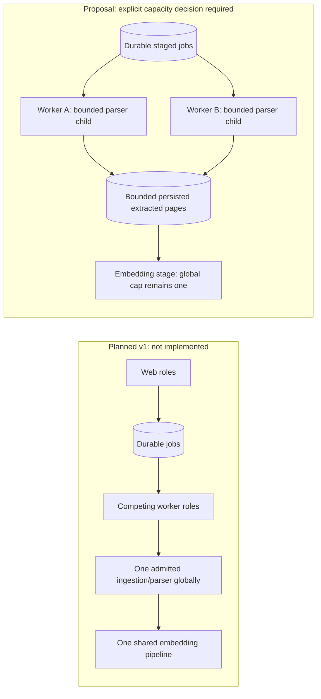

# Extraction scaling investigation

Date: 2026-10-26. Independent technical investigation against repository HEAD `776396722e499ff9108b87d1eba3ff091011cf62`. This is supporting research; the current [specification](../scopes/initial-application/spec.md#d-i-shared-coordination-and-staged-growth) and [plan](../scopes/initial-application/plan.md) own resulting decisions, capacity limits and implementation authority.

## Answer and evidence boundary

The planned runtime can accommodate more extraction workers without requiring a microservice, Spring Modulith, or additional Maven modules. However, **adding replicas under today's accepted configuration cannot increase extraction concurrency**: ingestion is globally capped at one job/parser. There is no measured extraction bottleneck yet: [ExtractorMain](../../pdf-extractor/src/main/java/com/aiknowledgebase/extractor/ExtractorMain.java) only accepts `--version` and reports `extractionAvailable:false`; [T6/T7 remain pending](../scopes/initial-application/plan.md#revised-task-list). This investigation evaluates a hypothetical growth requirement, not implemented throughput.

## What the current plan supports

[R22/R23 and D-A](../scopes/initial-application/spec.md#d-a-one-application-with-clear-internal-responsibilities) specify combined, web-only and worker-only roles from the same Java codebase. [T6](../scopes/initial-application/plan.md#slice-implementation-and-reuse) owns durable upload/extraction jobs, private files, claimed work, leases/fences and bounded PDFBox children: 256 MiB heap, two-minute extraction deadline. T7 extends that pipeline with indexing and complete-generation publication; the whole-job deadline is ten minutes.

[D-I](../scopes/initial-application/spec.md#d-i-shared-coordination-and-staged-growth) already provides the coordination design: PostgreSQL authority, short transactions, deployment-wide admission and bounded queues/pools. PostgreSQL documents `SKIP LOCKED` for competing queue-table consumers; that primitive alone does not implement leases, fencing, idempotency or exactly-once external calls. Those remain application responsibilities. [PostgreSQL 17 SELECT](https://www.postgresql.org/docs/17/sql-select.html#SQL-FOR-UPDATE-SHARE)

[Current limits](../scopes/initial-application/spec.md#limits-and-user-experience) allow one ingestion job and one embedding pipeline, including query embeddings; generations remain two globally, one per chat. [T13's two-web/two-worker experiment](../scopes/initial-application/plan.md#offline-scalability-and-performanceembedding-checkpoint-in-t13) intentionally retains these caps. It verifies coordination, failure recovery and resource behavior, not increased ingestion throughput.

## Refinements needed for extraction throughput

Run additional worker processes/containers from the same application artifact, each launching bounded extractor children. Worker capacity can grow separately from web capacity; Microsoft's [Web-Queue-Worker](https://learn.microsoft.com/en-us/azure/architecture/guide/architecture-styles/web-queue-worker) and [Competing Consumers](https://learn.microsoft.com/en-us/azure/architecture/patterns/competing-consumers) describe these properties and duplicate-processing considerations. These patterns do not require adopting their Azure services.

Recommend an explicit shared extraction admission limit plus per-worker child caps. Two or four extraction slots are illustrative, unmeasured candidates, not changed allowances. Raising global ingestion concurrency could permit parallel parsing while retaining paid-stage limits. For predictable independent scheduling, refine KD/T6/T7 with durable extraction/indexing stage states, versioned intermediate storage and bounded backlog. An embedding-waiting job should release parser capacity. A typed PostgreSQL job table can represent stages; separate brokers or multiple physical queues are unnecessary prerequisites. This refinement is not already guaranteed by the coarse current pipeline.

Preserve independent embedding, generation and spending limits. Revalidate ownership, archive/delete state and ingestion version before dispatch/publication; fenced claims must reject late stale-worker results. Uncertain paid calls retain reservations/admission until reconciled, rather than being blindly retried. These extend [D-C/D-I lifecycle rules](../scopes/initial-application/spec.md#d-c-page-preserving-restartable-ingestion).

## Resources, verification and unresolved capacity

More processes on one host share finite CPU, RAM and disk bandwidth. Heap limits exclude other JVM memory; `-Xmx256m` is neither a 256 MiB RSS ceiling nor a security sandbox. [Java 26 launcher documentation](https://docs.oracle.com/en/java/javase/26/docs/specs/man/java.html#extra-options)

Different hosts additionally require real shared private object storage, authenticated file access, an independently retained shared deletion journal and aggregate database-pool sizing; a shared local path proves only same-host coordination. These are explicit [multi-host prerequisites](../scopes/initial-application/plan.md#rollout), not delivered adapters.

Before increasing limits, extend T13 evidence with queue wait/oldest-job age, p95 parsing, embedding wait, RSS/CPU/disk, backlog, per-account fairness, database connections/locks, provider quotas and crash/retry recovery. Sustained incoming work above capacity requires bounded admission and explicit overload rejection/backpressure. T14 supplies separately authorized real-provider evidence. No benchmark, cost estimate, hosting allocation or performance promise follows from this note; the optional small-demo budget does not establish multi-worker capacity.
