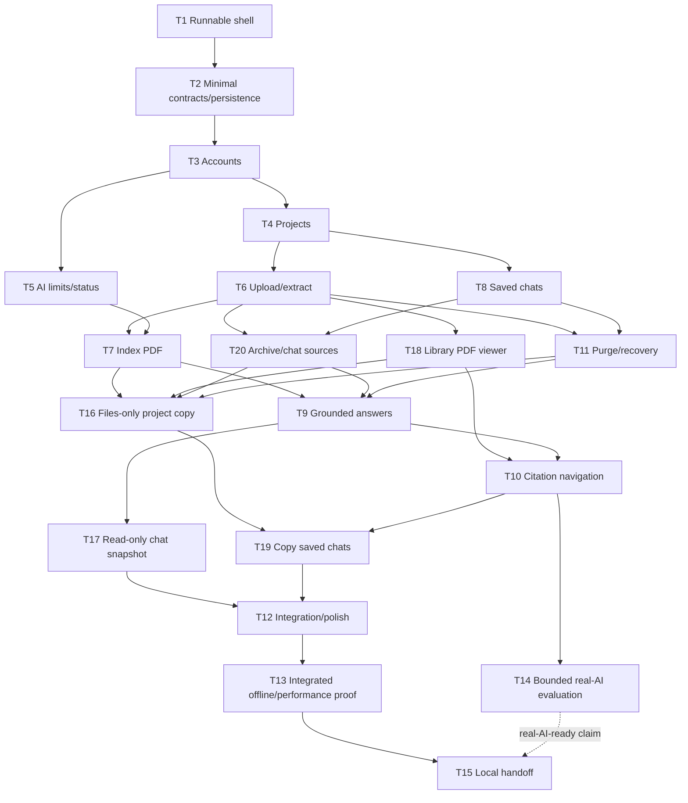

# Implementation plan for local AI knowledge base v1

## Current scope and sources

`change.json` was removed from the current records. Original human decisions and their covered scopes remain available in its [historical version in Git](https://github.com/igrgin/ai-knowledge-base/blob/7252f046b96f9a33e94f095f2b8b7790b76785ad/docs/changes/20261023-ai-knowledge-base/change.json). Use the current [plan](plan.md#revised-task-list) for task authority and progress.

Only T1 and its D20/D21 refinements were authorized for implementation. T1 is completed in unmerged [PR #21](https://github.com/igrgin/ai-knowledge-base/pull/21); T2–T20 remain pending and unauthorized.

## Sources and scope

| Source | Current section or identifying information | Relevant content |
| --- | --- | --- |
| [Requirements](spec.md#requirements) | R1–R29 | Current product behavior, constraints and acceptance/proposal distinctions |
| [Design decisions](spec.md#design-decisions) | D-A–D-L; Invariants; Verification and quality gate | Architecture, lifecycle, privacy, source eligibility and evidence requirements |
| [Intent](intent.md#desired-outcome) | Desired outcome and Constraints | Consolidated product purpose and owner-selected scope |
| [Cost research](../../research/costs.md#owner-choices-and-delivery-phases) | Delivery phases and dated cost scenarios | Optional later hosting, application AI allowance proposal and retention boundaries; not permission to spend |
| [Scalability research](../../research/scalability-evaluation.md#target-shape), [caching research](../../research/caching-evaluation.md#recommendation) | Supporting research and measurement guidance | Evidence behind the selected scalable, initially no-cache design |
| [Historical owner decision references](https://github.com/igrgin/ai-knowledge-base/blob/7252f046b96f9a33e94f095f2b8b7790b76785ad/docs/changes/20261023-ai-knowledge-base/change.json) | Removed index at a fixed Git commit; original source locators/selectors for D1–D14 | Continuing product/planning directions, including vertical slices; source provenance does not mean implementation permission |
| `AGENTS.md`, `.Lighthouse/settings/project.md` | Repository navigation and selected agent settings | Native task definitions own commands; Lighthouse supplies workflow/review defaults; application constraints and missing platform inputs remain in the specification |
| Lighthouse GitHub defaults, Lighthouse review defaults, [agent assignments](../../settings/project.md#development-agent-assignments), native task definitions and local-development guidance | D14 owner-selected setup/review/model rules and project Codex-config removal | Local policy adoption only; repository resources, commits and implementation still require their own authorization |

Implement the full local application: public-style registration/login, private projects, text-PDF ingestion, project-grounded answers and page navigation, independent saved chats, archive-only PDFs, chat deletion, whole-project purge, usage limits and local recovery. A local application may accept registrations through its interface without being published to the internet.

The revised local-v1 proposal also includes invitation/link project imports, optional copied chats, revocable read-only transcript snapshots, archive/unarchive, per-chat source exclusions and a library PDF reader. There is no live collaboration or shared editable project. Hosting, cloud accounts, S3 deployment, custom domains, email delivery/verification/recovery services, production permissions, paid hosting benchmarks and release operations remain optional later work. Local storage implements the file-store interface; an actual S3 adapter is not needed to finish local v1. No OCR, individual PDF deletion, live collaboration, hosted vector store, answer streaming, or general web-search feature is added. Public snapshot mode is an access rule that can be tested locally; it does not require publishing the local application to the internet.

The current intent/spec/plan are authoritative for their stated scope. Historical human decisions remain recoverable through the original decision-source links. D19 supplies acceptance and implementation authority for T1 at its committed setup baseline, without authorizing other tasks.

This is the single current implementation plan. It consolidates the owner directions in D1–D13. Stable IDs T1–T17 and split slices T18–T20 describe the current work; task numbers do not imply execution order. Repository/issue setup is complete. D19 authorizes only T1 on 2026-10-25; T1 and its D20/D21 revisions are completed in PR #21, with owner approval/manual merge pending; T2–T20 remain pending and unauthorized. The current concurrency limit remains 1; no hosting or paid work is authorized.

## Repository findings and prerequisites

T1 established the Maven reactor, Java/React runtime shell, database-backed readiness and native verification commands; see [T1 progress](#t1-execution-progress) and the dependency pins below. Before dependent execution, recheck actual JDK26, project-local Node and Docker/Compose availability. Preserve global runtime/settings; the optional Node installer is project-local. Use the database container's client for backup/recovery rather than requiring a native PostgreSQL installation.

The [2026-10-24 inspection](https://github.com/igrgin/ai-knowledge-base/blob/47b7d96cf3cbd9e714701f048f45f9323dcf6494/.Lighthouse/plan.md#repository-findings-and-prerequisites) is historical, including the then-unreachable Docker daemon and absence of application code. T1's recorded builds/integration results supersede those as current completion evidence. Feature-specific dependency compatibility remains its owning slice's work. Offline adapters need no provider account; real evaluation retains T14's separate credential and paid-call gates.

## Approach and affected files

Use a Maven repository with a Spring Boot backend and a small standalone PDF-extractor module, plus a React frontend. The extractor is a child process, not a separately operated service. It returns a versioned page-text result under a bounded heap/deadline; the backend owns all storage, jobs, authorization and model calls.

Run the modular backend in combined, web-only or worker-only roles. The default local launcher runs combined roles. A second local profile runs two web instances and two competing workers against one database, shared private directory and separately retained shared local deletion journal on the same machine. Route test requests to either web instance. The web role accepts durable operations and exposes status/results; workers execute ingestion, answer and purge jobs independently of the receiving web process. This verifies process coordination without claiming multi-host storage or cloud readiness.

Choose JDBC repositories and Flyway migrations for the application tables so ownership joins, pgvector ranking, leases and budget transactions are explicit. Use Spring Security and JDBC-backed Spring Session for authentication. Use Spring AI behind narrow embedding/chat adapters, with a direct owned SQL retrieval query. Prefer React feature folders and a shared typed API client over a new state-management framework. Keep source viewing separate from retrieval, sharing immutable document/page identifiers. Use fresh destination records and file keys for explicit project copies, and a separate minimal transcript view for published snapshots. Reuse compatible completed embedding values without paid regeneration; no Redis/Caffeine dependency is planned.

| Planned file or area | Intended change |
| --- | --- |
| `pom.xml`, `mvnw`, `mvnw.cmd`, `.mvn/` | Maven reactor/wrapper, Java 26, managed backend dependencies and verification plugins |
| `backend/pom.xml`, `backend/src/main/java/com/aiknowledgebase/` | Application entry point and internal `identity`, `project`, `document`, `ingestion`, `chat`, `source`, `lifecycle`, `usage`, `model`, `jobs`, `retrieval`, `distribution`, `publication`, `shared` packages |
| `backend/src/main/resources/application*.yml` | Combined/web/worker role settings, local multi-process profile, storage root, queue/pool/global limits, model and price configuration; server-side environment references only |
| `backend/src/main/resources/db/migration/` | Feature-owned additive migrations introduced by their slice, with integrator-assigned version ordering; T2 establishes wiring only, not the full domain schema |
| `pdf-extractor/pom.xml`, `pdf-extractor/src/` | Standalone bounded PDFBox process and extraction contract tests |
| `frontend/package.json`, `frontend/package-lock.json`, `frontend/.node-version` | Exact frontend dependencies, runtime pin and repeatable commands |
| `frontend/src/features/`, `frontend/src/components/ui/`, `frontend/src/lib/` | Auth, project/PDF library, ingestion status, chat sources, citations/PDF.js, archive/unarchive, copy import/distribution, transcript publication and purge UI; shadcn components kept as project code |
| `compose.yaml`, `.env.example`, `.gitignore` | Local pgvector database/persistent volume, documented configuration, ignored private data/secrets/build artifacts |
| `scripts/` | Optional project-local Node setup and genuinely necessary slice-specific scalability/backup/recovery tooling; native Maven/npm task definitions own routine run/build/test commands |
| `backend/src/test/`, `pdf-extractor/src/test/`, `frontend/src/**/*.test.*`, `frontend/e2e/` | Tests around actual access, state, recovery and user behavior |
| `test-fixtures/`, `evaluation/` | Generated PDFs/passages, known page facts, supported/unsupported/follow-up questions, quality results and reproducible scalability/cache reports with no private bodies |
| `README.md`, `docs/local-development.md`, `docs/local-recovery.md`, `docs/architecture.md` | Setup, runtime roles, limits, local recovery, diagrams, measured embedding/performance findings and deferred multi-host prerequisites |
| `.Lighthouse/scopes/initial-application/plan.md`, later agreed contract records under `docs/contracts/` when needed | Single-integrator current progress and shared contracts; original decisions and detailed execution evidence stay in native Git/PR records |

The implementation may add files inside these areas as needed. Material departures from accepted behavior, source ownership, architecture or cost bounds return to the owner; ordinary naming and code organization do not require repeated decisions.

### Dependency pins and compatibility checkpoint

Java 26 is the required project default. Use the installed Java 26.0.1 initially, allow compatible Java 26 patch updates, and do not silently fall back to Java 21. Spring Boot 4.1.2 documents support through Java 27, which includes Java 26. T1 checks the core build/runtime on Java 26; each feature verifies its own added dependencies and tests on the same runtime. [Spring Boot system requirements](https://docs.spring.io/spring-boot/system-requirements.html)

Primary catalogs were read without installing packages. The initial pins are Spring Boot **4.1.2**, Spring AI **2.0.2**, PDFBox **3.0.8**, React/React DOM **19.3.1**, Vite **8.3.5**, TypeScript **7.0.2**, PDF.js (`pdfjs-dist`) **6.4.299**, Playwright **1.64.1**, Vitest **5.0.5**, and shadcn CLI **4.22.1**. Use the current compatible React Vite plugin (candidate **6.1.2**) and lock its peer dependencies. Take Spring Security, JDBC driver, Flyway, Jackson and test dependency versions from the compatible Boot/Spring AI BOMs where managed; T1 records the resolved dependency tree rather than guessing independent versions.

Use PostgreSQL 17 with `pgvector/pgvector:0.8.7-pg17`, pinned to the inspected multi-platform manifest digest `sha256:ac08538c6f8b9904c33c8224c5e5706dbe760aca29db1d096972b4052c22a75d`. Confirm the selected platform resolves and the extension can be enabled before relying on it. Testcontainers must use the same database image family/digest, not H2 as a substitute for vector/transaction behavior.

The npm registry lists PDF.js 6.4.299 as requiring Node >=22.13.0 or >=24; the installed Node 22.12.0 therefore cannot be the supported build runtime. Select **Node 24.22.1 LTS** for project tooling and package builds, using an existing version manager or an explicitly pinned build container in T1. Matching the PDF.js worker to the exact library version is part of the lock/build check. Resolve shadcn-generated component dependencies into the lockfile; do not run an unpinned `latest` initializer on every build.

Sources read on 2026-10-24: [Spring Boot releases](https://docs.spring.io/spring-boot/index.html), [Spring AI compatibility](https://docs.spring.io/spring-ai/reference/getting-started.html), [PDFBox releases](https://pdfbox.apache.org/download.html); Maven Central metadata for [Boot](https://repo.maven.apache.org/maven2/org/springframework/boot/spring-boot-starter-parent/maven-metadata.xml), [Spring AI](https://repo.maven.apache.org/maven2/org/springframework/ai/spring-ai-bom/maven-metadata.xml), [PDFBox](https://repo.maven.apache.org/maven2/org/apache/pdfbox/pdfbox/maven-metadata.xml); npm registry records for [React](https://registry.npmjs.org/react/latest), [Vite](https://registry.npmjs.org/vite/latest), [TypeScript](https://registry.npmjs.org/typescript/latest), [PDF.js](https://registry.npmjs.org/pdfjs-dist/latest), [Playwright](https://registry.npmjs.org/@playwright/test/latest), [Vitest](https://registry.npmjs.org/vitest/latest), [shadcn](https://registry.npmjs.org/shadcn/latest), [Vite React plugin](https://registry.npmjs.org/@vitejs/plugin-react/latest); [Node releases](https://nodejs.org/dist/index.json), [pgvector image catalog](https://hub.docker.com/v2/repositories/pgvector/pgvector/tags?page_size=10&name=pg17).

T1 verifies the core skeleton, runtime pins, database startup and packaging contract. Add and resolve feature-specific libraries in their owning slices, with peer/compile/integration checks then; do not front-load every model/viewer/parser dependency into the shared foundation. The integrator may select a compatible patch within the recorded families when a real incompatibility is found, recording the reason and final lock. A required change of accepted major architecture or behavior remains an owner decision. T1 subsequently resolved and verified the core pins; feature-specific compatibility is checked in its owning slice.

## Vertical slices and dependency semantics

The D13 reassessment preserved pending tasks; D19 now authorizes **T1 only**, whose implementation and D20/D21 revisions are **completed** in PR #21 (not merged). T2–T20 remain pending and unauthorized. `maxParallelTasks` is still **1**, so execution remains one implementation writer at a time unless a later owner decision authorizes a change. Parallel opportunities below describe the dependency structure, not permission to dispatch agents. No application code, runtime configuration, policy or product requirement is changed by this plan.

Stable IDs T1–T17 remain in use. T2 provides only the small persistence/contract foundation. T18 owns library PDF reading, T19 extends project import with copied chats, and T20 owns archive/unarchive and chat source controls. All corresponding product behavior is retained in the current slices.

- **Start gates** permit bounded implementation against agreed contracts. A contract gate is available only after its producing slice has begun, published the named interface/schema assumptions and the integrator has recorded the agreement. A draft document alone does not satisfy it.
- **Completion prerequisites** must be integrated implementations before the consuming slice can be marked complete. Controlled test adapters can unblock development, but do not prove production wiring or justify fake application behavior.
- **Preferred order** is a scheduling recommendation, not a dependency. Adjacent task IDs and milestone order do not establish prerequisites.
- Each product slice owns its UI, API, feature migrations, persistence and meaningful tests. Its completion evidence demonstrates its own behavior. A requirement spanning several slices is complete only after all mapped slices and applicable integration checks pass.

### Small shared foundation

T1 provides the runnable shell and toolchain. T2 provides migration/test infrastructure and a few contract conventions. Neither creates future users/projects/documents/chat/vector/sharing tables, a general job engine, speculative adapters, or every feature's UI. Domain tables are introduced by their owning feature. The first real durable queue/storage implementation belongs to T6, the financial ledger to T5, and lifecycle recovery to T11.

### Contract gates for early starts

These are checkpoints inside existing tasks, not additional tasks or claims that implementations already exist. The owning writer proposes changes; the integrator is the sole editor of shared contract records and records versions, consumers and agreement in the plan during an authorized build.

| Gate | Producing task and owner | What must be agreed before a consumer starts | Consumers |
| --- | --- | --- | --- |
| K0 | T2, foundation owner | UUID actor/resource/request IDs, authenticated-principal shape, error envelope, migration/test conventions; no domain schema | T3, T5 |
| KP | T4, project owner | Owned-project key/read boundary, lifecycle revision and SQL project-lock convention; project migration/API available before UI polish | T6, T8, T11 |
| KU | T5, usage/model owner | Embedding/chat ports, token/price input, reservation/admission and unknown-outcome semantics | T7, T9 |
| KD | T6, document owner | Private original-file lookup/storage interface, immutable version/page-extraction format, processing states and durable job claim/fence contract | T7, T18, T20, T11, T16 |
| KH | T8, saved-chat owner | Ordered transcript/read-write API, owner/project association, message IDs and delete command boundary; no embeddings required | T20, T9, T17, T19 |
| KS | T20, source-control owner | Active-or-granted minus chat-exclusions query, archive-cycle/source revision semantics | T9, T16, T19 |
| KV | T18, viewer owner | One reusable viewer route/component accepting an authorized original-file reference and physical page | T10, T16 |
| KC | T9, answer owner | Persisted validated citation/turn DTO, passage/version/page references and bounded transcript representation | T10, T17, T19 |
| KL | T11, lifecycle owner | Parent revocation/SQL lock boundary, journal append/replay contract and deletion fences; explicit extension mechanism for later link kinds | T9, T16, T17 |
| KI | T16, distribution owner | Fixed-version manifest and destination-ID map/import transaction extension point | T19 |

K0 needs no speculative framework. Later gates are agreed by the first real provider/consumer pair. A contract change that affects another slice must be reviewed and versioned with that consumer before concurrent work continues.

### Revised task list

A task in the start column denotes its completion; a K gate denotes the narrower checkpoint above. Completion columns list the real dependencies directly, including some transitive ones for clarity. A feature can begin before all its completion dependencies exist, but cannot claim its integrated demonstration early. Writer roles are bounded assignments for a future build, not people or agents appointed by this record.

| Task | Demonstrable result | Requirement IDs | Can start after | Must exist before completion | Assigned writer | State | Intent label | Issue / branch |
| --- | --- | --- | --- | --- | --- | --- | --- | --- |
| T1 | Run the Java 26/React shell and local database reproducibly | R18, R19 | Planning/build authority | None | Integrator | completed | feature | [#1](https://github.com/igrgin/ai-knowledge-base/issues/1); `1-run-java-26-react-shell-and-local-database` (created) |
| T2 | Migrate/restart a minimal database and verify shared contract conventions | R18, R23 | T1 | T1 | Foundation owner | pending | feature | [#2](https://github.com/igrgin/ai-knowledge-base/issues/2); `2-add-minimal-persistence-and-contract-conventions` (planned; not created) |
| T3 | Register, log in/out and retain an authenticated session after restart | R1, R2, R16, R18, R23 | T2 | T2 | Identity slice owner | pending | feature | [#3](https://github.com/igrgin/ai-knowledge-base/issues/3); `3-register-log-in-and-retain-authenticated-sessions` (planned; not created) |
| T4 | Create/list/open/rename private projects through the UI | R2, R3, R6, R17 | T3 | T3 | Project slice owner | pending | feature | [#4](https://github.com/igrgin/ai-knowledge-base/issues/4); `4-create-and-manage-private-projects` (planned; not created) |
| T5 | See AI availability/budget status and enforce bounded, idempotent provider spending | R12, R16, R17, R23 | T2 and K0 | T3 | Usage/model slice owner | pending | feature | [#5](https://github.com/igrgin/ai-knowledge-base/issues/5); `5-show-ai-availability-and-enforce-provider-spending-limits` (planned; not created) |
| T6 | Upload a private PDF, observe durable extraction/failure status and recover after restart | R2, R4, R5, R6, R16, R17, R22, R23 | KP | T4 | Document slice owner | pending | feature | [#6](https://github.com/igrgin/ai-knowledge-base/issues/6); `6-upload-and-extract-private-pdfs-with-durable-status` (planned; not created) |
| T8 | Create/reopen/delete separate saved chats in a project | R2, R8, R14 | KP | T4 | Saved-chat slice owner | pending | feature | [#8](https://github.com/igrgin/ai-knowledge-base/issues/8); `8-create-reopen-and-delete-saved-project-chats` (planned; not created) |
| T18 | Open an uploaded original PDF from the project library | R2, R3, R13, R29 | KD | T6 | Viewer slice owner | pending | feature | [#18](https://github.com/igrgin/ai-knowledge-base/issues/18); `18-read-original-pdfs-from-the-project-library` (planned; not created) |
| T7 | Finish indexing a text PDF and show it ready for knowledge queries | R4, R5, R6, R16, R17, R22, R23, R25 | KD and KU | T6, T5 | Indexing slice owner | pending | feature | [#7](https://github.com/igrgin/ai-knowledge-base/issues/7); `7-index-pdfs-and-recover-interrupted-embedding-work` (planned; not created) |
| T20 | Archive/unarchive files and control each chat's fresh-retrieval sources | R2, R7, R13, R28 | KD and KH | T6, T8 | Source-control slice owner | pending | feature | [#20](https://github.com/igrgin/ai-knowledge-base/issues/20); `20-archive-pdfs-and-control-chat-retrieval-sources` (planned; not created) |
| T11 | Delete a project and recover safely from purge/restart/restore failures | R2, R5, R14, R15, R20, R23, R24 | KP, KD and KH | T6, T8 | Lifecycle slice owner | pending | feature | [#11](https://github.com/igrgin/ai-knowledge-base/issues/11); `11-purge-projects-and-recover-safely-after-restore` (planned; not created) |
| T9 | Ask a grounded question and persist an idempotent, validated answer | R2, R7, R9, R10, R11, R12, R16, R17, R22, R23, R28 | KU, KD, KH, KS and KL | T5, T7, T8, T20, T11 | Answer slice owner | pending | feature | [#9](https://github.com/igrgin/ai-knowledge-base/issues/9); `9-answer-grounded-questions-with-saved-provenance` (planned; not created) |
| T10 | Open a validated answer citation at its original physical PDF page | R2, R10, R13, R29 | KV and KC | T18, T9 | Citation slice owner | pending | feature | [#10](https://github.com/igrgin/ai-knowledge-base/issues/10); `10-open-answer-citations-at-the-correct-pdf-page` (planned; not created) |
| T16 | Share/import a fixed project copy containing files and ready knowledge | R2, R3, R7, R13, R15, R17, R20, R25, R26, R29 | KP, KD, KS, KV and KL | T7, T18, T20, T11 | Distribution slice owner | pending | feature | [#16](https://github.com/igrgin/ai-knowledge-base/issues/16); `16-share-and-import-independent-fixed-project-copies` (planned; not created) |
| T17 | Publish/update/revoke a restricted or public read-only chat snapshot | R2, R14, R15, R16, R20, R27 | KH, KC and KL | T8, T9, T11 | Publication slice owner | pending | feature | [#17](https://github.com/igrgin/ai-knowledge-base/issues/17); `17-publish-and-revoke-read-only-chat-snapshots` (planned; not created) |
| T19 | Include all saved chats with working destination citations in a project copy | R2, R7, R8, R10, R14, R20, R26, R28 | KI, KH and KC | T16, T10 | Distribution extension owner | pending | feature | [#19](https://github.com/igrgin/ai-knowledge-base/issues/19); `19-include-saved-chats-and-citations-in-project-copies` (planned; not created) |
| T12 | Complete cross-feature navigation, accessibility and packaged UI consistency | R1, R3, R6, R8, R10, R11, R12, R13, R14, R15, R18, R26, R27, R28, R29 | T4 | T17, T19 and all feature demos integrated with passing evidence | Integrator/UI integration owner | pending | feature | [#12](https://github.com/igrgin/ai-knowledge-base/issues/12); `12-integrate-navigation-accessibility-and-packaged-ui` (planned; not created) |
| T13 | Prove integrated privacy/lifecycle/scalability behavior and measure no-cache performance | R1, R2, R4, R5, R7, R10, R12, R13, R14, R15, R17, R20, R21, R22, R23, R24, R25, R26, R27, R28, R29 | T6 | T12 and its feature prerequisites | Verification owner | pending | feature | [#13](https://github.com/igrgin/ai-knowledge-base/issues/13); `13-verify-privacy-lifecycle-scalability-and-embedding-performance` (planned; not created) |
| T14 | Evaluate actual model grounding, citation quality, latency and cost within a bounded allowance | R4, R9, R10, R11, R16, R17, R21, R24, R25 | T5, T7 and passing focused offline dispatch/accounting checks; separate credential/paid-call authority | T9, T10 and passing focused offline answer/citation checks; paid-call authority | AI evaluation owner | pending | spike | [#14](https://github.com/igrgin/ai-knowledge-base/issues/14); `14-evaluate-real-ai-grounding-quality-latency-and-cost` (legacy planned name; no branch required for spike) |
| T15 | Hand over the reproducible local package and truthful readiness evidence | R18, R19, R20, R21, R22, R24, R25, R26, R27, R28, R29 | T1 for living documentation | T12, T13; T14 additionally required for a real-AI-ready claim | Integrator/handoff owner | pending | feature | [#15](https://github.com/igrgin/ai-knowledge-base/issues/15); `15-document-and-hand-over-the-reproducible-local-package` (planned; not created) |

T5 can begin beside T3 and does not depend on T4's project UI. T8 has no T7 dependency. T18 has no embedding/answer dependency. T16 and T17 have no dependency on each other. T19 completes R26's optional chat-copy branch without putting that work inside basic project import. T12 does not gate any feature slice.

### Completion dependency graph

Solid arrows mean integrated completion prerequisites, not permission to start. Transitive edges are reduced for readability; the table above supplies the exact full prerequisites. T14 also has the explicit credential/paid-call gate. T15's T14 edge is conditional on claiming real-AI readiness.



For example, T5 starts after K0 while T3 is unfinished, although its signed-in UI/ownership demonstration finishes after T3. T9 can demonstrate its first grounded answer once T5/T7/T8/T20 are wired; T11 is additionally required before declaring T9 complete because its deletion-race checks need the real delete command. T10 starts after KV/KC agreement while real answer integration is still underway. T17 can develop transcript publication using test-only transcript fixtures after KH/KC/KL agreement, but completion requires actual T9 messages. No app-mode fake provider or public endpoint backed only by a stub is allowed.

### Slice implementation and reuse

**T1:** Establish the pinned Maven reactor, Java 26 backend/extractor build contract, project Node/frontend locks, loopback PostgreSQL service, a minimal React shell and health/startup checks. Confirm the extractor can be packaged with the same Java runtime. Deliver a browser shell plus a database-backed readiness check and deterministic build/test entry points. Do not implement domain tables, multi-instance orchestration or feature-specific metrics here. Preserve global tools/settings; Docker availability and dependency compatibility are checked in this authorized build step, not assumed from catalog metadata.

**T2:** Reuse T1's `lvl2test`/Testcontainers setup, adding Flyway and the shared real-PostgreSQL migration fixture, one minimal migration/restart smoke path and K0. Define only needed ID/principal/error/transaction conventions, plus how feature owners publish later contracts. No all-domain schema or speculative job/cache/storage framework. Evidence is a clean database migration, restart without schema recreation, and consumer contract checks. T3 owns actual identity/session tables; later tasks own their own migrations.

**T3:** Own identity/session migrations, Spring Security hashing/login rotation/logout/CSRF, JDBC sessions, `/me` and registration/login/expired-session screens. Demonstrate two accounts, persistent sessions and rejected unauthorized/CSRF writes through the UI/API and actual database. Local cookies are explicitly loopback-compatible and secure for non-local HTTPS. Include cross-instance session tests when T13's harness exists; current shared-session design must not rely on sticky sessions. Email verification/recovery stays deferred.

**T4:** Own project migration, owner relationships, project/account count admission, lifecycle revision/project-row mutation boundary and create/list/open/rename screens. Publish KP before waiting for all UI finishing work. Provide document/chat mounting points rather than implementing those features twice. Demonstrate two-user project isolation and clear empty/limit states with browser/database tests. T6/T8/T16 reuse project ownership and admission instead of implementing parallel project repositories or a second library.

**T5:** Own financial/admission migrations and real implementation of typed model adapters, atomic reservations/settlement, price versions, UTC monthly allowance, daily/minute limits, deployment-wide provider slots and unknown outcomes. Deliver an authenticated AI-availability/limit notice and API status that explains missing credentials, capacity or exhausted allowance, reusing T3's principal when it is integrated. Starts from K0; no project UI dependency. Controlled-provider tests cover duplicate keys, simultaneous reservations, rate/concurrency limits, unknown calls and zero hidden paid retries. KU is the single model/spend path consumed by T7/T9; no credentials or fake app-mode success enter the UI. No actual paid call is needed.

**T6:** Own document/version/page-extraction, upload/storage-admission and first durable-job migrations, private file-store implementation, extraction worker and isolated PDFBox child. Deliver upload/status/retry UI plus durable acceptance and processing failures for valid text, corrupt, encrypted, oversized and image-only fixtures. The parser uses a 256 MiB heap, two-minute bound and physical-page provenance. Implement combined/web-only/worker-only behavior here with real claimed jobs, lease/fence checks and bounded executors. Publish KD; expose original storage through an owner-checked service, never public assets. Text extracted before T7 finishes remains processing/awaiting indexing, not falsely ready. T7 extends this job pipeline; T18 reads these originals; T11/T16 reuse storage/admission. Completion proves restart recovery, limits and staging cleanup with real database/parser tests.

**T8:** Own chat/message migrations and create/list/open/delete saved-chat UI/API. Empty conversations are a real demonstrable result and do not require PDFs, embeddings or invented AI messages. Preserve independent ordered history across restart, and apply the KP mutation boundary so T20 can later serialize archive with creation. Publish KH, including a completed-message/citation DTO extension shape for later consumers. Tests prove two-user/chat isolation, reopening and chat deletion without removing project PDFs. Do not require snapshot revocation or publication tables before T17 exists; the lifecycle integration rules below define when those obligations become active.

**T18:** Own the library's PDF-open action, authorized original-file/range route and one reusable PDF.js viewer with the locked matching worker. Read originals through T6's storage/ownership boundary. Demonstrate opening an accepted PDF, page navigation, restart persistence and denial of another user's whole/range requests, without embeddings or AI answers. All retained project originals can be viewed regardless of AI source eligibility. Publish KV; T10 must extend this viewer rather than create a second one. Later T20 archive and T16 imported-file cases extend its tests.

**T7:** Own chunk/vector/generation migrations and the indexing stage of T6's existing durable pipeline. Reuse KU reservations/provider ports and KD page provenance, storage and lease/fence behavior. Add approximately 500-token page-local chunks/80-token overlap, token-bounded embedding batches, two transient retries within the ten-minute job deadline and atomic complete-generation publication. The UI reuses upload status and gains a truthful ready/indexing/retry outcome. Demonstrate a PDF becoming ready and recovering from interrupted indexing through real database/extractor plus controlled-provider tests. No duplicate ready generations, partial search data or repeated embedding of completed work. Archive/purge checks are exercised against agreed lifecycle state; T20/T11 and T13 later verify the real command races. Real-provider quality remains T14.

**T20:** Own archive grants, chat exclusions/source revision migrations and archive/unarchive/source-picker UI/API. Reuse T4's project lock, T6's documents/cancellation boundary and T8's chat IDs. Demonstrate an upload archived from new chats, retained for old chats, reversible archive and independent chat toggles. New active ready uploads become available automatically. Exclusions affect fresh retrieval only; prior answers may remain in bounded model context and citations/history remain readable. The archive command never deletes retained processing data; non-ready files keep explicit status and ordinary bounded retry. T20 can demonstrate archive/selection before indexing exists. Actual ready-vector reuse and no-reembedding integration are verified when T7 is installed and again in T13, rather than claimed from a fake ready PDF. No PDF DELETE route/button or quota release on archive. Test archive cycles, chat-create races, grant/exclusion ownership and processing cancellation. T9 consumes the KS query; no second eligibility query is introduced there. T7 must honor the same lifecycle protocol when both features are integrated.

**T11:** Own lifecycle journal/purge migrations, delete-project confirmation/status, shared revocation/fence implementation and manual local backup/restore. Extend the existing T4/T8 deletion boundaries rather than invent a new CRUD system. Demonstrate immediate private access revocation, original-file purge with retry, restart recovery and replay of a project/chat deletion after restoring an older non-serving snapshot. The independently retained minimal journal and shared local filesystem lock must survive content restore. Publish KL for later distribution/publication revocation kinds; no share/snapshot table is required here. Integration with existing document/chat commands must use real implementations before completion. T7/T9 add their dispatch/publication race checks when consuming this protocol. Multi-host storage/journal services and hosted schedulers remain deferred.

**T9:** Own answer-operation/retrieval/provenance/citation migrations and answer composer/pending/error/answer UI, extending T8's real history rather than replacing it. Use KU, KD, KH and KS; exact filtered retrieval always applies ownership, ready-version and active-or-granted-minus-exclusion predicates. Cap eight passages, six recent messages, 8,000 input tokens and 1,024 billed output tokens. Keep earlier answers in bounded context, validate only newly retrieved passage citations for the new answer, and refuse insufficient evidence. Reuse T6's durable-operation mechanics and T5's shared limits/idempotency/accounting. Enforce two global generations, one per chat and a 60-second deadline, without blind charged retries. Completion requires actual T7 data, T20 source controls and T11 deletion commands: demonstrate supported/unsupported questions, reopen, duplicate submission, selection-change/deletion races and persisted provenance with controlled-provider browser/database tests. Publish KC. No claim of actual model grounding before T14.

**T10:** Add citation chips/resolution and physical-page navigation to T9 answers using the existing KV viewer. Own citation-specific UI/API mapping and authorization tests; do not create another PDF reader or basic chat screen. Completion opens a stored retrieved citation on its correct physical page, including a fixture with differing printed labels, denies foreign IDs/ranges, and preserves old citations after archive/exclusion. Reuse T18 error/loading behavior and T9's server-validated provenance.

**T16:** Own distribution/manifest/import migrations and project share/accept/progress UI for the files-only branch first. A named invitation or registered-link share pins the project version when created; updates require a new share. Use existing project/account/page/file/global storage admission, KD originals, completed T7 embeddings, KS source state and KL revocation/journal. Copy to independent private keys and fresh destination IDs with an idempotent durable job; no partial project is exposed and no completed vector is re-embedded. Preserve unfinished-source status and only use normal bounded processing for work the fixed manifest has not completed. A files-only copy has no inherited old-chat grants for archived files. Reuse T18 to open the destination's files and existing library/status screens. Completion tests named/link access, quotas, repeated acceptance, interruption, source revoke/delete racing acceptance, old-link immutability after source edits, a new share for updates and accepted-copy survival. Publish KI. This slice does not claim the optional copied-chat branch of R26 is complete; T19 extends the same import job/manifest.

**T17:** Own publication/snapshot migrations, preview/publish/update/revoke UI and the standalone restricted/public transcript route. Reuse KH/KC transcript data, T3 identity and KL journal/revocation. An explicitly published fixed sanitized snapshot can allow anonymous viewing, but grants no PDF/project API rights, AI actions or recipient-account chat. Later messages require explicit republication. Completion uses actual saved T9 answers and proves restricted/public access, transcript-only payloads, independent-copy isolation, parent chat/project deletion, revoke/update races and non-revival after restore. It has no T16/T19 dependency. Publication remains disabled/fails closed until parent deletion, current-state guards and durable revocation/replay integration are wired; test fixtures do not enable a fake public endpoint.

**T19:** Extend T16's versioned manifest and existing copy operation with the owner-selected include-all-chats option. Reuse KH/KC transcript/citation representation, KS grants/exclusions and KI destination-ID map. Add only extension migrations needed for pinned chat data/mapping. Remap messages, citations, exclusions and archive grants into destination IDs; do not copy source request keys as new paid operations or inherit live share/snapshot links. Demonstrate the same project-import flow with chats enabled, reopen copied answers and navigate citations through T10/T18. Existing files-only shares remain fixed; adding chats creates a new share rather than changing an old manifest. Test files-only compatibility, old/new archived eligibility, original/chat deletion independence after acceptance, immutable share content and no regenerated completed answers/embeddings. No second sharing/token/copy pipeline is allowed.

**T12:** Integrate and polish existing feature screens/components. Own only cross-feature routing/shell navigation, consistent loading/errors/budget states, keyboard/focus/accessibility and packaged same-origin behavior. Feature owners deliver their own UI and tests; missing upload/chat/viewer/sharing implementations return to their owning slices rather than being silently reimplemented in T12. Start integration after T4 and repeat small passes as branches land. Completion requires all feature demos wired together, deep links/refresh/session expiry/sign-out working, route fallback not swallowing `/api` errors, and the same behavior in development and packaged local mode.

**T13:** Start the real offline integration/fault/performance harness after T6 and grow it with each slice. Own two-web/two-worker local orchestration, controlled-provider scenarios, cross-account/range attacks, global admission/budget races, duplicate operations, archive/chat creation, purge/recovery and share/snapshot/import revocation races. Include fixed-version copies, copied citation mapping, retrieval-only source toggles with retained bounded context, and no individual-file delete. Complete only after T12 and all owning feature tests are integrated; record the no-cache load/corpus/embedding report below. No paid calls or fake application success are allowed in ordinary verification. New failures are fixed by their feature owner, not by a parallel second implementation in the harness.

**T14:** With a server-side credential and separately authorized token/cost allowance, start bounded embedding/provider smoke checks after T5/T7 and their focused offline safety checks pass. It need not wait for T12 polish or T13's full scale report. Final grounding/citation evaluation requires integrated T9/T10 plus their focused offline tests: at least 20 supported questions with 18 correct/grounded, 10 unsupported all abstaining, and every displayed citation resolving to a retrieved passage/correct page. Use the recorded model candidates/options and preserve model/prompt/fixture versions, actual usage/cost and per-stage resource/latency data. Unknown account access, missing authority or failed quality gates limit this task and real-AI readiness, not independent offline slices. No paid load test, silent model upgrade or increased allowance follows from planning.

**T15:** Maintain setup/architecture/recovery documentation as each real feature lands. Package through T1's existing build and T12's same-origin integration, including the extractor, migrations and sample configuration. Final handoff reruns a fresh setup/restart, privacy, PDF/chat/archive, copy/snapshot and purge/restore journey using the integrated implementation. Require T12/T13 for the local offline package; require T14 additionally before claiming real-AI-ready local v1. If provider access/authority is absent, retain T14 as incomplete and label an offline-capable handoff honestly. Reuse actual commands/results; document no email recovery, quota/archive retention, independent copies, transcript-only shares, optional hosting and unfinished review/platform inputs. Tests are not a fabricated authoritative clear Lighthouse review.

### Forward references and completion ownership

T8 completes basic saved-chat behavior before snapshots exist; it does not promise to revoke nonexistent publications or require T17. T11 adds real journal-aware parent deletion/replay to the existing commands. T17 then adds its own tables, parent-state guards, cascade/revocation handling and replay support and must prove deleting a source chat/project disables its snapshots. T16 and T19 similarly own revocation of distribution manifests containing deleted chats and proof that accepted copies survive. Later feature migrations and owners add those obligations; no T8-to-T17 cycle, no empty revocation callback and no app-mode stub counts as final behavior. T13 verifies all installed consumers together.

T2 does not pre-create T5/T6/T8/T9/T11/T16/T17 tables to avoid that work. T6 is the first consumer implementing durable jobs/private storage; later workers reuse it. T5 owns all charged call admission; T7/T9 must not create separate spend or concurrency counters. T20 owns source eligibility, T18 owns the reader, T8 owns saved history, T16 owns copying, and T12 owns composition rather than replacements.

### Preferred demonstrations, not extra prerequisites

| Demonstration | Relevant slices | Scheduling intent |
| --- | --- | --- |
| Local accounts/projects | T1–T4; T5 can overlap | First useful authenticated shell; no broad all-domain foundation |
| Upload/read and saved chats | T6, T18 and T8 | Show these independently before embeddings/answers |
| Ready knowledge and source controls | T5, T7, T20; T11 alongside | Finish AI inputs and lifecycle foundations without serializing viewer work |
| Grounded chat/page citation | T9, T10 | Extend history/reader; T14 may begin bounded evidence after focused safety checks |
| Distribute knowledge or a conversation | T16/T19 and T17 | Independent copying and publication branches; no collaboration feature |
| Complete local evidence/handoff | T12, T13, T14, T15 | Integration, actual AI evidence and package claims remain separate |

A valid single-writer sequence remains possible, for example T1, T2, T3, T4, T6, T8, T18, T5, T7, T20, T11, T9, T10, T16, T17, T19, T12, T13, T14, T15. This is a preference only. In particular T5 can be started earlier, T18 can follow T6 immediately, and T17 need not wait for copying.

## Potential parallel execution and ownership

The present configuration remains one writer. The following role/path assignments are a proposal for a later authorized build; assign each role to a named writer and isolated checkout before dispatch. The integrator owns the shared plan and merges feature work. An individual slice writer owns its UI, backend, feature migrations and tests together, avoiding separate frontend/backend handoffs for the same behavior.

### File and schema ownership

Paths are proposed because implementation files do not exist yet. Backend paths below are under `backend/src/main/java/com/aiknowledgebase/`; frontend paths are under `frontend/src/`. Matching feature tests/e2e fixtures belong to the same slice. A writer cannot modify another owner's base files merely because their task can start; request a small contract/implementation change from that owner/integrator instead.

| Slice owner | Exclusive application files/directories | Feature schema/migration responsibility | Shared touchpoints to coordinate |
| --- | --- | --- | --- |
| Integrator, T1/T2/T12/T15 | Root build/config/scripts, application shell/routes, `components/ui/`, `lib/api/`, contract records, plan and shared test bootstrap | Only minimal migration wiring in T2; reviews/numbers feature migrations at integration | Sole editor of poms, npm manifest/lock, common config, Compose, shell/routes, shared API types and plan; feature authors submit narrow changes |
| Identity, T3 | `identity/**`, `features/auth/**` | Users/JDBC sessions | K0 actor/principal and route/auth integration |
| Projects, T4 | `project/**`, `features/projects/**` | Projects/ownership/count limits and lifecycle revision | KP ownership/lock API; library mounts feature components without taking their files |
| Usage/model, T5 | `usage/**`, `model/**`, `features/ai-status/**` | Reservations/usage/periods/shared provider admission | KU, actor FK to T3, model dependencies/config through integrator |
| Documents, T6 | `document/upload/**`, `document/storage/**`, `document/api/**`, `ingestion/extraction/**`, `jobs/**`, `pdf-extractor/src/**`, `features/documents/upload/**`, `features/documents/status/**` | Documents/versions/pages/extraction, storage admission and first durable operations/jobs | KD document state, file service and job API; other slices extend through these boundaries |
| Indexing, T7 | `ingestion/indexing/**`, `features/documents/indexing/**` | Chunks/vectors/generations and ready-publication data | KU/KD; document state fields and status mounting through T6/integrator |
| Saved chats, T8 | `chat/history/**`, `features/chats/history/**` | Chats/ordered messages | KH; project lock, later answer metadata and deletion integration through agreed boundaries |
| Viewer, T18 | `source/viewer/**`, `features/pdf-viewer/**`, `features/documents/open/**` | Normally none; reuse T6 document identities | KV and document file route; library action mounted by integrator |
| Source controls, T20 | `document/archive/**`, `chat/sources/**`, `features/documents/archive/**`, `features/chats/sources/**` | Archive grants/cycles, chat exclusions and source revisions | KP/KD/KH; adds its own migration to existing domain tables with table-owner agreement |
| Lifecycle, T11 | `lifecycle/**`, `features/lifecycle/**`; backup/restore script contents integrated by sole script owner | Revocation journal/purge/tombstone data | KL; T4/T8 commands and T6 job/file API changes are serialized with those owners |
| Answers, T9 | `chat/answering/**`, `retrieval/**`, `features/chats/answering/**` | Answer operations and provenance/citation extensions | KU/KD/KH/KS/KL; message-schema extension approved with T8; no second history/provider/job implementation |
| Citations, T10 | `source/citations/**`, `features/chats/citations/**` | Normally none; extend T9 provenance only when warranted | KC/KV; use existing viewer props and coordinate API changes with T18 |
| Distribution, T16 | `distribution/projectcopy/**`, `features/distribution/projectcopy/**` | Fixed manifests, token/invitation access and import acceptance/state | KD/KS/KV/KL and existing quota/job APIs; KI for chat-copy extension |
| Publication, T17 | `publication/**`, `features/publication/**` | Transcript snapshots/access/revocation | KH/KC/KL; separate token namespace/routes from T16; no edits to its copy pipeline |
| Chat-copy extension, T19 | `distribution/chatcopy/**`, `features/distribution/chatcopy/**` | Pinned chat-manifest/mapping extensions | KI/KH/KC; T16 owner/integrator controls base copy engine and include-chats mounting |
| Verification/evaluation, T13/T14 | `evaluation/**`, dedicated `frontend/e2e/integration/**` and `backend/src/test/**/integration/**` scenarios | No production feature schema | Root launcher/Compose changes through integrator; failures go to the feature owner |

This matrix restricts ownership rather than granting blanket access to shared parent directories. When two slices need the same test helper, DTO, table definition or route entry, its existing owner/integrator is the sole writer and consumer changes are integrated together.

### Feature migrations and integration coordination

1. Each slice lists the tables/columns/indexes it owns when its contract gate is agreed. T2 owns only migration infrastructure. Examples: users/sessions in T3, projects in T4, money/provider slots in T5, originals/jobs in T6, saved history in T8, vectors in T7, grants/exclusions in T20, answer provenance in T9, lifecycle journal in T11, import/publication in T16/T17, copied-chat extensions in T19.
2. Slice writers use isolated disposable test databases and task-specific SQL filenames. The integrator assigns final unique Flyway version numbers in actual integration order after prerequisite migrations are available. Tentative branch migration numbers must never be applied to user/shared persistent data.
3. Before merging, rebase on the integration baseline, assign the final unused version/name, and rerun clean-schema plus upgrade-from-baseline checks. An unapplied/disposable-branch migration may be renumbered; an applied integrated/non-disposable migration is immutable. Never enable out-of-order execution or rewrite applied history to repair a collision. One integration writer serializes this step, so merging a higher migration cannot silently strand a lower version.
4. A foreign key to another slice's table is a real migration prerequisite. For example T5 can develop after K0, but its user ownership migration cannot complete before T3's identity migration; project UI completion is irrelevant. T20 needs T6 document and T8 chat schemas. T9 needs vector/history/source schema. This is separate from preferred UI order.
5. Cross-owner table/interface changes require the provider owner and integrator to agree on the extension and impacted consumers. Keep the API contract and consumer checks in the same integration batch; no concurrent edits to common DTO/build/config files.
6. Update slice state/evidence and the contract checkpoint only after its actual UI/API/database/test completion criteria pass. A branch with tests against adapters alone stays incomplete until real completion prerequisites are wired. The integrator alone updates `plan.md` and shared contract records; other writers report evidence and proposed edits.

### Parallel opportunities and actual limits

| Candidate pair | Earliest useful overlap | Independent ownership and completion caveat |
| --- | --- | --- |
| T3 accounts + T5 usage/model | T2/K0 agreed | Identity/auth files vs usage/model files; T5 signed-in UI/FK tests finish after T3, not T4 |
| T6 upload/extraction + T8 saved chats | KP agreed | Documents/jobs/parser UI vs saved-history UI; both finish against real T4 projects; no embeddings required |
| T7 indexing + T18 library reader | KD/KU and KD respectively | Indexing schema/worker vs PDF viewer; common document/status API changes go through T6/integrator |
| T18 reader + T20 source controls | KD and KH available | Viewer files vs archive/source-picker files; both use document state without editing its owner's base files |
| T7 indexing + T11 recovery | KD/KU and KP/KD/KH available | Indexing vs lifecycle/journal; shared lifecycle/job contract agreed first; T13 verifies combined races |
| T16 files-only import + T17 transcript publication | Their KD/KS/KV/KL and KH/KC/KL gates available | Distribution and publication own different modules/tables/UI; neither waits for the other. Each must still satisfy its own completion prerequisites |
| T19 copy-chat extension + T17 publication | KI/KH/KC and KL available | Chat-copy mapper vs published transcript; copy engine and journal integration remain single-owner edits |

These are alternatives, not permission to start every ready pair at once. The integrator selects work whose start gates and exclusive paths are available. T12 integration and T13 harness work can begin early, but shared routing/configuration edits stay serialized and do not add a third writer. T14 functional provider checks can overlap later UI work only with explicit paid-call authority and independently passing focused safety checks; they share the existing global provider allowance, not a new budget. T13/T14 timed resource benchmarks run in a quiet reference environment, not alongside load tests or heavy builds that would contaminate their measurements.

### Proposed concurrency-setting change, not applied

The current project concurrency limit is 1. The proposed increase remains unapplied.

A later proposal is **2 active implementation tasks/writers maximum**, with `project-owner` remaining accountable for shared records and one named integrator as their sole writer. The integrator counts within those two writers whenever implementing, editing shared code or integrating changes. Prefer one slice writer also holding the integrator role; two independent feature writers must yield a slot before a separate integrator writes/merges. Human milestone review and migration integration stay one at a time. More ready tasks wait. This is deliberately not a proposal to raise runtime AI/ingestion concurrency, which retains two global generations, one per chat and one ingestion/embedding pipeline.

Before enabling two writers, the owner must explicitly authorize parallel execution/settings, assign the actual integrator/writers and accepted slice scope, and establish a committed integration baseline plus isolated checkouts. Confirm migration ordering, consumer contracts and local test capacity. Initially schedule only one resource-heavy browser/database/multi-instance suite at a time; lightweight feature tests may overlap in isolated databases. Do not assume two task slots permit two simultaneous four-process scalability harnesses. Each writer gets a bounded task, permitted paths, source revisions, expected demo/tests and reporting route. If shared edits, migration collisions, integration failures or review backlog exceed one integrator's capacity, stop starting parallel work and return to one writer. No parallel agents/checkouts are launched by this plan.

### Offline scalability and performance/embedding checkpoint in T13

Run after the complete PDF-to-chat flow and lifecycle behavior work. Use controlled provider adapters, generated isolated fixtures, a real database and the bounded child parser. The checkpoint requires no API key and remains mandatory if real-provider evaluation is unavailable. Its report belongs under `evaluation/scalability/`, with workload/configuration files in version control and private/generated runtime data ignored.

| Experiment | Setup and required evidence |
| --- | --- |
| No-cache baseline | One combined process, then two web instances and two competing workers on the same machine. Use 20 concurrent clients, keep two global generations and one ingestion/embedding pipeline, and exercise the configured queue bounds. Record accepted/queued/rejected counts, timeouts, per-stage p50/p95, throughput, memory, CPU, database connections and storage. |
| Cross-process correctness and failure | Alternate web instances for session use/logout, duplicate operations and citation requests. Race archive/chat creation and purge across processes; kill a worker and a web instance during work. Prove no multiplied global limits, overspend, duplicate publication or deleted-content resurrection; uncertain provider calls retain conservative admission/accounting. |
| Corpus growth | Grow deterministic synthetic data to 100,000 passages across owners/projects with active and archived sources. Compare cold/warm query plans and timings. Generated fixtures may bypass upload ingestion only through test tooling; do not relax product quotas or expose fixture loaders in application mode. Compare recall against exact retrieval before recommending an approximate index. |
| Embedding work/reuse | Verify ready-data reuse on reopen, source toggles, unarchive and compatible project copy, with provider-request counts. Compare bounded passage batch sizes, queue wait and throughput without changing global concurrency/budget. Distinguish fake-provider overhead from actual T14 endpoint timings. |
| Optional optimization | No Caffeine/Redis prototype is required. If measured repeated work justifies one, compare it with the same baseline and include hit/miss rate, avoided calls, memory/cost and lifecycle/failure correctness. A recommendation is evidence for later adoption, not a new default runtime dependency. |
| Decision and handoff | Record bottlenecks, effective embedding batches/reuse, capacity uncertainty and reassessment signals. Keep no-cache architecture unless a later evidence-backed change is selected. New services or material budget changes require owner review. |

Record machine/OS/JDK, commit or exact code identity, database/configuration, random seed, workload mix, run duration, warmup and repetitions so comparisons can be rerun. Report queue wait and controlled provider delay separately from application time. Exploratory p95 targets of 250 ms for ordinary reads and 500 ms for retrieval are diagnostic hypotheses, not accepted service levels or unconditional release gates. Report results against them without claiming arbitrary capacity. For any retained candidate, require repeatable benefit worth its cost and passing correctness checks; preserve the baseline and record the comparison scope before changing the candidate.

The next optimization follows the measured bottleneck. If generation dominates total latency, avoid claiming that faster database reads alone solve the user-visible delay. Persisted document embeddings, saved messages and durable operation reuse remain baseline behavior irrespective of the cache decision.

## Requirement and constraint coverage

Each requirement maps to its owning vertical implementation and later integration/evidence. T2 supplies conventions, not every domain implementation. T12 verifies composition, not duplicate feature UI. Partial slice demonstrations do not claim the entire mapped requirement complete.

| Requirement | Owning slice and evidence |
| --- | --- |
| R1 | T3 registration/login/session UI/API/schema; T12 composition; T13 cross-account/session checks |
| R2 | T3 identity, T4 projects; each T6–T11/T16–T20 owns its resource authorization; T13 integrated private/public attack paths |
| R3 | T4 projects/counts; T6 document library/status; T18 retained PDF reader; T20 active/archive controls |
| R4 | T6 real parser/negative fixtures; T7 page-local indexing; T14 source-quality evidence |
| R5 | T6 first durable upload/extraction jobs; T7 indexing/retry; T11 purge fences; T13 restart/race integration |
| R6 | T4 empty project/library; T6 upload/status UI; T7 ready outcome; T8 saved chats; T12 consistency |
| R7 | T8 project-serialized chat creation; T20 grants/exclusions/automatic uploads; T7 readiness; T9 KS retrieval/revision checks; T19 copied grants; T13 races |
| R8 | T8 saved-history UI/API/schema; T9 answer persistence; T19 optional copied histories; T13 independent conversations |
| R9 | T9 evidence-only retrieval/answering through real history/data and KU; T14 semantic grounding/follow-ups |
| R10 | T9 validated citation provenance; T10 navigation extending T18 reader; T19 copied mapping; T14 semantic/page gate |
| R11 | T9 refusal/structural validation/UI states; T14 unsupported-question gate |
| R12 | T5 charged idempotency/admission; T6 reusable operation mechanics; T9 answer operation/UI; T13 duplicate/unknown-outcome tests |
| R13 | T20 archive/unarchive/grants and quota retention; T18 retained viewer; T11 no orphan purge; T13 lifecycle cases |
| R14 | T8 saved-chat deletion without PDF removal; T11 journal-aware parent deletion; T16/T19 distribution revocation integration and T17 snapshot revocation when introduced; T13 replay |
| R15 | T4 parent revision/ownership; T11 real delete/purge/recovery UI; T6/T7/T9 consumer fences; T16/T17/T19 original-link revocation and copy independence; T13 combined races |
| R16 | T3 session boundary; T5 server-only adapters; T6 parser isolation; T7/T9 minimal model inputs; T17 bounded transcript publication; T14/T15 retention evidence/docs |
| R17 | T4 account project limits; T6 storage/pages/files admission; T5 financial/global provider authority; T7/T9 bounded calls; T16 import admission reuse; T13 races/T14 actual usage |
| R18 | T1 local shell/toolchain; T2 persistence wiring; each slice runnable locally; T12 single-origin integration; T15 repeatable distribution |
| R19 | T1/T15 no hosting prerequisite; hosted provider/controls/costs remain separately requested later work |
| R20 | T11 independent journal and restore replay; T16/T17/T19 extend actual revocation integration; T13 old-backup tests; T15 documentation |
| R21 | Every slice owns meaningful tests; T13 integrated offline/performance evidence; T14 real-model gate; T15 truthful handoff |
| R22 | T6 first combined/web/worker durable execution; T7/T9/T11/T16 extend it; T13 two-web/two-worker proof; T15 role instructions |
| R23 | T3 JDBC sessions; T4 SQL ownership/lock boundary; T5 shared admission/accounting; T6 claims/fences; T20 grants/revisions; T11 recovery; consumers reuse those boundaries; T13 competing processes |
| R24 | T6/T11 shared local file/journal contracts; T13 load/corpus/failure report; T14 bounded provider-stage evidence; T15 clearly deferred multi-host storage/operations |
| R25 | T7 bounded embedding batches and completed-vector persistence; T20 ready unarchive reuse; T16 compatible ready-vector copying; T13 no-cache performance/embedding report; T14 actual endpoint data; no mandatory cache prototype |
| R26 | T16 fixed invitation/link files-only imports; T19 include-all-chats extension completes optional chat behavior using the same pipeline; T11 lifecycle contract; T13 quota/independence/version/race tests |
| R27 | T17 explicit restricted/public transcript publication/update/revoke and lifecycle replay; T8/T9 actual history; T11 parent/journal contract; T13 no-PDF/no-AI and revocation cases |
| R28 | T20 fresh-retrieval exclusions; T9 keeps bounded prior answers/context and fences stale retrieval; T19 maps exclusions into copied chats; T13 no hidden history reset |
| R29 | T18 library/original PDF reader; T10 citation navigation; T16 destination files; T19 destination citations; T17 never grants PDF access |

| Invariant or concern | Work/disposition |
| --- | --- |
| Per-user confidentiality and explicit sharing | Resource-owning slices enforce ownership; T16 imports only via explicit grants; T17 returns transcript-only views; T13 tests together |
| Old-chat archives, new-chat exclusion, retained originals | T20 is the only eligibility owner; T9 consumes KS and T18 viewer remains separate; T19 remaps archive grants |
| Physical-page provenance and grounded/refused answers | T6 extraction, T7 immutable indexing, T9 validation/refusal, T10 viewer navigation, T14 actual grounding |
| No resurrection after delete/revoke | T11 parent/journal base; later T16/T17/T19 install their own actual consumer integration before completion; T13 restore/worker races |
| Independent copies and transcript-only snapshots | T16/T19 fresh destination ownership/IDs, T17 isolated view; no shared mutable project or original PDF grant |
| C1 hosted cost fit | Deferred hosting; T5 financial bounds, T13 resources and T14 actual usage inform a future cost decision |
| C2 archive/source UX | T20 owns controls; T18 owns library reading; T9 consumes retrieval-only choices; T12 checks navigation/copy consistency |
| C3 limits/languages/evaluation | Existing quotas/English-first criteria unchanged; feature tests and T13/T14 evidence before expansion |
| C4 unfinished/failed archives | T6 owns processing state; T20 visibility/cancellation; T7 uses the same fences and T13 verifies combined cases |
| C5 backup/provider retention | T11 local journal/restore; T16/T17 replay integration; T15 transparent retention; hosted backup terms remain later |
| C6 review/operations/platform policy | Use installed Lighthouse review guidance and selected project agent settings. Native GitHub protections are established; hosted controls remain deferred and require actual authority before operation |
| C7 account email | T3 password sessions and in-app T16 invitations; no email service added; hosted verification/recovery later |
| C8 dependency/model compatibility/access | Core checks T1, feature-library checks in its slice; T5 test adapters remain test-only; paid/account-quality limitations affect T14 only |
| C9 unknown total workload/capacity | T13 reproducible experiments, T14 bounded provider evidence; no invented throughput promise or budget increase |
| C10 no-cache performance | T7/T16 reuse ready embeddings; T13 report mandatory, cache prototype optional only with evidence |
| C11 retrieval-only exclusion | D12 settled behavior; T20 filter/T9 bounded prior context, T13 checks; no transitive history-filter graph |
| C12 import/publication operating limits | T16 reuses existing quota/admission/jobs; T17 bounds views; T19 extends one copy pipeline; T13 measures before hosting |
| Preserve instructions/settings/tools | Preserve current records and native definitions; T1 is delivered in the unmerged PR, later tasks remain pending, and the concurrency proposal is unapplied |

## Local command contract and verification

Current profile/configuration rules are documented in [local development](../../../docs/local-development.md#configuration-and-profiles) and native `application*.yml`/test resources: shared static settings in the base file, local values in `dev`, required nonblank environment values without local fallbacks in `prod`, no implicit dev profile, and separate `test`/`lvl2test` resources excluded from runtime packages. Keep this split when extending native tests.

D21 selects native tool commands for T1. CI performs environment/dependency setup and runs these two suites directly:

```sh
npm test --prefix frontend
./mvnw -B -Pintegration-tests verify
```

The frontend's normal `pretest` builds its production assets; Playwright owns its preview server and the test-only readiness responses for browser behavior. Maven runs basic `test`-profile checks, native Failsafe `lvl2test` integration checks, the actual packaged backend against pinned pgvector Testcontainers, and the packaged extractor launch contract. Backend resources consume `frontend/dist`, so build/test the frontend before full packaging/integration. Basic `./mvnw test` requires neither Docker nor full application startup.

Local development uses native Maven `spring-boot:run` with explicit `dev` and frontend `npm run dev`. Packaging uses frontend `npm run build` followed by Maven `package`; direct `java -jar` selects the intended profile. See [the development guide](../../../docs/local-development.md#development-and-package) for exact commands and port/environment settings. Docker Compose manages the persistent local database. Only the optional self-contained project-local Node installer remains; CI does not invoke it. The custom verify/package/dev/run/smoke/metadata-check wrappers are retired.

Later slices extend these native test/build definitions and add only task-specific capabilities actually needed: T11 backup/restore with deletion replay, T13 multi-instance/no-cache performance measurements, T14 separately authorized paid evaluation, and T15 integrated documentation/handoff. Their required behaviors remain unchanged; the earlier proposed wrapper filenames are not mandates. Ordinary tests make no paid AI calls. Test fixtures own disposable processes/containers and must preserve development data and unrelated listeners.

Tests target meaningful failure paths, not implementation-mirroring snapshots. Frontend browser behavior is tested independently from actual packaged backend/database behavior; there is no combined live-database browser harness in the simplified T1 suite. PostgreSQL/vector/restart/persistence, readiness/outage/recovery, same-origin HTML/assets, backend restart and extractor packaging remain exercised by native integration tests. Keep private files, credentials, database data and generated outputs in ignored paths; never source `.env` as executable code or expose backend credentials through frontend configuration.

## Rollout

The initial rollout is local only. After implementation authority, establish tool/runtime pins and a project-only database/storage root; complete slices according to their actual completion graph, using the preferred demonstration order only for scheduling; run the offline suite, including T16/T19 copy and T17 snapshot behavior, then the separately scoped real-AI gate; package and demonstrate the local app. Defaults bind services to loopback and do not publish ports to the LAN. Preserve stored data across ordinary restarts and upgrades. A production or hosted environment is not created by local Compose startup.

There is no existing project operations runbook or accepted native release route to invoke. T11/T15 author local recovery/use instructions as part of the accepted local requirements; these do not grant cloud deployment authority. R19 remains future work: a managed platform, current price/account/extension checks, measured capacity, email decision, backups, permissions and release candidate/authorization must be handled in a separately requested hosting phase.

Before any multi-host rollout, implement shared private object storage and an independently retained shared deletion log, then rerun lifecycle/restore tests against them. Establish routing, readiness/draining, aggregate pool/provider/queue limits and measured capacity on the actual resources. A local shared directory proves only same-machine process coordination. Additional web/worker instances or Redis do not imply high availability or fit within the small-demo budget.

## Recovery

Take a consistent local database/private-files snapshot before applying migrations to non-disposable data. Preserve the database image/runtime lock and a manifest of the snapshot. Applied migrations are append-only. If a migration or startup fails, keep the app unavailable, diagnose against a copy and restore a verified compatible snapshot instead of silently recreating the user's database. Ordinary `compose down` keeps volumes; destructive volume removal is not the recovery path.

On restart, recover expired job leases, settle/reconcile accounting, clean only never-accepted staging files, replay durable project deletion and share/snapshot revocation intents and resume incomplete purges before making content available. Archived PDFs are retained regardless of remaining chat references. An origin project's deletion cannot purge independently copied destination files/records. Revoked distribution/snapshot links remain revoked after restore, even when content comes from an older snapshot. For backup restore, use a non-serving target and the current separately retained deletion journal, verify replay and ownership, then enable service. A missing/inconsistent deletion journal limits the restore: keep it non-serving and have `project-owner` resolve recovery rather than republishing potentially deleted content.

Provider outages leave paid operations clearly failed/pending; read-only library access and permitted lifecycle actions remain usable. Unknown charged calls retain a conservative reservation. A spent monthly allowance does not trigger an automatic increase, model switch or paid retry.

Process recovery uses shared job leases and fences; stale workers cannot publish after another worker takes ownership. Reconcile uncertain provider dispatches before allowing a replacement call or freeing a possibly occupied global slot. Do not let an expired heartbeat alone reset spending/concurrency authority. If a measured cache is retained, restarting or losing it cannot erase durable work, access revocations or spending limits; recreate only disposable entries after current authorization checks.

## Downstream capacity

Limits below derive from the accepted specification. Owner is `project-owner`; no actual provider rate-limit entitlement or hosted resource size has been established.

| Downstream system | Limit and units | Responsible owner | Assumptions/source | Reassess when |
| --- | --- | --- | --- | --- |
| Implementation writers | Current limit 1 active task/writer; future proposal 2 total writers including an implementing integrator | project-owner | Current concurrency remains 1; preserve bounded ownership/contracts/migration rules and their stated approval scope | Owner explicitly authorizes a new limit/dispatch; reduce parallel starts if shared edits or review/migration capacity becomes a bottleneck |
| PDF intake/storage | 10 MiB/PDF, 200 pages/PDF, 250,000 text tokens/PDF; 3 projects/account, 10 PDFs/project including archives, 2,000 retained pages/account | project-owner | Accepted spec limits; archive does not free capacity | Valid fixtures fail bounds, disk reserve approaches configured high-water mark, or scope changes |
| Local disk admission | Initial proposal: 5 GiB managed PDF store and 2 GiB PostgreSQL high-water budgets, plus 1 GiB unallocated host free-space reserve; backup/journal space separate and checked | project-owner | Implementation-level capacity values for plan acceptance; no hosted allocation assumed | Measured derived/vector growth or backup/free space cannot fit; stop uploads rather than silently expand |
| Ingestion | 1 job/parser at a time; parser 256 MiB heap; extraction 2 minutes; whole job 10 minutes; at most 2 transient embedding retries | project-owner | Accepted concurrency/deadlines; parser heap is a plan-level resource choice, verified T6/T13/T14 | Valid bounded PDFs exceed memory/time or foreground responsiveness degrades |
| Chat/provider calls | At most 2 generations globally, 1 per chat, 1 embedding pipeline; account 30 answers/day and 5/minute; 60-second answer deadline | project-owner | Accepted spec; actual API account RPM/TPM unknown | Provider returns rate limits, task interference or measured latency requires lower concurrency |
| Prompt/output | 8 passages, about 500 tokens each; 6 recent messages; 8,000 total input tokens and 1,024 billed output tokens | project-owner | Accepted spec; model tokenizer/config must be verified | Fixture quality needs more context or calls threaten the allowance |
| AI spend | $3/month proposed local application allowance, UTC period; actual provider bills may include independent use/retention-related exceptions | project-owner | Accepted design allocation and `costs.md`; not permission to spend | Price/model changes, unknown reservations accumulate, or evaluation would exceed authorized allowance |
| Future hosting | Target $15–20/month before tax/domain; no resource commitment | project-owner; actual platform administrator unresolved | Owner D2/D4; optional later phase | Hosting is explicitly requested and measured/billed resources are available |
| Human review | One milestone/decision at a time; D14 review policy and fresh-context requirements adopted | project-owner | Existing ownership/configuration | Owner requests more review concurrency or an authoritative clear review is needed |
| Future parallel verification resources | Proposed one heavy integration/benchmark suite at a time, with isolated feature databases; actual machine memory/CPU capacity not established | Integrator under project-owner | Parallelism remains disabled now; no larger runtime/provider allocation is implied | Memory/CPU pressure, interference in timing results, failed suites or integration backlog require serial execution |
| Local scalability experiment | 20 concurrent synthetic clients; 1 combined process compared with 2 web + 2 worker processes; staged growth to 100,000 test passages | project-owner; implementing agent runs isolated offline fixtures | R22–R24 experiment scope; existing product/AI quotas remain unchanged; no paid load test | Results exceed local memory/time limits, reveal bottlenecks, or owner supplies a real target; record any reduced run and incomplete coverage |
| Database/queue capacity | Finite per-role pools and global/per-account pending-operation bounds; concrete values selected by T5 provider admission and T6 worker/storage admission, then aggregate-checked in T13 before higher load; total pools must fit database capacity with administrative reserve | Implementing agent for local configuration; project-owner for scope/resource increases | R23, D-I; current machine/database capacity unmeasured; no hosted scale claim until sized | Connection saturation, long queue waits, overload rejection, memory pressure or additional roles |
| Embedding/performance work | No backend application-data cache or required Redis/Caffeine experiment; bounded passage batches and reuse of persisted ready vectors; existing shared AI/storage caps unchanged | Implementing agent for measurements; project-owner for runtime/budget changes | R25/D-J; T7/T20/T16 implementation and T13 evidence | Measured repeat work or a bottleneck justifies an additional optimization |
| Imports/publication | Imports consume recipient's 3-project, 10-retained-PDF/project and 2,000-page/account limits plus global storage; bounded pending operations/views, no paid generation for transcript reads | project-owner; implementing agent configures finite local bounds | R17/R26–R27, C12; no new hosted allocation or email provider | Copy memory/disk, import volume, public-view load or provider usage pressure existing limits |

Counts/quotas, reservations, global admission and archive-grant changes are database-atomic; client checks are convenience only. Process-local semaphores supplement shared capacity and cannot multiply the configured allowance. Query embedding shares the global embedding pipeline. T13 measures local process/corpus behavior without paid calls; T14 measures actual provider behavior within its separate scope. This plan does not claim a hardware performance guarantee.

## Material decisions and unresolved work

Only T1 and its D20/D21 refinements have implementation authority. T2–T20 remain pending and unauthorized; the full task definitions, gates and ownership above govern any later request. The specification owns current behavior and unresolved application-design concerns.

| Input | Current disposition | Affected work |
| --- | --- | --- |
| Representative PDFs/questions | Use redistributable/generated fixtures; preferred owner material remains optional | T6/T13/T14 |
| Languages and limits | English-first acceptance and existing configured bounds; expand only after evidence; preserve the specification's proposed numeric defaults and quality criteria | T6/T7/T14; specification limits/quality gate |
| Capacity/concurrency | No traffic/corpus target was supplied; measure defined local experiments without claiming hosted throughput. Current concurrency is one; the [two-writer proposal](#proposed-concurrency-setting-change-not-applied) remains unapplied | T13/T14 and later sizing/dispatch decisions |
| Real provider access and paid-call scope | Credentials/account access and bounded call authority remain unresolved; ordinary offline work is independent | T14 and real-AI readiness only |
| Model quality | Execute recorded fixtures and numeric grounding/citation criteria; structural citation validation alone is insufficient | T14; T15 real-AI-ready claim |
| Hosted operations/email/provider controls | Optional later phase; establish actual permissions, security/operating controls and recovery before dependent release actions | Hosted operations, not local-v1 readiness |

Deployment/model/usage allowance choices are separate from development-agent settings. Applicable [agent assignments](../../settings/project.md#development-agent-assignments) stay project-local. Current native GitHub controls use `Tests` and manual user squash merging; provider state must be inspected before changing it.

## T1 execution progress

T1 is **completed in unmerged [PR #21](https://github.com/igrgin/ai-knowledge-base/pull/21)** at `7252f046b96f9a33e94f095f2b8b7790b76785ad`, from setup baseline `b203ffd17063f65f06e0e4bea3cb49e9e68cdc44`. D19 authorized its scope; D20/D21 refined documentation/profiles and native test commands. The user retains approval/manual merge; no later implementation authority follows.

Delivered scope: Java26/Maven and React/shadcn shell, persistent local pgvector, real database readiness, same-origin packaging, extractor version/build probe, shared/dev/prod/test/lvl2test profiles, and product/startup documentation. PDF extraction, domain tables/Flyway, authentication, AI, the multi-instance harness and hosting remain unimplemented. Implementation was single-writer, with integrator-owned shared records and a fresh report-only reviewer.

Actual evidence: three browser tests and seven Java tests passed locally and on Linux; native dev/package launches, PostgreSQL/vector, outage/recovery, restart/persistence and extractor packaging were verified. Browser tests use explicit test-only readiness responses; real packaged-backend/database behavior is covered separately. The final-head [Tests run](https://github.com/igrgin/ai-knowledge-base/actions/runs/40156815793) passed. These are recorded results, not new execution claims.

Independent bugs/security/requirements review is clear. Historical correction count **2** is retained; F1 (a stale command-heading pointer) is addressed and verified. [PR assessment](https://github.com/igrgin/ai-knowledge-base/pull/21#issuecomment-6390736664) and [original review evidence](https://github.com/igrgin/ai-knowledge-base/blob/7252f046b96f9a33e94f095f2b8b7790b76785ad/docs/changes/20261023-ai-knowledge-base/review.md#comparison) retain findings/dispositions. The [complete T1/D20/D21 execution record](https://github.com/igrgin/ai-knowledge-base/blob/47b7d96cf3cbd9e714701f048f45f9323dcf6494/.Lighthouse/plan.md#t1-execution-progress) preserves original candidates, commands, compatibility details and per-round evidence.

## Interactive AI evaluation task

T14 / issue #14 uses the `spike` intent label for a developer–agent evaluation and decision, with no implementation-agent handoff, mandatory branch or PR. Its existing start gates, completion prerequisites, model/fixture/version evidence and numerical grounding/citation criteria remain unchanged. Real calls still require a separately authorized credential and token/cost allowance.

Agree the evaluation conclusion with the developer and post a final issue comment covering the question, actual evidence/cost/limits, agreed model or readiness decision, and follow-ups. Verify the comment before marking T14 complete. Keep any useful evaluation documentation deliberately. Required production tooling changes need their own feature/bug scope; prototype success does not establish application readiness. T15 still requires T14 evidence for a real-AI-ready claim; it remains a feature task because it includes runnable-package and integrated verification obligations, not documentation alone.
