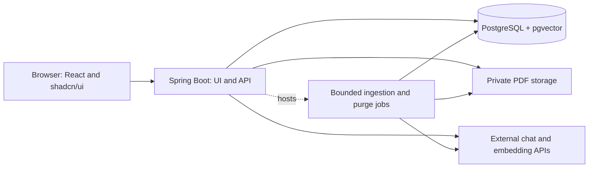
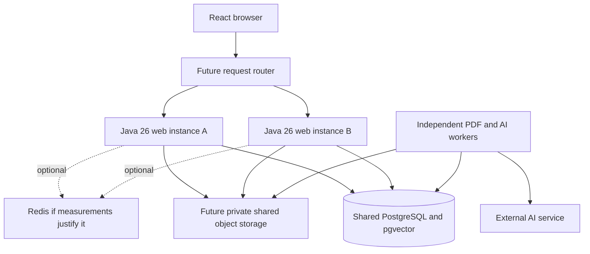

# Requirements and design for the AI knowledge base

## Current scope and sources

Original human decisions and their covered scopes are in the [decision source](https://github.com/igrgin/ai-knowledge-base/blob/7252f046b96f9a33e94f095f2b8b7790b76785ad/docs/changes/20261023-ai-knowledge-base/change.json). Use the current [plan](plan.md#revised-task-list) for task authority and progress.

## Sources

These links identify the current documents and relevant sections. The linked historical decision source retains the original owner-message sources; source navigation does not manufacture approval of later edits or authorize implementation.

| Source | Current section or identifying information | Relevant content |
| --- | --- | --- |
| [Intent](intent.md#desired-outcome) | Desired outcome and Constraints | Current consolidated product purpose and owner-selected behavior |
| [Owner decision references](https://github.com/igrgin/ai-knowledge-base/blob/7252f046b96f9a33e94f095f2b8b7790b76785ad/docs/changes/20261023-ai-knowledge-base/change.json) | D1–D13, with original conversation locators/selectors | Continuing owner directions and explicit later replacements; no alternative plan copies |
| [Cost research](research/costs.md#owner-choices-and-delivery-phases) | Owner choices, local/optional hosted phases and dated calculations | Budget scenarios and provider/retention caveats; not spending authority |
| [Scalability research](research/scalability-evaluation.md#target-shape) | Target shape and Proposed experiments | Supporting primary sources and measurable growth-path experiments |
| [Caching research](research/caching-evaluation.md#recommendation) | Recommendation and Measurement and follow-up | No-cache baseline, persisted embedding reuse and optional evidence-based optimization |
| [Implementation plan](plan.md#revised-task-list) | Revised task list; Contract gates for early starts | Current task allocation for this specification, including split slice ownership |
| [Agent settings](project.md#development-agent-assignments) | D14 project-specific role/model assignments | Selected development-agent models and effort; application and platform concerns remain below |

This is the current specification. Later explicit owner choices replace only the affected earlier choices. Use R1–R29 below and the current implementation plan, rather than looking for older draft files or local Git objects.

## Requirements

Stable requirement IDs are retained. Owner choices from D1–D12 are consolidated below. R26–R29 cover the selected project-copy, transcript-publication, chat-source and PDF-library behavior. New implementation details are proposals for review, not retroactive full-document acceptance. Product quotas remain unchanged; experiment sizes and latency targets are not capacity guarantees.

| ID | Required behavior and acceptance example |
| --- | --- |
| R1 | Anyone can register and log in without invitation. Duplicate account identifiers are handled consistently; logout invalidates the session. Proposed local v1 authentication is email/password; email verification and recovery are a concern below rather than silently included paid dependencies. |
| R2 | Each project and its files, chats, retrieval and citation access belong to one account. Other accounts cannot access the original by substituting IDs. A specifically authorized project import creates a new independently owned copy; a published chat snapshot exposes only its selected transcript under its own access rule, never project APIs/files. Ownership comes from the authenticated session, not the browser. |
| R3 | Users create, list, open and rename projects, each with at most 10 retained PDFs including archives and separate saved chats. The library distinguishes active/archived files and lets the owner open any retained PDF in a reader. Archived files continue to count toward quota. |
| R4 | Accept text-based PDFs within the configured size/page/text limits; verify actual parsing, not only filename/MIME. Reject encrypted/password-required, corrupt, image-only or unsupported files with a useful explanation. OCR and image/table interpretation are outside v1; ordinary extractable text inside tables may still be used without promising layout fidelity. |
| R5 | Process accepted uploads durably in the background. Expose queued, processing, ready and failed states, and a retry action for eligible failures. A restart cannot silently lose an accepted upload; incomplete chunks never become searchable as if processing succeeded. |
| R6 | The library shows project documents, upload status, failures and available chats. Opening a project with no ready source explains why grounded chat is unavailable. A user can use ready documents while other uploads process. |
| R7 | New chats start with ready active project PDFs enabled. New active uploads automatically become available to existing chats when ready. Project-archived PDFs remain eligible only for chats that existed when archived; per-chat exclusions can further narrow eligible sources. Unarchive restores active eligibility. Every response records its source versions and chat source-selection revision. |
| R8 | Users create and reopen independent chats within a project, with ordered saved messages. One chat's discussion does not become another chat's conversational memory. History persists across logout, login and application restart. |
| R9 | Answers use retrieved project passages as evidence. They may explain, summarize or compare that evidence, but unsupported document claims cannot be filled from general knowledge or web search. Follow-up questions use a bounded recent conversation context. |
| R10 | Substantive supported answers include server-validated citations to specific source pages. Clicking a citation opens an authenticated viewer at that physical PDF page. File names and printed page labels cannot substitute for the physical page index. |
| R11 | When no eligible sources or sufficient supporting evidence exist, explain that the documents do not contain enough information. Do not invent an answer or page citation. Similarity scores and syntactically valid citations alone are not treated as proof of factual correctness. |
| R12 | Chat gives visible pending/completed/failed states. A retried browser submission with the same request key does not create duplicate turns or schedule a second generation. Proposed v1 returns the complete validated answer rather than streaming unvalidated citation text. |
| R13 | Individual PDFs support archive/unarchive only. Archive excludes a file from new chats while retaining its original, text, embeddings, existing-chat eligibility and citations. Unarchive reuses complete unchanged processing data; unfinished/cancelled files resume only through normal bounded processing. Archive never frees quota. No individual PDF delete API/button, source-deleted citation workflow or automatic orphan purge is included. |
| R14 | Users delete saved chats and their messages/citations/grants/exclusions, revoking published snapshots and distribution manifests containing that chat first. This does not remove project files or other chats. Archived PDFs remain retained until project deletion even if their last chat is deleted. |
| R15 | Users delete a whole project with an explicit confirmation. Immediately revoke project access, distribution links and published snapshots, then purge its active/archived PDFs, text, embeddings, chats and citations through a tracked operation. Pending work cannot resurrect it. Its independently imported copies remain owned and retained by their recipients. Completion requires active-store purge. |
| R16 | Provider credentials remain server-side. Send document text for embeddings and only selected passages/context for answers. Disable optional provider response storage, avoid provider file/vector-store uploads, and explain external processing/retention to users. Logs/metrics omit document and chat bodies. |
| R17 | Apply configured per-user upload/chat limits, global storage and AI limits, bounded provider inputs/outputs, and conservative atomic budget reservations. When AI budget is exhausted, new paid work stops with a clear explanation while library access and deletion continue. Public registration does not imply unlimited paid usage. |
| R18 | Initial delivery runs locally from repeatable project commands with a persistent PostgreSQL/pgvector instance and file storage. The frontend is React + shadcn/ui and the backend is Java Spring Boot. External AI calls require owner-supplied credentials; configuration validates missing credentials explicitly. |
| R19 | Managed hosting is optional later work. Before any hosted release, verify actual resource use, storage/extensions, provider eligibility, backups and native controls against the owner's $15–20 monthly small-demo target. Larger deployments require separately assessed capacity and owner-approved budget. A higher quote returns to the owner; it does not silently change budget or local-release readiness. |
| R20 | Project deletion and share/snapshot revocation survive backup restore through an independently retained minimal lifecycle journal replayed before traffic. Live removal is distinct from backup expiry and independent AI-provider retention. Restore cannot revive a deleted project or revoked published link, and source deletion cannot erase independent destination projects. |
| R21 | Demonstrate evidence quality, page navigation, archival source scope, per-user isolation, restart recovery and deletion races with representative fixtures and acceptance checks. The quality gate below must pass before claiming the RAG behavior is ready. |
| R22 | Support combined, web-only and worker-only runtime roles from the same Java 26 codebase. Durable PDF, AI-answer and purge work must not depend on the receiving web process staying alive. Verify locally with two web instances and two competing worker processes; the default local launcher may run combined roles. |
| R23 | Preserve sessions, ownership, archive eligibility, request identity, job ownership, quotas, spending reservations and configured global concurrency across processes. A request retried through another web instance reuses its operation; adding workers cannot multiply AI limits or publish stale results. Use PostgreSQL as authority, with bounded queues and connection pools. |
| R24 | Produce reproducible offline scalability evidence covering concurrent traffic, corpus growth, process failure and cross-instance lifecycle changes. Record hardware, workload, configuration, stage timings, resource use and correctness. Before multi-host deployment, require shared private file storage and an independently retained shared deletion log; these hosted adapters remain optional later work. |
| R25 | Complete an offline performance checkpoint after the core flow works, measuring a no-cache baseline, embedding batches/reuse, queue wait, retrieval, generation, memory and resource cost. Start without Redis or Caffeine. Reopening, changing source selections, unarchiving unchanged ready files or copying compatible ready embeddings must not trigger unnecessary embedding calls. A cache experiment is optional only if measured repeated work justifies it; no cache is a valid completed result. |
| R26 | Owners distribute a fixed project version captured when creating a named invitation or registered-recipient link. Later project changes require a new share. The owner chooses project files alone or files plus all saved chats. Import creates an independent recipient-owned project subject to existing account/file/page/storage quotas, with destination source/citation IDs and no replay of copied paid operations. Source changes/deletion or link revocation cannot change accepted copies; revocation stops future imports. No collaborative project is created. |
| R27 | Owners explicitly publish a fixed read-only chat transcript snapshot, optionally public without login. It is a standalone view, not a recipient-account chat, and exposes no original PDFs, project APIs or AI actions. Later messages require explicit republishing. The owner can revoke access; deleting its source chat/project disables it. Restricted snapshots still require their configured invitation/account access. |
| R28 | Each owned chat can exclude/re-enable otherwise eligible files for new retrieval. Its choices do not affect project viewing or other chats and cannot override project archive eligibility. Preserve saved history and citations; earlier answers may remain in bounded conversation context. Exclusion does not promise model forgetting or prevent prior discussion from influencing a later answer. Source-choice changes fence publication based on a stale retrieved source set. |
| R29 | Every retained PDF in an owned or imported project opens in a simple authenticated viewer, with physical-page navigation from citations or the library. File/range requests use project ownership, independent of that chat's current AI source selection. Standalone published chat snapshots show citation labels only and do not authorize PDF access. |

## Design decisions

The design below consolidates the owner directions referenced by D1–D12. Preserve unrelated accepted behavior and quotas. Retrieval-only source context and fixed-share versions are now owner-selected; remaining import/publication details are reviewable proposals; they do not authorize implementation or promise hosted capacity.

### D-A: One application with clear internal responsibilities

Use a modular Spring Boot application that serves a built React/TypeScript UI and an authenticated JSON API. Keep identity/session management, project library, ingestion, chat/retrieval, source viewing, lifecycle/purge and usage accounting as internal responsibilities with explicit interfaces. Configuration enables combined, web-only or worker-only roles from the same codebase. The default local process runs combined roles with bounded executors. Durable database-backed ingestion, answer and purge jobs can also run in separate worker processes without introducing separate business services.

Single-origin delivery simplifies browser sessions and avoids extra frontend-hosting costs. Use Spring Security sessions with secure HttpOnly cookies, CSRF protection on state-changing requests and a persistent session store. Use framework password hashing and session rotation at login. Do not put session secrets or provider API keys in browser storage. The session mechanism is supported by [Spring Security](https://docs.spring.io/spring-security/reference/servlet/authentication/session-management.html); the particular integration still needs implementation verification.

Use Spring Session JDBC so either web instance can handle the next request without sticky-session dependence. Verify cross-instance session continuity and invalidation. [Spring Session JDBC](https://docs.spring.io/spring-session/reference/configuration/jdbc.html)

Dependency family: Java 26, stable Spring Boot 4.1.x with Spring AI 2.0.x, Maven, React/TypeScript with Vite, PostgreSQL and a compatible pgvector extension. Pin exact supported patch versions in implementation planning; use released dependencies rather than snapshots. Current Spring AI documentation lists Boot 4.0.x/4.1.x compatibility. [Spring AI getting started](https://docs.spring.io/spring-ai/reference/getting-started.html)

D20 refines configuration and testing within T1: keep static shared settings in base `application.yml`, local overrides in `application-dev.yml`, and required environment-provided deployment values in `application-prod.yml` without local fallbacks. Local launchers select `dev` explicitly; supplying production configuration does not authorize hosting. Keep `application-test.yml` and `application-lvl2test.yml` in test resources: `test` supports unit/basic checks, while `lvl2test` supports full Spring startup, real Testcontainers and end-to-end feature checks. Basic checks do not require Docker. The explicit Maven integration-test selection is separate from the Spring profile name.

D21 simplifies T1 delivery tooling: CI sets up dependencies and directly runs the native frontend/backend test suites. Normal npm/Playwright and Maven/Failsafe fixtures own test build/startup/cleanup, preserving meaningful readiness, package, database and frontend behavior checks. Repository-document/PR-metadata CI and custom verification/package wrappers are retired. The D20 profile split and later product/scalability requirements are unchanged.

### D-B: Own the retrieval data in PostgreSQL

Store account, project, document, page, chunk, chat, message and citation metadata alongside vectors in PostgreSQL. Store original PDFs in a private file-store abstraction: a local persistent directory in phase 1; an S3-compatible private bucket in the optional hosted phase. Files are never served as public assets.

Use a dedicated embedding-model adapter and chat-model adapter, with Spring AI as the initial integration. Keep authorization-sensitive retrieval in a project-owned repository query so that owner/project/document status predicates are mandatory before ranking and returning passages. Generic metadata filters are not a substitute for ownership checks. Start with exact cosine search over the eligible project corpus and indexes on owner/project/document status; add approximate indexing only when measurements justify it. pgvector documents exact filtered search and the recall implications of approximate indexes. [pgvector filtering](https://github.com/pgvector/pgvector#filtering), [Spring AI PGvector support](https://docs.spring.io/spring-ai/reference/api/vectordbs/pgvector.html)

Do not duplicate user PDFs into a provider-managed vector store. This preserves direct control over page provenance, chat source eligibility and project purge while avoiding another storage service charge.

### D-C: Page-preserving, restartable ingestion

Parse with Apache PDFBox and preserve physical page order. Extract text per page before chunking, so a passage always retains its actual page. Normalize extraction artifacts without dropping page provenance. Start with approximately 500-token chunks and approximately 80-token overlap within each page; small pages remain smaller. Empty pages are skipped with a count, and a document with no usable text fails with a text-PDF explanation. Do not claim image recognition or reliable complex reading order.

Create document metadata, a private temporary/object upload, and a durable ingestion job. Finalize the upload and queued job with compensating cleanup for interrupted file writes; sweep unreferenced temporary uploads. Worker claims use a lease/heartbeat and bounded attempts. Before each external call and before publishing results, recheck project/document lifecycle state. Insert chunk generations under an ingestion version and publish them atomically only when all required embeddings succeed. Retry replaces an unpublished generation rather than appending duplicate searchable chunks. Parse in an isolated child process with a bounded heap and a killable deadline so a stuck parser cannot occupy the ingestion executor indefinitely.

Keep ingestion state (`queued → processing → ready | failed | cancelled`) separate from visibility (`active ↔ archived`). Archive may be applied to any accepted upload. A ready archived document keeps its complete source data. Archiving an unfinished document cancels future unpaid work and leaves it archived/cancelled, retaining the original file but exposing no incomplete search data; already dispatched calls still settle against the budget. Failed active documents may be retried. Unarchive changes visibility back to active; it reuses a complete ready generation or leaves an unfinished file visibly awaiting a normal bounded retry. Unarchive does not dispatch a hidden paid call. Each new archive transition recalculates grants for the chats then present, within the project lock. Every state can be revoked by project deletion.

The stable extraction API supports page ranges; the implementation must check current library behavior, resource bounds and patch versions rather than copy historical examples. [Apache PDFBox text extraction](https://svn.apache.org/repos/asf/pdfbox/site/publish/userguide/text_extraction.html)

### D-D: Chat eligibility and answer provenance

Each chat belongs to exactly one project. Ready active PDFs are eligible unless that chat explicitly excludes them. Store exclusions rather than a frozen allowlist so newly ready active uploads are available automatically. When archiving a PDF, capture the IDs of all non-deleted chats already in that project in an archival-access relation within the same transaction. Existing chats keep access to that PDF; a chat created after that transaction gets no archival access. Serialize chat creation and archiving through the project row so there is a deterministic boundary, including simultaneous requests.

At each turn, derive documents eligible for fresh retrieval from active sources plus that chat's archival grants, minus that chat's exclusions. These exclusions do not strip earlier answers from bounded conversation context. Unarchiving clears obsolete grants for that file; a later archive establishes a new boundary. Archive, unarchive, chat creation and source-choice updates serialize through the project row and bump the applicable revision. Source versions and file contents are immutable; re-uploading creates a new document/version. Adding a new active PDF makes it available to subsequent turns in old and new chats. Each completed answer stores the exact selected chunk/version/page references. The UI shows whether a cited document is archived. All retained files remain viewable by the project owner through the library and past citations, including files currently excluded from new AI retrieval. A chat created while a file is archived cannot enable it for AI until unarchived; the PDF viewer does not grant retrieval eligibility.

For retrieval, assemble bounded recent conversation context, which may include earlier answers from a now-excluded PDF, and embed the current question, select up to eight relevant eligible passages, and cap total prompt input. Avoid a second paid query-rewrite call initially. Set a relevance threshold from the demonstration fixtures rather than treating an arbitrary score as factual confidence. If retrieval cannot support the question, return a plain refusal; if the context is relevant but incomplete, the model must state that limitation.

Request a structured result containing answer text, an answer/insufficient-evidence disposition and passage citation IDs. The model sees only temporary IDs tied to retrieved passages; the server resolves them to actual document/page records. Reject references outside that set and unsupported page values. Display plain/sanitized answer content and server-generated citation links. There are no document-triggered tools, browser searches or executable instructions: PDF text is untrusted evidence. Validation proves source membership, not semantic entailment; the quality gate assesses grounding separately.

Before publishing a response, recheck the owning project, the newly retrieved source references and the chat source-selection revision. Retained history is still authorized project/chat content; a retrieval exclusion alone does not invalidate its existing references. If the user excluded a source during generation, do not publish an answer based on the old source set; settle any dispatched call without silently buying a replacement. If a project/chat was deleted during generation, discard the result. Archiving does not invalidate a pending answer in a chat with an archival grant. The provider may already have processed an in-flight request; deletion cannot retract that external request.

### D-E: Citations use original physical pages

Keep an immutable source locator `(documentVersionId, physicalPageNumber, chunkId)` for each cited passage. Pages are 1-based physical PDF positions; the UI may separately display printed page labels if available. Use a PDF.js-based viewer route such as `/projects/{id}/chats/{chatId}/sources/{citationId}`. The backend validates ownership of the retained source in that project before streaming it. AI archive grants and chat exclusions determine model input, not whether the owner can read a retained file. The route selects the cited physical page rather than trusting a filename or a model-supplied URL. [PDF.js page rendering](https://mozilla.github.io/pdf.js/examples/)

The project library can open active and archived originals directly in the same viewer. Imported copies resolve their own destination source IDs, never an original owner's private route. All file and byte-range requests enforce the same authorization. Responses are private and must not be stored by a shared public cache. Viewer errors distinguish missing/deleted project state from processing failures without exposing another user's content.

### D-F: Archive PDFs; purge only whole projects

Archive/unarchive is available in local v1; individual-file deletion is excluded again by D11. Retain original files, chunks, embeddings and archived access metadata until project deletion, even if chats are deleted. Count retained archives against document/page/storage limits and explain that archiving does not free capacity. Active files offer Archive; archived files offer Unarchive. Explain that files remain retained and viewable, existing chats retain source eligibility, and each chat may further exclude a source. The UI must not imply erasure.

Deleting a chat revokes its published snapshots and distribution manifests containing that chat before removing its messages, citations, source exclusions and archival grants, while retaining project files. Deleting a project first marks it deleting/revokes all API access in a short transaction and records a durable purge job with its object keys. Cancel queued work, discard unpublished generations, remove private file objects with retries, and cascade project-owned database content. Revoke all original-project distribution links and snapshots as part of access revocation. Origin provenance must not cascade deletion into independent recipient projects. Keep only the minimal purge operation/tombstone information needed to finish and prevent resurrection; expire it after the recovery window. Usage totals can remain aggregated without project content. A failing file-store operation keeps the purge incomplete and visible for operator retry.

Backups and AI-provider logs have their own retention boundaries. Propose encrypted daily application/database backups with a seven-day rolling retention for any hosted phase, plus a minimal deletion ledger outside the restored content snapshot. Restore into a non-serving environment, replay project deletions and share/snapshot revocations, verify no removed or revoked content is accessible, then reopen traffic. Exact storage/retention and their cost need owner acceptance under C5; this is not a promise that every external copy disappears instantly.

### D-G: Simple local delivery; optional managed hosting

Phase 1 runs the full app, PostgreSQL/pgvector and persistent file storage locally with repeatable commands. Local development may use a frontend dev server and proxy, while the packaged artifact serves a single origin. Provide an explicit sample configuration and startup instructions; migrations own the database schema. No hosting account is required for local readiness.

For phase 2, propose a single-region Railway application + pgvector database + private bucket, with the React build inside the app image. Railway bucket docs describe private storage served through a backend; ensure authorization and private cache headers rather than copying a public-asset caching example. [Storage pattern](https://docs.railway.com/guides/storage-buckets-guide)

A hosted demonstration has one app instance and one database instance initially. It tolerates deployment/restart interruptions; no high-availability service level is promised. Health checks reveal service readiness without document contents. Project owner approves any release candidate/environment; the actual provider-account owner configures credentials, compute limits and platform permissions. Those account identities/controls remain to be resolved before release, not inferred from a project record.

### D-H: Measured AI choice and bounded use

Propose OpenAI `text-embedding-3-small` at 1536 dimensions for passages and queries; model/dimension are recorded per ingestion version and cannot be silently changed without re-embedding. Evaluate `gpt-6-luna` with reasoning disabled first, against the fixture gate. Use `gpt-4.1-mini` as a priced comparison if citation/instruction quality requires it. Model choice is subject to real account access, supported integration options and observed quality; the design does not infer correctness from provider marketing. Full price arithmetic and caveats are in `costs.md`.

Keep credentials in server configuration and use direct stateless calls with optional provider response storage disabled. OpenAI documents separate training, application-state and abuse-monitoring retention; disabling response storage is not zero retention. Inform users before uploads/calls and send neither account passwords nor unneeded account identifiers. [Data controls](https://developers.openai.com/api/docs/guides/your-data)

Track estimated reserved and settled cost in PostgreSQL using integer currency units with sufficient precision. Before each call, reserve its conservative maximum under a lock/transaction; include bounded output, input/cache-write rates and retries. Reconcile actual usage afterward; uncertain calls keep the reservation until reviewed. Reserve ingestion embedding cost after extraction/token counting and before paid work, including the permitted retry allowance, and release unused reservation only after settlement. A single ledger and UTC billing period prevent simultaneous workers from overshooting their configured application allowance. If the price configuration is missing/stale or a model is unknown, pause paid work rather than assuming a free rate.

Propose a $3/month AI limit in local use, and at most $17 infrastructure + $3 AI for the optional hosted phase, subject to an actual benchmark and backup cost. These are proposed allocations within the owner's $15–20 target, not authorized spending. Native infrastructure hard limits can stop the entire demo; application AI limits only disable new paid work. Railway Agent budgets do not control the app's OpenAI API usage. [Railway cost controls](https://docs.railway.com/pricing/cost-control)

### D-I: Shared coordination and staged growth

PostgreSQL owns durable operations, sessions, SQL archive/chat locks, job claims, usage reservations and global admission. Workers claim jobs transactionally, renew leases and fence stale completions. A lease expiring must not imply an uncertain external AI call is safe to repeat or its capacity slot is safe to release; retain conservative accounting/admission until reconciled. Local semaphores may protect a process, but cannot enforce deployment-wide allowances. Keep transactions short and do not hold a database connection or row lock while waiting for an AI response. PostgreSQL supports `SKIP LOCKED` for queue-like consumers; use it only within the job-claim protocol. [PostgreSQL locking](https://www.postgresql.org/docs/17/sql-select.html#SQL-FOR-UPDATE-SHARE)

Bound pending work globally and per account, executor size and aggregate database connections across all configured roles. Record concrete queue/pool settings during T1/T5 and exercise overload in T13. Report accepted/queued/rejected outcomes explicitly. Preserve the existing two-generation, one-per-chat and single-ingestion/embedding limits across processes. More web instances do not increase those limits. Provider rate entitlements and a larger throughput target remain unknown; later increases require capacity/cost reassessment.

The growth path adds a request router, web instances and independently sized workers. Before using different machines, replace host-local PDFs with shared private object storage and the host-local recovery journal with an independently retained shared deletion log. The local multi-process profile uses shared directories on one machine and proves process coordination only. A cloud account, object-store adapter, hosted router, Redis service and high availability are outside local v1.

Keep exact filtered retrieval initially. At larger corpus sizes, measure query plans and compare any approximate index against exact results using actual owner/project/archive filters. A lagging replica or cache cannot supply authoritative access/lifecycle decisions. Database sizing, index changes and any dedicated retrieval service follow evidence rather than being prerequisites for local v1.

### D-J: Performance and embedding work without a required cache

Start without Redis, Caffeine or an application-data cache. Persist extracted text, document embeddings, saved messages and operation IDs. Reopening a chat, changing source selection or unarchiving an unchanged ready document reuses that data. A compatible authorized project copy reuses completed embeddings without another provider call. Fingerprinted frontend assets may use browser caching; private originals retain current ownership checks.

Batch passage embedding inputs within the chosen endpoint's token/request limits and preserve page/version provenance per returned vector. Measure batch size, throughput, queue wait and provider time, without silently increasing the shared embedding concurrency or monetary allowance. Do not assume more parallel calls are faster or affordable. Spring AI documents token-aware batching; the owned adapter must verify actual integration. [Spring AI batching](https://docs.spring.io/spring-ai/reference/api/vectordbs.html#_batching_strategy)

T13 records the no-cache baseline and repeated-work analysis with controlled provider adapters, separating extraction, embedding, retrieval, generation, persistence and PDF delivery. T14 adds real provider timing/cost only within its separate scope. A bounded cache experiment is optional when a measured bottleneck and repeat rate justify it; do not require implementing or comparing Caffeine and Redis to finish the checkpoint. Any later cache adoption needs evidence, correct keys/bounds/invalidation, current PostgreSQL authorization/accounting and lifecycle tests. New runtime services or material budget changes return to the owner.

### D-K: Independent project imports

The owner creates an immutable distribution manifest capturing the project version at share creation, with an include-chats choice and either named-recipient invitation access or registered-link access. Invitations use in-app acceptance/links without adding an email-delivery dependency. A named recipient must authenticate as the intended account. Registered-link possession permits only its bounded import action, not browsing the source's private project APIs. Use unguessable tokens, store token hashes, keep tokens out of logs and allow owner revocation. The manifest pins original file/version identities, visibility/processing metadata, completed embeddings and any included chat history/grants/exclusions at creation. Later uploads, completions, source-state changes or messages do not update that invitation/link; the owner creates a new share for updates. Pending work is never copied as an operation to execute again.

Import reserves destination account/project/page/file/global storage quotas before work, uses an idempotent acceptance key and publishes one destination project only after its copied data/files are consistent. Record a durable job so interruption cannot expose a partial project. Use independent generated private file keys and copied database records, with fresh destination document/page/chunk/chat/message/citation IDs. Copy ready vector values with their exact model, dimensions and processing versions; incompatible generations fail clearly rather than silently re-embedding. Unfinished active sources need ordinary bounded destination processing with explicit status and normal reservations; archived unfinished sources stay retained/non-searchable. No generation/embedding request is replayed merely because a completed chat or vector was copied.

Remap copied chats' sources, exclusions and archived-source grants to destination IDs. A files-only copy has no copied old chats and thus no inherited chat grants for archived files; they can be viewed or unarchived by the new owner. A copied completed answer keeps its destination citation provenance. Source edits/deletion and share revocation cannot alter an accepted copy. Chat deletion revokes distribution manifests containing that chat before removing its history. Revocation and import publication serialize so a revoked/deleted original or manifest cannot publish a later acceptance; copies committed before that boundary remain independent. A user-authorized copy is not a global duplicate-content cache or cross-account hash search.

### D-L: Revocable read-only transcript snapshots

Explicit publication captures a fixed, sanitized transcript of selected chat history. The owner reviews the included messages before publishing or updating it. Restricted access checks the configured recipient account; public-link mode can be opened without login. The response contains only the snapshot's transcript and display citation labels. No source PDF route, private operation ID, provider credential, project navigation, chat continuation or import action is authorized by the snapshot token. A recipient with their own project copy still opens its files through their own authenticated library.

A later message stays private until explicit republication. Snapshot updates and revocation serialize with chat/project deletion; a stale publication job cannot revive revoked access. Persist revocation identifiers in the independently retained lifecycle journal used for recovery, and check current publication state on every view. Do not serve a revoked snapshot from shared caches. Deleting the source chat/project revokes all its snapshots; original files and retained chats are otherwise unaffected by snapshot revocation. Independent project copies do not inherit the original owner's live links or publications.

D12 resolves R28: per-chat exclusions filter fresh retrieval only. Earlier user/assistant messages remain eligible for the normal bounded conversation window, including discussion based on a now-excluded file. Do not add transitive source-dependency filtering or a hidden history reset. Keep new retrieved-passage provenance distinct from retained conversation context; new passage citations must validate against that turn's retrieved set, while old messages keep their original citations. A file-source toggle is not a model-forgetting guarantee. Still fence pending publication if fresh retrieval used a source the user has since excluded.

## Limits and user experience

These starting values were accepted with the baseline design. Storage use includes archived PDFs and derived data. They apply across the deployment, including when roles run in separate processes. Increase them only after measuring cost and resource use.

| Area | Proposed v1 bound or behavior |
| --- | --- |
| Account/project capacity | 3 projects/account; 10 uploaded PDFs/project including archives |
| Upload | 10 MiB/PDF; 200 physical pages/PDF; 250,000 extracted text tokens/PDF; 2,000 retained pages/account |
| Aggregate storage | Configurable global high-water mark; reserve room for database/vectors, archives and backup overhead; stop new uploads before storage exhaustion |
| Text/language | English acceptance fixtures first; Unicode extraction retained; other languages best effort until evaluated; no OCR |
| Processing | 1 ingestion job at a time; 2 bounded transient embedding retries; 2-minute extraction bound and 10-minute whole-job deadline, with explicit failure/retry status |
| AI concurrency | At most 2 generation requests globally and 1 per chat; 1 embedding pipeline; shared limits include ingestion/query embedding calls |
| User interaction limits | 30 answered questions/account/day and 5/minute; bounded registration/login/upload bursts; global monetary allowance remains authoritative |
| Chat context | At most 8 passages, approximately 500 tokens each; at most 6 recent messages; trim to 8,000 total input tokens; cap generation at 1,024 billed output tokens |
| Timeouts | 60-second answer deadline; return an explicit failure state when exceeded, without silently retrying a potentially charged generation |
| Library progress | Poll job state while visible, approximately every 2 seconds; stop polling terminal jobs; provide queued/processing/failure text rather than an invented percent |
| Answer presentation | Whole validated response, Markdown with sanitized output, source chips showing PDF title and physical page; pending indicator and accessible errors |
| Source UI | Active/Archived library views with PDF reader, archive/unarchive and per-chat source toggles; no individual PDF delete button |
| Project deletion | Separate confirmation naming the project and all content removed; deletion status persists until purge completes |

Backend resource limits are authoritative; frontend checks provide immediate feedback. Numeric thresholds and supported-language commitments are C3 rather than hidden requirements accepted by the user.

## Interfaces

All private project `/api` paths require the authenticated owner. Share acceptance requires the intended/registered account; a separate published-snapshot route applies its publication access policy and can allow anonymous viewing. UUIDs identify resources; they do not grant access. Cross-account resource lookups return a consistent non-disclosing not-found response. State-changing browser requests require CSRF validation.

| Interface | Behavior |
| --- | --- |
| `/api/auth/register`, `/login`, `/logout`, `/me` | Account/session lifecycle; no provider keys in payloads |
| `/api/projects` and `/{projectId}` | Create/list/get/rename and whole-project DELETE; DELETE returns a purge operation and revokes access immediately |
| `/api/projects/{projectId}/documents` | Multipart upload; list active/archived metadata and job state; upload returns a durable queued document/job |
| `/api/documents/{documentId}/archive` and `/unarchive` | Idempotent visibility changes; preserve originals/old-chat grants as specified and increment source revisions; no document DELETE route |
| `/api/documents/{documentId}/retry` | Retry an eligible failed ingestion version under the same configured limits |
| `/api/projects/{projectId}/chats` and `/api/chats/{chatId}` | Create/list/get and delete independent saved chats |
| `/api/chats/{chatId}/messages` | Submit a turn with a unique client request key; return/poll an answer operation, then saved answer/citations or failure |
| `/api/documents/{documentId}/file` and `/api/chats/{chatId}/citations/{citationId}/file` | Owner-authorized retained original stream/range access, independent of AI exclusions; citation page comes from the saved record |
| `/api/chats/{chatId}/sources` | Read/update explicit source exclusions under ownership and source revision checks |
| `/api/projects/{projectId}/shares`, `/api/shares/{shareId}` | Owner creates/revokes invitation or registered-link distribution with include-chats choice |
| `/api/project-imports` | Authenticated token acceptance with an idempotency key; reserve quotas and return a durable destination-copy operation |
| `/api/chats/{chatId}/snapshots` and `/api/snapshots/{snapshotId}` | Owner publishes/updates/revokes fixed transcripts; private management requires authentication/CSRF |
| `/shared/chats/{token}` | Read-only published view under its token/access policy; no project/files/model actions |
| `/api/operations/{operationId}` | Owner-visible processing/generation/purge state without another user's information |
| External model adapters | Typed passage embeddings, bounded answer request and validated result, usage/token reporting; no browser/provider coupling |

Errors distinguish invalid inputs, no ready documents, capacity/rate limits, unavailable budget/provider, and retryable ingestion failures. Creation/archive races are serialized; deletion and retry operations are idempotent. Automatic retries of a browser request reuse the same operation ID. Unknown provider outcomes require accounting reconciliation, not blind charged re-execution.

## Data effects

| Data | Ownership, persistence and lifecycle |
| --- | --- |
| User and session | Account ID, normalized login identifier and password hash; session records separate from project content |
| Project | Owner ID, title, lifecycle/revision; parent authorization boundary for all content |
| Document/version | Project/owner linkage, immutable version ID and private storage key, title, page/token counts, model/extraction version, processing state and archive timestamp |
| Page/chunk/embedding | Immutable page provenance and normalized text; chunk sequence and vector dimensions/model; publish only a complete ready ingestion version |
| Chat/message | Project/owner linkage, creation time, order, request key, answer state, text and source-version references |
| Archival access and exclusions | Same-project chat grants per archive cycle plus chat exclusions and source-selection revision; remap on import; remove with chat/project deletion |
| Project distribution/import | Owner, pinned manifest, include-chats/access mode, recipient or token hash, revocation state, acceptance key, destination owner/project and fenced copy job; provenance never cascades source deletion into destination |
| Transcript publication | Owner/source chat, fixed sanitized messages/display citations, access mode/token hash, publication revision and revocation; no original file grants; source chat/project deletion revokes access |
| Turn provenance and selection | Newly retrieved passage/version/page references, bounded prior-message context references and the source-selection revision; no transitive context-filter graph required |
| Citation | Message/owner/project linkage, immutable document version and physical page, selected passage ID; server-created file URL |
| Job/purge operation | Lease, bounded attempts, lifecycle version, progress/error code; deletion revokes work and cleans project data without resurrection |
| Usage ledger | Period, selected price version, estimated reservation, actual usage/cost, reconciliation state; project deletion removes content-bearing identifiers where not needed; aggregate cost can remain |
| Original PDF | Private local file or optional bucket object; retained through archive and chat deletion; removed on project purge |

Foreign keys/composite constraints tie nested records to their actual project/owner. Application queries always apply those relationships. The database is accessed only through the backend/private network; browser-supplied owner, archive-grant or citation records are never trusted. Do not create cross-user content caches or content-hash deduplication that can leak document existence. Only an explicit authorized import copies source data to a new owner; a published transcript grants no general project/file rights.

## Intent constraint mapping

| Intent constraint | Requirement, decision or concern |
| --- | --- |
| Preserve existing guidance/policies/tools | R18, D-A, source/config preservation; no adoption-file or tool changes |
| Java Spring Boot, React, shadcn/ui | R18, D-A |
| Learning/portfolio purpose | R18–R19, D-A/D-G; small local-first deployment and optional hosting |
| Text PDFs, no OCR | R4–R5, D-C, proposed limits |
| Multiple PDFs per project and project-scoped knowledge | R2–R3, R7, R28, D-B/D-D; maximum 10 retained files including archives |
| Grounded answers and page citations | R9–R11, D-D/D-E, quality gate |
| Separate saved chats, reopened later | R8, R12, D-D |
| Private per user; external AI permitted | R2/R16, D-A/D-H; only explicit import/publication extends access under R26–R27 |
| Live-demo finish line | Superseded by later owner direction: R18–R19 and D-G make hosting optional later |
| PDF/chat/project deletion | D11 restores archive-only individual PDFs after D8's abandoned delete proposal: R13, D-D/D-F. Chat and whole-project deletion remain R14–R15 |
| Project deletion removes everything inside | R15, R20, D-F and C5; revocation/purge, backup/provider boundary and restore replay explicit |
| Budget deferred to design | R17/R19, D-H, `costs.md`; owner selected $15–20 target, exact feasible allocation awaits benchmark |
| Explain unfamiliar RAG terms | D-B/D-C/D-D distinguish text, vectors, retrieval and model answer generation; UI uses user-level terms |
| Intent-only scope in original record | Superseded for this stage by explicit design authorization; no implementation authorization inferred |
| Missing project policy sources | Source table, invariants and C6; proposed design baseline does not appoint external administrators or invent accepted policy |
| Scalable architecture without supplied traffic targets | R22–R24, D-A/D-I; shared correctness, separable roles and local multi-process verification; C9 owns future capacity commitments |
| Performance and faster embeddings | R25, D-J; no required cache experiment, persisted embedding reuse and bounded batches; offline T13 measurements and separately scoped T14 provider evidence |
| Independent project distribution without collaboration | R26, D-K; registered imports by invitation/link, optional copied chats and recipient quotas |
| Standalone read-only chat sharing | R27, D-L; fixed revocable snapshots, optional anonymous viewing, no PDF or AI access |
| Project PDF reader and chat-level source choices | R28–R29, D-D/D-E; automatic new uploads, retained history and viewer access distinct from AI eligibility |

## Open-question dispositions

| Intent/design question | Resolution or carried concern | Decision owner | Affected work |
| --- | --- | --- | --- |
| Q1: representative PDFs/questions | Propose a small redistributable fixture set with supported, unsupported and follow-up questions; owner may supply preferred learning material | project-owner | Fixture choice and quality demonstration; C3 |
| Q6: languages/limits/processing UX | Proposed English baseline, limits and durable status/failure behavior above | project-owner | Final requirements and verification thresholds; C3/C4 |
| Q7: hosting/AI budget | Owner chose $15–20/month, managed hosting acceptable, hosting optional later; full scenario calculations in `costs.md` | project-owner | Cost allocations and optional hosted readiness; C1 |
| Q11/Q16: individual PDF deletion | D11 restores archive-only; no broken-source citation or file-triggered message-deletion workflow. Existing chat/project deletion remains | project-owner | R13–R15, D-F |
| Q12/Q13/Q19: project sharing | Owner-selected invitation/link imports create independent copies, optionally all chats, without collaboration or source-deletion cascade | project-owner | R26, D-K |
| Q14/Q15: archive and chat sources | Existing chats retain archived eligibility, new chats exclude it; chat exclusions narrow sources; new ready active uploads automatically become available | project-owner | R7/R13/R28, D-D; retrieval-only context rule resolved under C11 |
| Q17: local scope/usage | Draft local-v1 work includes selected sharing features; imported projects use destination owner quotas and normal global spending limits. Final revised scope remains reviewable | project-owner | R17/R26–R27, T16/T17 |
| Q21/Q22: exclusion context and share versions | D12 selects fresh-retrieval exclusion only, with earlier answers allowed in bounded context, and fixed project versions captured at share creation | project-owner | R26/R28, D-D/D-K/D-L |
| Q18/Q20: file viewing and snapshots | Project owners can read all retained PDFs; standalone public/restricted chat snapshots expose only fixed transcripts and display citations | project-owner | R27/R29, D-E/D-L |
| Scale target | Owner has no target. Establish reproducible experiments and report measured limits; do not infer a hosted service level | project-owner | R22–R24, D-I, C9 |
| Redis, Caffeine or no cache | Default is no backend application-data cache. Required checkpoint focuses on bottlenecks and embeddings; a cache prototype is optional only when warranted by evidence | project-owner | R25, D-J, C10 |

## Invariants

The source for each product invariant is the accepted intent revision above as amended by the named owner messages. These are design constraints, not claims that code already enforces them.

| Invariant | Authoritative source | Effect on design |
| --- | --- | --- |
| Original private content requires ownership or an explicit distribution/publication action | Accepted privacy baseline as amended by D9–D10 | Private project/file APIs stay owner-scoped; imports have independent ownership; public snapshots expose transcript data only |
| New chats cannot retrieve project-archived PDFs until unarchive | D9 archive clarification, D11 archive-only restoration | Atomic archive/grant cycles; per-chat choices only narrow eligibility |
| Archiving preserves old-chat source access | Same owner clarification | Retain original immutable PDF and retrieval data; no automatic orphan purge |
| Citation pages refer to actual stored source versions | Accepted intent, clickable page citations | Page-preserving extraction, structured citation IDs and authorized original-file viewer |
| Unsupported evidence produces no fabricated document answer | Accepted intent, insufficient-information behavior | Bounded evidence-only prompting, validation and fixture-based grounding checks |
| Project deletion prevents original-content service or resurrection | Accepted project deletion with D10 independent-copy/snapshot distinction | Revoke links/snapshots, fence jobs and purge original content; replay lifecycle journal; independent destination projects survive |
| Accepted copies cannot depend on the original project's lifetime | D10 independent-copy reply | Fresh destination identifiers/private keys, remapped provenance and no origin cascade deletion |
| Revoked transcript snapshots cannot regain access after restart/restore | D10 acceptance of revocable snapshots | Current publication checks, fenced updates and replayable revocation journal |
| Hosting can be deferred without failing local v1 | Later optional-hosting direction | Separate local readiness from hosted cost/permission checks |
| Owner choices and budget do not authorize provider spending | Current design request and budget-question scope | Research/design only; native accounts, credentials and deployment remain separate authority |
| Adding processes preserves shared limits and lifecycle rules | D7 owner-selected architecture; accepted R2/R7/R12/R15/R17 | SQL coordination, durable operation identity, fenced workers and global admission; no per-JVM authority |
| Cache availability or stale entries cannot grant access or spending | D7 cache-checkpoint direction plus accepted privacy/deletion/budget constraints | Current PostgreSQL checks remain authoritative; caches are disposable optimizations |

## Verification and quality gate

Propose a small evaluation set with at least 20 supported questions (including cross-PDF comparisons and follow-ups), 10 deliberately unsupported questions, plus source/ownership/lifecycle scenarios. All citations must reference a retrieved passage and open the correct original physical page. Target at least 18/20 supported answers judged correct and grounded, and 10/10 unsupported questions producing an appropriate abstention. Count a semantically unsupported answer with a valid-looking citation as a failure. These are initial release gates, not a guarantee against all model mistakes; owner accepts thresholds with the design.

Exercise user-A/user-B identifier substitution and semantic retrieval separation; archive with chats created before/after its transaction; new active upload availability; restart during ingestion; duplicate turn submission; account/global quota races; project deletion during extraction, provider calls and final response persistence; file-purge retry; and restore deletion replay. Archive retention and project purge are checked separately. Measure actual PDF text extraction, answer latency, peak memory, stored-vector footprint and paid usage against the proposed limits before optional hosting.

Local scalability verification uses controlled provider adapters, a real PostgreSQL/pgvector database and the child extractor. Compare one combined process with two web instances and two competing worker processes on one machine. Alternate requests between web instances. Verify login/logout, duplicate requests, global limits, worker loss/lease recovery, cross-instance archive/chat creation, citation access, purge and deletion replay. Under unknown provider outcomes, verify conservative reservations and no blind duplicate dispatch. Saturate bounded admission and record explicit accepted/queued/rejected outcomes.

The initial experiment workload is 20 concurrent clients and staged corpus growth to 100,000 generated passages distributed across isolated owners/projects, including archived-source filters. These are synthetic fixtures, not changed user quotas or promised throughput. Report cold/warm latency percentiles, queue wait, stage timings, error rates, memory, connections and storage, with hardware, data seed, duration and repetitions. Exploratory targets of p95 application reads below 250 ms and retrieval below 500 ms exclude provider and queue time; they remain hypotheses to assess, not accepted service levels or unconditional local-release gates.

Complete R25's performance/embedding report during this offline checkpoint. Verify no re-embedding on reopen, source toggles, ready-file unarchive or compatible ready project import; measure batch sizing and provider request counts through controlled adapters. A cache comparison is not required. If evidence warrants an optional prototype, compare it against the same baseline and rerun isolation, archive, purge and failure cases. Record future multi-host adapter/recovery/load requirements separately from local multi-process evidence. No synthetic benchmark consumes paid AI allowance.

Exercise invitation vs registered-link import, duplicate import acceptance, quota exhaustion, copied citation/grant mapping, source deletion after import, import interruption and source revoke/delete racing with import completion. Exercise private/public transcript snapshots, explicit republish, anonymous inability to fetch PDFs or call AI, cross-instance revocation, source chat/project deletion and replay of a pre-revocation backup. Include archive/unarchive cycles, exclusion during generation, earlier answers retained as context without fresh excluded-file retrieval, automatic later uploads and retained-library viewing independent of AI choices. Change the original after creating a share and verify the old link imports only its fixed version while a new share captures the updates.

## Concerns

All concerns belong to `project-owner` unless the owner names an actual platform administrator. No concerns below are silently accepted policy.

| Concern | Uncertainty/conflict | Proposed resolution | Decision owner | Affected work |
| --- | --- | --- | --- | --- |
| C1: optional hosted cost fit | $15–20 target has limited margin; usage and backup costs are unmeasured | Keep hosting optional; start with $3 AI local limit and benchmark; host only if measured infrastructure including backups fits the remaining target or the owner changes it | project-owner | Hosting selection, quotas and future deployment |
| C2: archive/source UX verification | Product choices are resolved; cycles, old-chat grants and user expectations still need verification | Archive/unarchive, per-chat exclusions and reader controls; show which sources a turn may use and retain all project files/citations | project-owner | R7/R13/R28–R29 and lifecycle/UI tests |
| C3: limits, languages and evaluation | Numeric defaults and English-first gate are proposals | Review the proposed limits/fixture thresholds; measure before expanding; keep other languages best effort until evaluated | project-owner | Ingestion, quotas, quality commitments and readiness |
| C4: archive-only failed/pending uploads | Permanent individual removal is excluded, including when a user changes their mind during processing | Proposed resolution is specified in D-C: separate visibility from ingestion state, allow archive of unfinished/failed uploads, cancel future paid work, retain the original until project deletion, and count it against quota | project-owner | Review the proposed state rules with this design; implementation must not add a hidden individual-delete path |
| C5: deletion versus backup/provider retention | “Remove everything” cannot imply retrospective erasure of independent provider logs or instantaneous backup rewriting | Immediate live-access revocation, tracked active purge, proposed 7-day backup expiry, deletion replay on restore and documented external retention; owner reviews retention before hosted release | project-owner | Deletion acceptance language, backup policy and privacy notice |
| C6: policy and platform controls | Lighthouse supplies review defaults; native GitHub setup is established. Hosted security/operations controls remain deferred | Use the installed Lighthouse review guidance and actual PR evidence. Establish hosted controls, recovery and provider access before deployment | project-owner; hosted provider/control identity remains unresolved | Actual candidate review and separately authorized hosted release; policy adoption alone grants no resources or implementation authority |
| C7: account-email workflow | Public registration is required; email verification/recovery adds a provider and scope/cost | Propose local v1 email/password with no paid email dependency; explicitly decide verification/recovery before the public hosted phase | project-owner | Authentication completeness, demo-account recovery and hosted setup |
| C8: model/integration access and quality | Public documentation does not establish this account's access or actual RAG quality | Pin compatible dependencies in planning; run the fixture gate in authorized implementation; keep model configurable and reassess budget before a quality-driven upgrade | project-owner | Model selection, implementation compatibility and paid evaluation |
| C9: workload, hardware and future capacity | Owner has no traffic/corpus target; no implementation measurements or hosted capacity exist | Run the defined local experiments, report limits and bottlenecks; owner chooses future throughput/service levels and larger budgets from evidence | project-owner | T13/T14 measurements; multi-host capacity and availability promises remain later work |
| C10: performance and cache benefit | Embedding throughput, repeat rates and bottlenecks are unmeasured | Mandatory no-cache performance/embedding report; no required cache prototype; owner reviews any later runtime/cost addition | project-owner | R25, T13/T14 |
| C11: retrieval-only exclusion verification | Resolved product choice under D12; actual behavior still needs tests | Keep bounded prior conversation context and history/citations; filter only fresh retrieval, explain that earlier discussion may influence answers, and fence stale retrieved-source publication. No transitive context-filter graph | project-owner | R28, D-D/D-L, T8/T9/T13 |
| C12: import/publication operating limits | Quotas exist but copy cost and link-import/public-view rates are unmeasured | Copy within existing account/global limits; bound queues/rates, use explicit owner actions and idempotency; measure T13 before hosted exposure. In-app invitations avoid a mail-service dependency | project-owner | R26–R27, T16/T17/T13; hosted operations remain later |

Original acceptances remain recoverable in the historical decision source linked above. D7–D11 provide the scoped architecture/product directions incorporated here. C11 is resolved by D12; remaining implementation details, including C12, are ready for owner review; no full-document acceptance is inferred from answers to individual questions. D19 subsequently accepts and authorizes the bounded T1 increment at the committed setup baseline. Its implementation/review evidence is in the current plan; T2–T20 remain pending and unauthorized. No broader plan acceptance is inferred. Hosting is optional later; no publication, deployment or paid work is authorized by these records.
