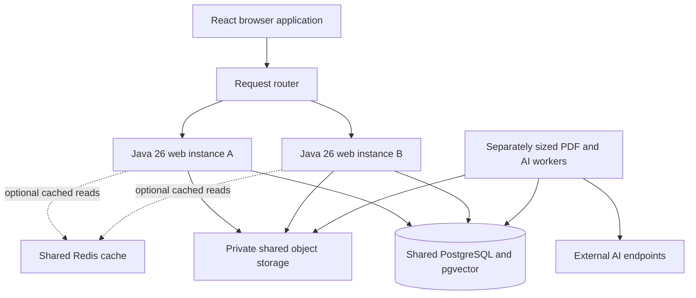

# Scalable design and caching

## Current planning references

This is supporting research, not another implementation plan. Use the current [requirements](spec.md#requirements), [design decisions](spec.md#design-decisions) and single [task list](plan.md#revised-task-list). The [performance checkpoint](plan.md#offline-scalability-and-performanceembedding-checkpoint-in-t13) measures a no-cache baseline and embedding batching/reuse; no Caffeine or Redis prototype is required. Hosting remains optional later. No implementation or capacity result is claimed by this note.

## Owner requirement and recommendation

The owner stated on 2026-10-24: "I need this to be scalable. A scalable design. This is what I want you to make sure in your research." When asked for simultaneous-chat and document-volume targets, the owner answered "no I don't."

Design for multiple Java 26 application instances and independently sized ingestion/AI workers. Keep PostgreSQL authoritative for ownership, source eligibility, operations, job leases and financial reservations. Make private file storage replaceable by shared object storage before deploying across machines. A cache remains an optimization. Redis is a candidate for shared caches or fast shared rate limits; it is not a prerequisite for a scalable application.

No measured capacity claim is available because there is no application implementation. Proposed workload experiments below make the requirement testable without inventing a user-supplied service level. The $15–20 monthly target remains a small-demo budget, not a promise to operate an arbitrary scale within it. Hosting stays optional later.

## Target shape

Initially one process may run web and worker roles together. The same codebase should support web-only and worker-only execution through configuration. Separating those roles must not require moving business rules into new microservices. Worker leases, persisted operation status and file access must work independently of whichever web instance accepted the request.

## Evaluate the existing plan

| Area | Existing design helps | Additional requirement for multiple instances |
| --- | --- | --- |
| Web instances | Durable chats and request IDs, JDBC sessions, server-side authorization | No authoritative state in a particular JVM. Route subsequent requests and polling to either instance without sticky-session dependence |
| Session storage | Spring Session JDBC uses shared database tables | Verify login/logout/session invalidation across two web processes; Redis sessions are an option only if measured session traffic warrants migration |
| Files | The private file-store interface isolates physical storage | A host-local directory cannot supply files to another machine. Use shared private object storage for multi-host deployment; original PDFs remain private and owner/chat authorization runs on every request |
| Ingestion | Durable jobs, leases, immutable generations and atomic publication | Claim jobs safely across workers, renew leases, fence stale completions and bound the queue. Allow worker processes to run apart from web requests |
| Chat operations | Unique request keys, saved pending/completed operations | A retry on a different web instance must reuse the same operation. Provider-call uncertainty cannot be solved by a JVM map |
| Provider concurrency | Accepted design specifies global limits | Global generation/embedding limits need a shared admission mechanism. Two per-process semaphores would multiply the allowance. Local semaphores can protect each process in addition to shared limits |
| Money and account quotas | Atomic PostgreSQL reservations already fit shared coordination | Reserve under shared transactions before calls, including worker retries. Preserve unknown outcomes. Redis eviction or restart must not reset spend authority |
| Archive and purge | SQL lifecycle revisions, grants and completion fences | Archive/chat creation and purge must serialize across instances, not Java object locks. Stale local entries cannot authorize old sources or revive a project |
| Recovery | A deletion journal survives restoring old content | A journal on one server is insufficient across machines. A shared durable independently retained deletion log and replay rule are required before multi-host release |
| Database access | Owned SQL queries and exact filtered vector search | Bound connection pools across all instances and workers. Keep short transactions separate from provider network waits; add indexes and approximate retrieval only with measured query/quality evidence |

Spring Session's JDBC implementation uses database-backed session tables. PostgreSQL documents `SKIP LOCKED` for queue-like consumer work, with caveats against treating its inconsistent view as a general query strategy. These capabilities support the proposed shared session/job approach; the full application behavior still needs testing. [Spring Session JDBC](https://docs.spring.io/spring-session/reference/configuration/jdbc.html), [PostgreSQL 17 locking](https://www.postgresql.org/docs/17/sql-select.html#SQL-FOR-UPDATE-SHARE)

Worker execution is at-least-once under failures. Leases and idempotent writes protect publication; they do not prove exactly-once execution at an external AI endpoint after an unknown network outcome. Keep accounting conservative and avoid blind charged retries.

## Cache placement at scale

| Data | Proposed treatment |
| --- | --- |
| Model metadata or bounded recomputable values | Optional per-instance Caffeine, if measured useful. No requirement that another instance see the same cached entry |
| Repeated query embeddings | Candidate after measuring repeats. Scope by owner/project/model/exact prepared input and current access. Per-instance Caffeine or shared Redis depends on measured duplication and memory |
| High-frequency shared request-rate counters | Redis is a reasonable later candidate with explicit atomic operations and failure behavior. Financial reservations remain in PostgreSQL |
| Sessions | Keep JDBC initially. Measure session-write/lookup pressure before choosing a Redis session store |
| Permissions, archive grants, lifecycle state, budget authority | Do not make a stale performance cache authoritative |
| Retrieval results and generated answers | Avoid initially. Keys must represent the exact source eligibility, context and model/prompt versions; all serving paths still check current access |

Spring Cache is an interface, not automatic cross-process coherence. Each Caffeine instance has its own entries. A Redis-backed Spring cache centralizes entries, but the app must still handle invalidation, serialization, failures and concurrent changes. [Spring cache behavior](https://docs.spring.io/spring-framework/reference/integration/cache/strategies.html), [Redis cache configuration](https://docs.spring.io/spring-data/redis/reference/redis/redis-cache.html)

Do not add both local and shared caches for private data without a demonstrated need. For any future two-level cache, a missed invalidation must not permit stale access. A transactional outbox and replayable change handling can drive eviction; authorization and deletion need a current consistent check even when an eviction message is delayed. Ordinary Redis Pub/Sub is not a durable replay log, so it cannot be the sole mechanism protecting archive/purge correctness. [Redis delivery semantics](https://redis.io/docs/latest/develop/pubsub/#delivery-semantics)

## Growing the vector collection

Begin with the accepted exact filtered search at local volume. Record passage count, retrieval duration, query plans, database memory and index/storage size. When that evidence requires approximate search, evaluate HNSW with the actual owner/project/archival filters and compare recall against exact search on the same fixtures.

pgvector documents that approximate-index filtering and shared indexes across tenants can affect recall and speed. Increasing an index parameter does not eliminate the need to verify tenant filters and answer-source quality. Partitioning or a dedicated retrieval database can follow measured pressure; neither is a starting prerequisite. [pgvector filtering and multitenancy](https://github.com/pgvector/pgvector#filtering)

Do not route permission-sensitive reads to a lagging replica and assume immediate archive/deletion visibility. If retrieval uses a replica, validate its candidate sources through a current consistent eligibility check before sending content to the AI and before serving the result. Database connections across all replicas/workers also need an aggregate budget; adding web instances cannot create unlimited database connections.

## Proposed experiments

These are research proposals, not accepted throughput promises or changes to the user's product quotas. Use generated, isolated test data and controlled AI endpoints so these tests do not spend the owner's model budget.

| Experiment | Proposed setup | Evidence to collect |
| --- | --- | --- |
| Baseline | 1 web process with worker roles, 20 concurrent client requests, accepted shared caps of 2 active generations and 1 ingestion job | Accepted/queued/rejected operations, latency by stage, bounded queue behavior, memory and actual shared-cap use |
| Multi-instance correctness | 2 web processes and 2 competing worker processes, same shared database/files and same global caps | Session continuity across instances; one durable operation per request key; no multiplied limits, overspend or duplicate published versions |
| Lifecycle under load | Create chats on one instance, archive on another, delete projects while workers are active; kill/restart a worker or web instance | Correct old/new-chat sources, current citation access, stale-work rejection, purge completion and recovery without resurrection |
| Corpus growth | Increase synthetic data to 100,000 passages spread across owners/projects; compare cold and warm queries and archive-heavy source filters | Exact-search timing, query plans, memory/storage and source recall; choose index/cache work from the measured result |
| Performance starting targets | Propose p95 ordinary application reads below 250 ms and filtered retrieval below 500 ms on a declared reference machine and dataset, excluding AI network/generation and queue time | Whether the proposed targets are met; provider/queue/end-to-end timings reported separately. Record hardware, workload, durations and repetitions |
| Cache value | Compare the no-cache baseline with a bounded query-embedding cache only if input repetition is significant | Hit rate, avoided paid calls, memory, cold-start behavior and invalidation/tenant correctness |

The generation cap deliberately stays global in the first multi-instance test: increasing process count should not silently increase allowed AI work. A later throughput test can raise the configured cap with an appropriate capacity/cost scope. Full response latency cannot be promised before the model, provider quotas and workload are measured.

## Current task allocation

Implementation ownership is defined only by the current [task list](plan.md#revised-task-list), [contract gates](plan.md#contract-gates-for-early-starts) and [file/schema ownership](plan.md#file-and-schema-ownership). T6 establishes actual durable worker execution; T7 and T9 extend it. T5 owns shared provider accounting/admission, T20 source controls, T11 lifecycle recovery, and T13 integrated multi-instance/performance evidence. T16/T19 own independent copies and T17 transcript publication. These references replace the earlier task-placement suggestions; this research note carries no separate task state or execution authority.

## Project and request sources

Use the current `spec.md` and `plan.md` for product behavior, Java 26, local limits and optional hosting. The original owner requests and scale clarification are in `codex://threads/01a1699d-af41-71f0-a5e7-c75152955b39`, 2026-10-24. The companion `caching-evaluation.md` evaluates individual cache candidates. This note supplies evidence for the current requirements and plan; original owner-message references remain in `change.json`.
