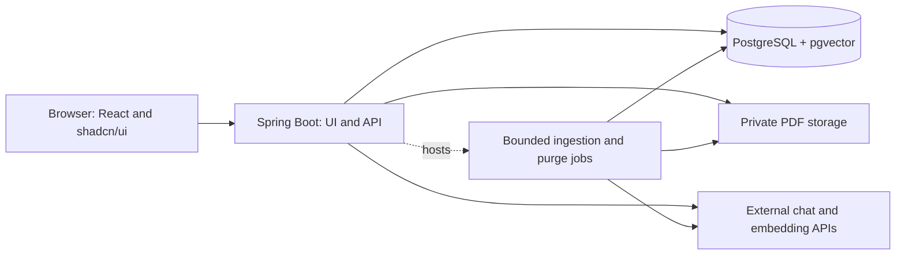
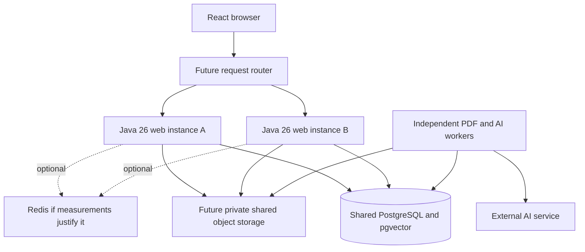

# Application design: private PDF knowledge base

## Overview

This is the canonical product and target-architecture design for local v1. It preserves the accepted R1–R29 requirements and D-A–D-L decisions, with later proposals and C1–C12 concerns identified separately. A proposed mechanism does not gain acceptance merely by appearing here. [The owner planning conversation](codex://threads/01a1699d-af41-71f0-a5e7-c75152955b39) records the original directions and scoped amendments. The existing technical research supplies the dated evidence and alternatives.

[The roadmap](../roadmap.md) owns task state, gates and authorization. [EGM.md](../../EGM.md) describes implemented boundaries; this design includes future behavior. Only T1/T2 are implemented. No later feature is authorized by this document. Hosted operations and paid calls retain separate authority.

## Problem

Build a learning and portfolio application that lets people organize text PDFs into projects and explore their contents through saved AI conversations. Answers should be grounded in the project's eligible documents and include page citations that users can inspect. The application must say when those documents cannot support an answer.

## Goals

1. Register, log in and create a private project containing at most 10 retained PDFs, including archives.
2. Upload text PDFs and observe durable processing, ready or failed states. Preserve physical-page provenance when extracting text, creating passages and storing embeddings.
3. Open retained originals from the project library in a simple PDF viewer, including through citations at the actual cited page. File viewing is distinct from AI-source eligibility.
4. Create separate saved chats per project, reopen their history, and receive grounded answers with usable citations or an explicit insufficient-evidence response.
5. New chats start with ready active files enabled. New active uploads automatically become available to existing chats when ready.
6. Archive/unarchive individual files without deleting their originals, text, embeddings or citations. Archives retain quota usage. Chats already present at archive time retain source eligibility; new chats exclude a file while it is archived.
7. Exclude/re-enable otherwise eligible files within one chat. Exclusions stop new retrieval only; earlier answers may remain in bounded conversation context and visible history/citations remain intact. A retrieval toggle does not guarantee that later discussion is uninfluenced by earlier answers.
8. Share a fixed project version captured when creating an invitation/link, either with files alone or with all saved chats. Create a new share for updates. Accepted imports have their own owner, identifiers, quotas and files; later source changes, source deletion or link revocation do not erase those copies.
9. Explicitly publish, update or revoke a fixed read-only chat snapshot. Later private messages appear only after explicit republication. Revocation or deletion of its source chat/project disables the published view; it is not imported as a loose chat into someone else's account.
10. Delete saved chats without deleting project PDFs. Delete a whole project through immediate revocation and tracked purge of its own active/archived files and derived data. Revoke its distribution links and published snapshots; independently accepted project copies remain intact.
11. Run the full core flow locally with repeatable commands and persistent state. Demonstrate two-user isolation, archive/source rules, independent copies, snapshots, restart recovery and deletion/revocation behavior. Hosting is optional later work.

## Non-goals

No OCR, non-PDF ingestion, individual file delete, live project collaboration, web-search answers, provider-hosted PDF/vector storage or answer streaming is added. Dedicated quiz/summary/comparison features are not required; ordinary grounded questions asking for summaries or comparisons are supported. Hosted infrastructure, email delivery/verification/recovery and production release operations remain optional later work.

## Requirements

Stable requirement IDs are retained. Owner choices from D1–D12 are consolidated below. R26–R29 cover the selected project-copy, transcript-publication, chat-source and PDF-library behavior. New implementation details are proposals for review, not retroactive full-document acceptance. Product quotas remain unchanged; experiment sizes and latency targets are not capacity guarantees.

| ID | Required behavior and acceptance example |
| --- | --- |
| R1 | Anyone can register and log in without invitation. Duplicate account identifiers are handled consistently; logout invalidates the session. Proposed local v1 authentication is email/password; email verification and recovery are a concern below rather than silently included paid dependencies. |
| R2 | Each project and its files, chats, retrieval and citation access belong to one account. Other accounts cannot access the original by substituting IDs. A specifically authorized project import creates a new independently owned copy; a published chat snapshot exposes only its selected transcript under its own access rule, never project APIs/files. Ownership comes from the authenticated session, not the browser. |
| R3 | Users create, list, open and rename projects, each with at most 10 retained PDFs including archives and separate saved chats. The library distinguishes active/archived files and lets the owner open any retained PDF in a reader. Archived files continue to count toward quota. |
| R4 | Accept text-based PDFs within the configured size/page/text limits; verify actual parsing, not only filename/MIME. Reject encrypted/password-required, corrupt, image-only or unsupported files with a useful explanation. OCR and image/table interpretation are outside v1; ordinary extractable text inside tables may still be used without promising layout fidelity. |
| R5 | Process accepted uploads durably in the background. Expose queued, processing, ready and failed states, and a retry action for eligible failures. A restart cannot silently lose an accepted upload; incomplete chunks never become searchable as if processing succeeded. |
| R6 | The library shows project documents, upload status, failures and available chats. Opening a project with no ready source explains why grounded chat is unavailable. A user can use ready documents while other uploads process. |
| R7 | New chats start with ready active project PDFs enabled. New active uploads automatically become available to existing chats when ready. Project-archived PDFs remain eligible only for chats that existed when archived; per-chat exclusions can further narrow eligible sources. Unarchive restores active eligibility. Every response records its source versions and chat source-selection revision. |
| R8 | Users create and reopen independent chats within a project, with ordered saved messages. One chat's discussion does not become another chat's conversational memory. History persists across logout, login and application restart. |
| R9 | Answers use retrieved project passages as evidence. They may explain, summarize or compare that evidence, but unsupported document claims cannot be filled from general knowledge or web search. Follow-up questions use a bounded recent conversation context. |
| R10 | Substantive supported answers include server-validated citations to specific source pages. Clicking a citation opens an authenticated viewer at that physical PDF page. File names and printed page labels cannot substitute for the physical page index. |
| R11 | When no eligible sources or sufficient supporting evidence exist, explain that the documents do not contain enough information. Do not invent an answer or page citation. Similarity scores and syntactically valid citations alone are not treated as proof of factual correctness. |
| R12 | Chat gives visible pending/completed/failed states. A retried browser submission with the same request key does not create duplicate turns or schedule a second generation. Proposed v1 returns the complete validated answer rather than streaming unvalidated citation text. |
| R13 | Individual PDFs support archive/unarchive only. Archive excludes a file from new chats while retaining its original, text, embeddings, existing-chat eligibility and citations. Unarchive reuses complete unchanged processing data; unfinished/cancelled files resume only through normal bounded processing. Archive never frees quota. No individual PDF delete API/button, source-deleted citation workflow or automatic orphan purge is included. |
| R14 | Users delete saved chats and their messages/citations/grants/exclusions, revoking published snapshots and distribution manifests containing that chat first. This does not remove project files or other chats. Archived PDFs remain retained until project deletion even if their last chat is deleted. |
| R15 | Users delete a whole project with an explicit confirmation. Immediately revoke project access, distribution links and published snapshots, then purge its active/archived PDFs, text, embeddings, chats and citations through a tracked operation. Pending work cannot resurrect it. Its independently imported copies remain owned and retained by their recipients. Completion requires active-store purge. |
| R16 | Provider credentials remain server-side. Send document text for embeddings and only selected passages/context for answers. Disable optional provider response storage, avoid provider file/vector-store uploads, and explain external processing/retention to users. Logs/metrics omit document and chat bodies. |
| R17 | Apply configured per-user upload/chat limits, global storage and AI limits, bounded provider inputs/outputs, and conservative atomic budget reservations. When AI budget is exhausted, new paid work stops with a clear explanation while library access and deletion continue. Public registration does not imply unlimited paid usage. |
| R18 | Initial delivery runs locally from repeatable project commands with a persistent PostgreSQL/pgvector instance and file storage. The frontend is React + shadcn/ui and the backend is Java Spring Boot. External AI calls require owner-supplied credentials; configuration validates missing credentials explicitly. |
| R19 | Managed hosting is optional later work. Before any hosted release, verify actual resource use, storage/extensions, provider eligibility, backups and native controls against the owner's $15–20 monthly small-demo target. Larger deployments require separately assessed capacity and owner-approved budget. A higher quote returns to the owner; it does not silently change budget or local-release readiness. |
| R20 | Project deletion and share/snapshot revocation survive backup restore through an independently retained minimal lifecycle journal replayed before traffic. Live removal is distinct from backup expiry and independent AI-provider retention. Restore cannot revive a deleted project or revoked published link, and source deletion cannot erase independent destination projects. |
| R21 | Demonstrate evidence quality, page navigation, archival source scope, per-user isolation, restart recovery and deletion races with representative fixtures and acceptance checks. The quality gate below must pass before claiming the RAG behavior is ready. |
| R22 | Support combined, web-only and worker-only runtime roles from the same Java 26 codebase. Durable PDF, AI-answer and purge work must not depend on the receiving web process staying alive. Verify locally with two web instances and two competing worker processes; the default local launcher may run combined roles. |
| R23 | Preserve sessions, ownership, archive eligibility, request identity, job ownership, quotas, spending reservations and configured global concurrency across processes. A request retried through another web instance reuses its operation; adding workers cannot multiply AI limits or publish stale results. Use PostgreSQL as authority, with bounded queues and connection pools. |
| R24 | Produce reproducible offline scalability evidence covering concurrent traffic, corpus growth, process failure and cross-instance lifecycle changes. Record hardware, workload, configuration, stage timings, resource use and correctness. Before multi-host deployment, require shared private file storage and an independently retained shared deletion log; these hosted adapters remain optional later work. |
| R25 | Complete an offline performance checkpoint after the core flow works, measuring a no-cache baseline, embedding batches/reuse, queue wait, retrieval, generation, memory and resource cost. Start without Redis or Caffeine. Reopening, changing source selections, unarchiving unchanged ready files or copying compatible ready embeddings must not trigger unnecessary embedding calls. A cache experiment is optional only if measured repeated work justifies it; no cache is a valid completed result. |
| R26 | Owners distribute a fixed project version captured when creating a named invitation or registered-recipient link. Later project changes require a new share. The owner chooses project files alone or files plus all saved chats. Import creates an independent recipient-owned project subject to existing account/file/page/storage quotas, with destination source/citation IDs and no replay of copied paid operations. Source changes/deletion or link revocation cannot change accepted copies; revocation stops future imports. No collaborative project is created. |
| R27 | Owners explicitly publish a fixed read-only chat transcript snapshot, optionally public without login. It is a standalone view, not a recipient-account chat, and exposes no original PDFs, project APIs or AI actions. Later messages require explicit republishing. The owner can revoke access; deleting its source chat/project disables it. Restricted snapshots still require their configured invitation/account access. |
| R28 | Each owned chat can exclude/re-enable otherwise eligible files for new retrieval. Its choices do not affect project viewing or other chats and cannot override project archive eligibility. Preserve saved history and citations; earlier answers may remain in bounded conversation context. Exclusion does not promise model forgetting or prevent prior discussion from influencing a later answer. Source-choice changes fence publication based on a stale retrieved source set. |
| R29 | Every retained PDF in an owned or imported project opens in a simple authenticated viewer, with physical-page navigation from citations or the library. File/range requests use project ownership, independent of that chat's current AI source selection. Standalone published chat snapshots show citation labels only and do not authorize PDF access. |

## Open questions

| Intent/design question | Resolution or carried concern | Decision owner | Affected work |
| --- | --- | --- | --- |
| Q1: representative PDFs/questions | Propose a small redistributable fixture set with supported, unsupported and follow-up questions; owner may supply preferred learning material | project-owner | Fixture choice and quality demonstration; C3 |
| Q6: languages/limits/processing UX | Accepted English-first baseline, starting limits and durable status/failure behavior above | project-owner | Feature verification and evidence before expanding limits/language commitments; C3/C4 |
| Q7: hosting/AI budget | Owner chose $15–20/month, managed hosting acceptable, hosting optional later; full scenario calculations in `costs.md` | project-owner | Cost allocations and optional hosted readiness; C1 |
| Q11/Q16: individual PDF deletion | D11 restores archive-only; no broken-source citation or file-triggered message-deletion workflow. Existing chat/project deletion remains | project-owner | R13–R15, D-F |
| Q12/Q13/Q19: project sharing | Owner-selected invitation/link imports create independent copies, optionally all chats, without collaboration or source-deletion cascade | project-owner | R26, D-K |
| Q14/Q15: archive and chat sources | Existing chats retain archived eligibility, new chats exclude it; chat exclusions narrow sources; new ready active uploads automatically become available | project-owner | R7/R13/R28, D-D; retrieval-only context rule resolved under C11 |
| Q17: local scope/usage | Draft local-v1 work includes selected sharing features; imported projects use destination owner quotas and normal global spending limits. Final revised scope remains reviewable | project-owner | R17/R26–R27, T16/T17 |
| Q21/Q22: exclusion context and share versions | D12 selects fresh-retrieval exclusion only, with earlier answers allowed in bounded context, and fixed project versions captured at share creation | project-owner | R26/R28, D-D/D-K/D-L |
| Q18/Q20: file viewing and snapshots | Project owners can read all retained PDFs; standalone public/restricted chat snapshots expose only fixed transcripts and display citations | project-owner | R27/R29, D-E/D-L |
| Scale target | Owner has no target. Establish reproducible experiments and report measured limits; do not infer a hosted service level | project-owner | R22–R24, D-I, C9 |
| Redis, Caffeine or no cache | Default is no backend application-data cache. Required checkpoint focuses on bottlenecks and embeddings; a cache prototype is optional only when warranted by evidence | project-owner | R25, D-J, C10 |

### Concerns

All concerns belong to `project-owner` unless the owner names an actual platform administrator. No concerns below are silently accepted policy.

| Concern | Uncertainty/conflict | Proposed resolution | Decision owner | Affected work |
| --- | --- | --- | --- | --- |
| C1: optional hosted cost fit | $15–20 target has limited margin; usage and backup costs are unmeasured | Keep hosting optional; start with $3 AI local limit and benchmark; host only if measured infrastructure including backups fits the remaining target or the owner changes it | project-owner | Hosting selection, quotas and future deployment |
| C2: archive/source UX verification | Product choices are resolved; cycles, old-chat grants and user expectations still need verification | Archive/unarchive, per-chat exclusions and reader controls; show which sources a turn may use and retain all project files/citations | project-owner | R7/R13/R28–R29 and lifecycle/UI tests |
| C3: limits, languages and evaluation | Starting limits and the English-first quality gate are accepted; fixture results and broader-language/capacity evidence remain outstanding | Verify the recorded bounds and quality thresholds in the owning features/T13/T14; measure before expanding; keep other languages best effort until evaluated | project-owner | Ingestion, quotas, quality commitments and readiness |
| C4: archive-only failed/pending uploads | Permanent individual removal is excluded, including when a user changes their mind during processing | Proposed resolution is specified in D-C: separate visibility from ingestion state, allow archive of unfinished/failed uploads, cancel future paid work, retain the original until project deletion, and count it against quota | project-owner | Review the proposed state rules with this design; implementation must not add a hidden individual-delete path |
| C5: deletion versus backup/provider retention | “Remove everything” cannot imply retrospective erasure of independent provider logs or instantaneous backup rewriting | Immediate live-access revocation, tracked active purge, proposed 7-day backup expiry, deletion replay on restore and documented external retention; owner reviews retention before hosted release | project-owner | Deletion acceptance language, backup policy and privacy notice |
| C6: policy and platform controls | EGM governs design review; native repository controls are established. Hosted security/operations remain deferred | Use EGM design review, fresh implementation review and actual PR evidence under the [workflow](../egm-workflow.md) and [remote policy](../remote-work.md). Establish hosted controls, recovery and provider access before deployment | project-owner; hosted provider/control identity remains unresolved | Candidate review and separately authorized hosted release; policy adoption grants no resources or feature authority |
| C7: account-email workflow | Public registration is required; email verification/recovery adds a provider and scope/cost | Propose local v1 email/password with no paid email dependency; explicitly decide verification/recovery before the public hosted phase | project-owner | Authentication completeness, demo-account recovery and hosted setup |
| C8: model/integration access and quality | Public documentation does not establish this account's access or actual RAG quality | Pin compatible dependencies in planning; run the fixture gate in authorized implementation; keep model configurable and reassess budget before a quality-driven upgrade | project-owner | Model selection, implementation compatibility and paid evaluation |
| C9: workload, hardware and future capacity | Owner has no traffic/corpus target; no implementation measurements or hosted capacity exist | Run the defined local experiments, report limits and bottlenecks; owner chooses future throughput/service levels and larger budgets from evidence | project-owner | T13/T14 measurements; multi-host capacity and availability promises remain later work |
| C10: performance and cache benefit | Embedding throughput, repeat rates and bottlenecks are unmeasured | Mandatory no-cache performance/embedding report; no required cache prototype; owner reviews any later runtime/cost addition | project-owner | R25, T13/T14 |
| C11: retrieval-only exclusion verification | Resolved product choice under D12; actual behavior still needs tests | Keep bounded prior conversation context and history/citations; filter only fresh retrieval, explain that earlier discussion may influence answers, and fence stale retrieved-source publication. No transitive context-filter graph | project-owner | R28, D-D/D-L, T8/T9/T13 |
| C12: import/publication operating limits | Quotas exist but copy cost and link-import/public-view rates are unmeasured | Copy within existing account/global limits; bound queues/rates, use explicit owner actions and idempotency; measure T13 before hosted exposure. In-app invitations avoid a mail-service dependency | project-owner | R26–R27, T16/T17/T13; hosted operations remain later |

Original acceptances are recorded in the planning conversation linked above. D7–D11 provide the scoped architecture/product directions incorporated here. C11 is resolved by D12; remaining implementation details, including C12, are ready for owner review; no full-document acceptance is inferred from answers to individual questions. D19 subsequently accepts and authorizes the bounded T1 increment at the committed setup baseline. T1/T2 implementation/review evidence and scoped authority are recorded in the [roadmap and linked PRs](../roadmap.md#completed-foundation); later tasks remain pending and need their own implementation authority. No broader plan acceptance is inferred. Hosting is optional later; no publication, deployment or paid work is authorized by these records.

## Critical user journeys

1. Register and sign in, create a private project, and reopen it after restart (R1–R3/R8). Another account substituting identifiers receives no private content; session rotation, expiry, logout and CSRF checks belong to T3/T4.
2. Upload a bounded text PDF, follow durable status and open its original physical pages (R4–R6/R29). Reject unsupported/corrupt/encrypted/image-only input; retry eligible failures without losing accepted files or publishing incomplete search data.
3. Ask a supported or unsupported question in an independent saved chat (R7–R12). Return a validated grounded answer with page citations, or an insufficient-evidence response; duplicate submissions reuse the operation and unknown charged calls are not blindly repeated.
4. Archive/unarchive a file or change one chat's retrieval sources (R13/R28). Existing-chat grants, later-chat exclusion, ready active uploads and saved history follow D-D. Viewing retained originals does not grant AI eligibility; exclusions do not promise model forgetting.
5. Invite a recipient to import a fixed project version, optionally with saved chats, or publish a separate fixed transcript (R26–R27). Quota failure or interrupted import never exposes a partial destination; revoked tokens cannot publish stale work. Accepted copies remain independent, while snapshots grant no PDF/API/AI access.
6. Delete a chat or whole project and recover across process failure or backup restore (R14–R15/R20). Revoke access before purge, retain archives until project deletion, preserve independent recipient copies, and replay deletion/revocation before serving restored content.

The verification section below covers the failure, privacy, race and recovery scenarios for these journeys. Each producing feature owns its UI/API/storage and meaningful tests; integrated completion follows the roadmap.

## Technical plan

### Design decisions

The design below consolidates the owner directions referenced by D1–D12. Preserve unrelated accepted behavior and quotas. Retrieval-only source context and fixed-share versions are now owner-selected; remaining import/publication details are reviewable proposals; they do not authorize implementation or promise hosted capacity.

### D-A: One application with clear internal responsibilities

Use a modular Spring Boot application that serves a built React/TypeScript UI and an authenticated JSON API. Keep identity/session management, project library, ingestion, chat/retrieval, source viewing, lifecycle/purge and usage accounting as internal responsibilities with explicit interfaces. Configuration enables combined, web-only or worker-only roles from the same codebase. The default local process runs combined roles with bounded executors. Durable database-backed ingestion, answer and purge jobs can also run in separate worker processes without introducing separate business services.

On 2026-10-26, the owner accepted the separate architecture assessments in the [planning conversation](codex://threads/01a1699d-af41-71f0-a5e7-c75152955b39): “I agree with number four. I agree with your assessment for number three and number two.” Use Spring Modulith to verify logical feature interfaces as backend features grow; retain the modular application and separately scalable worker roles, with a dedicated extraction service deferred until independent operational needs justify it. Keep the existing Maven build modules. The owner clarified that Maven modularity is primarily about running selected modules and test levels separately or together. Surefire owns basic tests; Failsafe owns integration tests. Maven test selection and Spring test configuration profiles are distinct. These decisions do not authorize implementing later features or changing capacity limits now. Supporting investigations: [Modulith](../research/spring-modulith-investigation.md), [microservices](../research/microservices-investigation.md), [extraction scaling](../research/extraction-scaling-investigation.md), [Maven](../research/maven-multi-module-investigation.md).

Single-origin delivery simplifies browser sessions and avoids extra frontend-hosting costs. Use Spring Security sessions with secure HttpOnly cookies, CSRF protection on state-changing requests and a persistent session store. Use framework password hashing and session rotation at login. Do not put session secrets or provider API keys in browser storage. The session mechanism is supported by [Spring Security](https://docs.spring.io/spring-security/reference/servlet/authentication/session-management.html); the particular integration still needs implementation verification.

Use Spring Session JDBC so either web instance can handle the next request without sticky-session dependence. Verify cross-instance session continuity and invalidation. [Spring Session JDBC](https://docs.spring.io/spring-session/reference/configuration/jdbc.html)

Dependency family: Java 26, stable Spring Boot 4.1.x with Spring AI 2.0.x, Maven, React/TypeScript with Vite, PostgreSQL and a compatible pgvector extension. Pin exact supported patch versions in implementation planning; use released dependencies rather than snapshots. Current Spring AI documentation lists Boot 4.0.x/4.1.x compatibility. [Spring AI getting started](https://docs.spring.io/spring-ai/reference/getting-started.html)

D20 refines configuration and testing within T1: keep static shared settings in base `application.yml`, local overrides in `application-dev.yml`, and required environment-provided deployment values in `application-prod.yml` without local fallbacks. Local launchers select `dev` explicitly; supplying production configuration does not authorize hosting. Keep `application-test.yml` and `application-itest.yml` in test resources: `test` supports unit/basic checks, while `itest` supports full Spring startup, real Testcontainers and end-to-end feature checks. Basic checks do not require Docker. The explicit Maven integration-test selection is separate from the Spring profile name.

D21 simplifies T1 delivery tooling: CI sets up dependencies and directly runs the native frontend/backend test suites. Normal npm/Playwright and Maven/Failsafe fixtures own test build/startup/cleanup. Repository-document/PR-metadata CI and custom verification/package wrappers are retired. The D20 profile split and later product/scalability requirements are unchanged.

For PR #21, the owner amended T1 on 2026-10-26 in the [planning conversation](codex://threads/01a1699d-af41-71f0-a5e7-c75152955b39): “ProductionConfig: this isn't required, delete this file”, “DeploymentConfigurationTest: not necessary to test”, “ReadinessIT: Not necessary test”, and “create a BOM that backend and pdf extractor use”. Remove the custom production validator and those two tests; retain environment placeholders without fallbacks and delegate configuration handling to Spring Boot and the datasource. This removes T1's automated backend configuration/readiness/database lifecycle coverage rather than replacing it with equivalent tests. Introduce a shared Maven dependency BOM used by both Java modules. The runtime readiness endpoint, profile split and later feature/database verification obligations remain unchanged.

### D-B: Own the retrieval data in PostgreSQL

Store account, project, document, page, chunk, chat, message and citation metadata alongside vectors in PostgreSQL. Store original PDFs in a private file-store abstraction: a local persistent directory in phase 1; an S3-compatible private bucket in the optional hosted phase. Files are never served as public assets.

Use a dedicated embedding-model adapter and chat-model adapter, with Spring AI as the initial integration. Keep authorization-sensitive retrieval in a project-owned repository query so that owner/project/document status predicates are mandatory before ranking and returning passages. Generic metadata filters are not a substitute for ownership checks. Start with exact cosine search over the eligible project corpus and indexes on owner/project/document status; add approximate indexing only when measurements justify it. pgvector documents exact filtered search and the recall implications of approximate indexes. [pgvector filtering](https://github.com/pgvector/pgvector#filtering), [Spring AI PGvector support](https://docs.spring.io/spring-ai/reference/api/vectordbs/pgvector.html)

Do not duplicate user PDFs into a provider-managed vector store. This preserves direct control over page provenance, chat source eligibility and project purge while avoiding another storage service charge.

### D-C: Page-preserving, restartable ingestion

Parse with Apache PDFBox and preserve physical page order. Extract text per page before chunking, so a passage always retains its actual page. Normalize extraction artifacts without dropping page provenance. Start with approximately 500-token chunks and approximately 80-token overlap within each page; small pages remain smaller. Empty pages are skipped with a count, and a document with no usable text fails with a text-PDF explanation. Do not claim image recognition or reliable complex reading order.

Create document metadata, a private temporary/object upload, and a durable ingestion job. Finalize the upload and queued job with compensating cleanup for interrupted file writes; sweep unreferenced temporary uploads. Worker claims use a lease/heartbeat and bounded attempts. Before each external call and before publishing results, recheck project/document lifecycle state. Insert chunk generations under an ingestion version and publish them atomically only when all required embeddings succeed. Retry replaces an unpublished generation rather than appending duplicate searchable chunks. Parse in an isolated child process with a bounded heap and a killable deadline so a stuck parser cannot occupy the ingestion executor indefinitely.

Represent extraction and indexing as durable stages with bounded, versioned persisted page text between them. Admit parser work and embedding work separately, with per-worker child limits and deployment-wide limits; waiting for embedding capacity must not occupy a parser slot. T6 owns extraction/stage publication and T7 consumes it for indexing. A typed PostgreSQL job table can represent both stages. Start with the existing single-ingestion and single-embedding bounds. Future parallel parsing requires an explicit measured capacity increase while retaining independent embedding, generation and budget limits; no additional service or broker is required by this design.

Keep ingestion state (`queued → processing → ready | failed | cancelled`) separate from visibility (`active ↔ archived`). Archive may be applied to any accepted upload. A ready archived document keeps its complete source data. Archiving an unfinished document cancels future unpaid work and leaves it archived/cancelled, retaining the original file but exposing no incomplete search data; already dispatched calls still settle against the budget. Failed active documents may be retried. Unarchive changes visibility back to active; it reuses a complete ready generation or leaves an unfinished file visibly awaiting a normal bounded retry. Unarchive does not dispatch a hidden paid call. Each new archive transition recalculates grants for the chats then present, within the project lock. Every state can be revoked by project deletion.

The stable extraction API supports page ranges; the implementation must check current library behavior, resource bounds and patch versions rather than copy historical examples. [Apache PDFBox text extraction](https://svn.apache.org/repos/asf/pdfbox/site/publish/userguide/text_extraction.html)

### D-D: Chat eligibility and answer provenance

Each chat belongs to exactly one project. Ready active PDFs are eligible unless that chat explicitly excludes them. Store exclusions rather than a frozen allowlist so newly ready active uploads are available automatically. When archiving a PDF, capture the IDs of all non-deleted chats already in that project in an archival-access relation within the same transaction. Existing chats keep access to that PDF; a chat created after that transaction gets no archival access. Serialize chat creation and archiving through the project row so there is a deterministic boundary, including simultaneous requests.

At each turn, derive documents eligible for fresh retrieval from active sources plus that chat's archival grants, minus that chat's exclusions. These exclusions do not strip earlier answers from bounded conversation context. Unarchiving clears obsolete grants for that file; a later archive establishes a new boundary. Archive, unarchive, chat creation and source-choice updates serialize through the project row and bump the applicable revision. Source versions and file contents are immutable; re-uploading creates a new document/version. Adding a new active PDF makes it available to subsequent turns in old and new chats. Each completed answer stores the exact selected chunk/version/page references. The UI shows whether a cited document is archived. All retained files remain viewable by the project owner through the library and past citations, including files currently excluded from new AI retrieval. A chat created while a file is archived cannot enable it for AI until unarchived; the PDF viewer does not grant retrieval eligibility.

For retrieval, assemble bounded recent conversation context, which may include earlier answers from a now-excluded PDF, and embed the current question, select up to eight relevant eligible passages, and cap total prompt input. Avoid a second paid query-rewrite call initially. Set a relevance threshold from the demonstration fixtures rather than treating an arbitrary score as factual confidence. If retrieval cannot support the question, return a plain refusal; if the context is relevant but incomplete, the model must state that limitation.

Request a structured result containing answer text, an answer/insufficient-evidence disposition and passage citation IDs. The model sees only temporary IDs tied to retrieved passages; the server resolves them to actual document/page records. Reject references outside that set and unsupported page values. Display plain/sanitized answer content and server-generated citation links. There are no document-triggered tools, browser searches or executable instructions: PDF text is untrusted evidence. Validation proves source membership, not semantic entailment; the quality gate assesses grounding separately.

Before publishing a response, recheck the owning project, the newly retrieved source references and the chat source-selection revision. Retained history is still authorized project/chat content; a retrieval exclusion alone does not invalidate its existing references. If the user excluded a source during generation, do not publish an answer based on the old source set; settle any dispatched call without silently buying a replacement. If a project/chat was deleted during generation, discard the result. Archiving does not invalidate a pending answer in a chat with an archival grant. The provider may already have processed an in-flight request; deletion cannot retract that external request.

### D-E: Citations use original physical pages

Keep an immutable source locator `(documentVersionId, physicalPageNumber, chunkId)` for each cited passage. Pages are 1-based physical PDF positions; the UI may separately display printed page labels if available. Use a PDF.js-based viewer route such as `/projects/{id}/chats/{chatId}/sources/{citationId}`. The backend validates ownership of the retained source in that project before streaming it. AI archive grants and chat exclusions determine model input, not whether the owner can read a retained file. The route selects the cited physical page rather than trusting a filename or a model-supplied URL. [PDF.js page rendering](https://mozilla.github.io/pdf.js/examples/)

The project library can open active and archived originals directly in the same viewer. Imported copies resolve their own destination source IDs, never an original owner's private route. All file and byte-range requests enforce the same authorization. Responses are private and must not be stored by a shared public cache. Viewer errors distinguish missing/deleted project state from processing failures without exposing another user's content.

### D-F: Archive PDFs; purge only whole projects

Archive/unarchive is available in local v1; individual-file deletion is excluded again by D11. Retain original files, chunks, embeddings and archived access metadata until project deletion, even if chats are deleted. Count retained archives against document/page/storage limits and explain that archiving does not free capacity. Active files offer Archive; archived files offer Unarchive. Explain that files remain retained and viewable, existing chats retain source eligibility, and each chat may further exclude a source. The UI must not imply erasure.

Deleting a chat revokes its published snapshots and distribution manifests containing that chat before removing its messages, citations, source exclusions and archival grants, while retaining project files. Deleting a project first marks it deleting/revokes all API access in a short transaction and records a durable purge job with its object keys. Cancel queued work, discard unpublished generations, remove private file objects with retries, and cascade project-owned database content. Revoke all original-project distribution links and snapshots as part of access revocation. Origin provenance must not cascade deletion into independent recipient projects. Keep only the minimal purge operation/tombstone information needed to finish and prevent resurrection; expire it after the recovery window. Usage totals can remain aggregated without project content. A failing file-store operation keeps the purge incomplete and visible for operator retry.

Backups and AI-provider logs have their own retention boundaries. Propose encrypted daily application/database backups with a seven-day rolling retention for any hosted phase, plus a minimal deletion ledger outside the restored content snapshot. Restore into a non-serving environment, replay project deletions and share/snapshot revocations, verify no removed or revoked content is accessible, then reopen traffic. Exact storage/retention and their cost need owner acceptance under C5; this is not a promise that every external copy disappears instantly.

### D-G: Simple local delivery; optional managed hosting

Phase 1 runs the full app, PostgreSQL/pgvector and persistent file storage locally with repeatable commands. Local development may use a frontend dev server and proxy, while the packaged artifact serves a single origin. Provide an explicit sample configuration and startup instructions; migrations own the database schema. No hosting account is required for local readiness.

For phase 2, propose a single-region Railway application + pgvector database + private bucket, with the React build inside the app image. Railway bucket docs describe private storage served through a backend; ensure authorization and private cache headers rather than copying a public-asset caching example. [Storage pattern](https://docs.railway.com/guides/storage-buckets-guide)

A hosted demonstration has one app instance and one database instance initially. It tolerates deployment/restart interruptions; no high-availability service level is promised. Health checks reveal service readiness without document contents. Project owner approves any release candidate/environment; the actual provider-account owner configures credentials, compute limits and platform permissions. Those account identities/controls remain to be resolved before release, not inferred from a project record.

### D-H: Measured AI choice and bounded use

Propose OpenAI `text-embedding-3-small` at 1536 dimensions for passages and queries; model/dimension are recorded per ingestion version and cannot be silently changed without re-embedding. Evaluate `gpt-6-luna` with reasoning disabled first, against the fixture gate. Use `gpt-4.1-mini` as a priced comparison if citation/instruction quality requires it. Model choice is subject to real account access, supported integration options and observed quality; the design does not infer correctness from provider marketing. Full price arithmetic and caveats are in [cost research](../research/costs.md).

Keep credentials in server configuration and use direct stateless calls with optional provider response storage disabled. OpenAI documents separate training, application-state and abuse-monitoring retention; disabling response storage is not zero retention. Inform users before uploads/calls and send neither account passwords nor unneeded account identifiers. [Data controls](https://developers.openai.com/api/docs/guides/your-data)

Track estimated reserved and settled cost in PostgreSQL using integer currency units with sufficient precision. Before each call, reserve its conservative maximum under a lock/transaction; include bounded output, input/cache-write rates and retries. Reconcile actual usage afterward; uncertain calls keep the reservation until reviewed. Reserve ingestion embedding cost after extraction/token counting and before paid work, including the permitted retry allowance, and release unused reservation only after settlement. A single ledger and UTC billing period prevent simultaneous workers from overshooting their configured application allowance. If the price configuration is missing/stale or a model is unknown, pause paid work rather than assuming a free rate.

Propose a $3/month AI limit in local use, and at most $17 infrastructure + $3 AI for the optional hosted phase, subject to an actual benchmark and backup cost. These are proposed allocations within the owner's $15–20 target, not authorized spending. Native infrastructure hard limits can stop the entire demo; application AI limits only disable new paid work. Railway Agent budgets do not control the app's OpenAI API usage. [Railway cost controls](https://docs.railway.com/pricing/cost-control)

### D-I: Shared coordination and staged growth

PostgreSQL owns durable operations, sessions, SQL archive/chat locks, job claims, usage reservations and global admission. Workers claim jobs transactionally, renew leases and fence stale completions. A lease expiring must not imply an uncertain external AI call is safe to repeat or its capacity slot is safe to release; retain conservative accounting/admission until reconciled. Local semaphores may protect a process, but cannot enforce deployment-wide allowances. Keep transactions short and do not hold a database connection or row lock while waiting for an AI response. PostgreSQL supports `SKIP LOCKED` for queue-like consumers; use it only within the job-claim protocol. [PostgreSQL locking](https://www.postgresql.org/docs/17/sql-select.html#SQL-FOR-UPDATE-SHARE)

Bound pending work globally and per account, executor size and aggregate database connections across all configured roles. T1 supplies the shell datasource pool; T5 owns concrete provider-admission settings and T6 owns durable worker/storage admission, bounded executors and their queue/pool settings. T13 verifies aggregate connection capacity and overload across roles. Report accepted/queued/rejected outcomes explicitly. Preserve the existing two-generation, one-per-chat and single-ingestion/embedding limits across processes. More web instances do not increase those limits. Provider rate entitlements and a larger throughput target remain unknown; later increases require capacity/cost reassessment.

Additional worker replicas under the initial one-ingestion limit provide coordination/failure-recovery capacity, not higher concurrent ingestion throughput. The accepted growth path sizes parser workers separately from web roles and uses the durable stages above so extraction capacity can later increase without increasing paid embedding concurrency. Measure queue age/wait, parsing and embedding durations, worker/child CPU and total memory, storage and database pressure before selecting higher limits. The local two-worker verification retains the initial caps; it is not evidence of higher extraction throughput.

The growth path adds a request router, web instances and independently sized workers. Before using different machines, replace host-local PDFs with shared private object storage and the host-local recovery journal with an independently retained shared deletion log. The local multi-process profile uses shared directories on one machine and proves process coordination only. A cloud account, object-store adapter, hosted router, Redis service and high availability are outside local v1.

Keep exact filtered retrieval initially. At larger corpus sizes, measure query plans and compare any approximate index against exact results using actual owner/project/archive filters. A lagging replica or cache cannot supply authoritative access/lifecycle decisions. Database sizing, index changes and any dedicated retrieval service follow evidence rather than being prerequisites for local v1.

### D-J: Performance and embedding work without a required cache

Start without Redis, Caffeine or an application-data cache. Persist extracted text, document embeddings, saved messages and operation IDs. Reopening a chat, changing source selection or unarchiving an unchanged ready document reuses that data. A compatible authorized project copy reuses completed embeddings without another provider call. Fingerprinted frontend assets may use browser caching; private originals retain current ownership checks.

Batch passage embedding inputs within the chosen endpoint's token/request limits and preserve page/version provenance per returned vector. Measure batch size, throughput, queue wait and provider time, without silently increasing the shared embedding concurrency or monetary allowance. Do not assume more parallel calls are faster or affordable. Spring AI documents token-aware batching; the owned adapter must verify actual integration. [Spring AI batching](https://docs.spring.io/spring-ai/reference/api/vectordbs.html#_batching_strategy)

T13 records the no-cache baseline and repeated-work analysis with controlled provider adapters, separating extraction, embedding, retrieval, generation, persistence and PDF delivery. T14 adds real provider timing/cost only within its separate scope. A bounded cache experiment is optional when a measured bottleneck and repeat rate justify it; do not require implementing or comparing Caffeine and Redis to finish the checkpoint. Any later cache adoption needs evidence, correct keys/bounds/invalidation, current PostgreSQL authorization/accounting and lifecycle tests. New runtime services or material budget changes return to the owner.

### D-K: Independent project imports

The owner creates an immutable distribution manifest capturing the project version at share creation, with an include-chats choice and either named-recipient invitation access or registered-link access. Invitations use in-app acceptance/links without adding an email-delivery dependency. A named recipient must authenticate as the intended account. Registered-link possession permits only its bounded import action, not browsing the source's private project APIs. Use unguessable tokens, store token hashes, keep tokens out of logs and allow owner revocation. The manifest pins original file/version identities, visibility/processing metadata, completed embeddings and any included chat history/grants/exclusions at creation. Later uploads, completions, source-state changes or messages do not update that invitation/link; the owner creates a new share for updates. Pending work is never copied as an operation to execute again.

Import reserves destination account/project/page/file/global storage quotas before work, uses an idempotent acceptance key and publishes one destination project only after its copied data/files are consistent. Record a durable job so interruption cannot expose a partial project. Use independent generated private file keys and copied database records, with fresh destination document/page/chunk/chat/message/citation IDs. Copy ready vector values with their exact model, dimensions and processing versions; incompatible generations fail clearly rather than silently re-embedding. Unfinished active sources need ordinary bounded destination processing with explicit status and normal reservations; archived unfinished sources stay retained/non-searchable. No generation/embedding request is replayed merely because a completed chat or vector was copied.

Remap copied chats' sources, exclusions and archived-source grants to destination IDs. A files-only copy has no copied old chats and thus no inherited chat grants for archived files; they can be viewed or unarchived by the new owner. A copied completed answer keeps its destination citation provenance. Source edits/deletion and share revocation cannot alter an accepted copy. Chat deletion revokes distribution manifests containing that chat before removing its history. Revocation and import publication serialize so a revoked/deleted original or manifest cannot publish a later acceptance; copies committed before that boundary remain independent. A user-authorized copy is not a global duplicate-content cache or cross-account hash search.

### D-L: Revocable read-only transcript snapshots

Explicit publication captures a fixed, sanitized transcript of selected chat history. The owner reviews the included messages before publishing or updating it. Restricted access checks the configured recipient account; public-link mode can be opened without login. The response contains only the snapshot's transcript and display citation labels. No source PDF route, private operation ID, provider credential, project navigation, chat continuation or import action is authorized by the snapshot token. A recipient with their own project copy still opens its files through their own authenticated library.

A later message stays private until explicit republication. Snapshot updates and revocation serialize with chat/project deletion; a stale publication job cannot revive revoked access. Persist revocation identifiers in the independently retained lifecycle journal used for recovery, and check current publication state on every view. Do not serve a revoked snapshot from shared caches. Deleting the source chat/project revokes all its snapshots; original files and retained chats are otherwise unaffected by snapshot revocation. Independent project copies do not inherit the original owner's live links or publications.

D12 resolves R28: per-chat exclusions filter fresh retrieval only. Earlier user/assistant messages remain eligible for the normal bounded conversation window, including discussion based on a now-excluded file. Do not add transitive source-dependency filtering or a hidden history reset. Keep new retrieved-passage provenance distinct from retained conversation context; new passage citations must validate against that turn's retrieved set, while old messages keep their original citations. A file-source toggle is not a model-forgetting guarantee. Still fence pending publication if fresh retrieval used a source the user has since excluded.

## Non-functional requirements

- Preserve project guidance, policies and tools. Use Java 26 as the project compilation, test and runtime default, including the PDF-extraction child process.
- Support text PDFs; OCR and non-PDF ingestion are outside v1. Keep separate conversations scoped to their owned project.
- Send only bounded necessary content to an external AI provider; keep credentials server-side. Explain external processing and retention. Treat PDF text as untrusted evidence.
- Store extracted text, passage embeddings, saved answers and operation identities durably. Reopening, source selection and ready-file unarchive reuse existing data. Compatible authorized copies can reuse completed embeddings rather than requesting them again.
- Start without Redis or Caffeine. Measure embedding batching/reuse and actual bottlenecks; no cache prototype is required to complete local v1.
- Support a growth path with separately runnable web/worker roles and shared durable coordination. Keep access, global quotas, provider concurrency and spending authority correct across processes. Verify locally without claiming an unmeasured hosted capacity.
- Keep the $15–20/month target before tax/domain costs for an optional small hosted demo. Larger capacity and hosting need separate assessment/authorization. Credentials or a budget target do not authorize spending.
- Archive preserves project files and chat history/citations. Project PDFs survive chat deletion; deleting a chat removes its messages, citations, grants and exclusions without removing other chats' records. Do not provide individual PDF deletion or an automatic orphan purge. Whole-project removal, backup expiry and independent provider retention are distinct; recovery must not revive deleted projects or revoked shares.
- Existing file/page/token, account, AI and quality bounds remain in [Limits and user experience](#limits-and-user-experience) and [Verification and quality gate](#verification-and-quality-gate).

### Limits and user experience

These starting values and English-first evaluation were accepted with the baseline requirements and design (D4, recorded in the owner planning conversation linked in the overview); later owner-selected changes, including the 10-file project limit, are incorporated below. Storage use includes archived PDFs and derived data. The bounds apply across the deployment, including when roles run in separate processes. Increase them only after measuring cost and resource use. Separately marked later resource proposals and experimental targets do not inherit this acceptance.

| Area | Starting v1 bound or behavior |
| --- | --- |
| Account/project capacity | 3 projects/account; 10 uploaded PDFs/project including archives |
| Upload | 10 MiB/PDF; 200 physical pages/PDF; 250,000 extracted text tokens/PDF; 2,000 retained pages/account |
| Aggregate storage | Configurable global high-water mark; reserve room for database/vectors, archives and backup overhead; stop new uploads before storage exhaustion |
| Text/language | English acceptance fixtures first; Unicode extraction retained; other languages best effort until evaluated; no OCR |
| Processing | 1 ingestion job at a time; 2 bounded transient embedding retries; 2-minute extraction bound and 10-minute whole-job deadline, with explicit failure/retry status |
| AI concurrency | At most 2 generation requests globally and 1 per chat; 1 embedding pipeline; shared limits include ingestion/query embedding calls |
| User interaction limits | 30 answered questions/account/day and 5/minute; bounded registration/login/upload bursts; global monetary allowance remains authoritative |
| Chat context | At most 8 passages, approximately 500 tokens each; at most 6 recent messages; trim to 8,000 total input tokens; cap generation at 1,024 billed output tokens |
| Timeouts | 60-second answer deadline; return an explicit failure state when exceeded, without silently retrying a potentially charged generation |
| Library progress | Poll job state while visible, approximately every 2 seconds; stop polling terminal jobs; provide queued/processing/failure text rather than an invented percent |
| Answer presentation | Whole validated response, Markdown with sanitized output, source chips showing PDF title and physical page; pending indicator and accessible errors |
| Source UI | Active/Archived library views with PDF reader, archive/unarchive and per-chat source toggles; no individual PDF delete button |
| Project deletion | Separate confirmation naming the project and all content removed; deletion status persists until purge completes |

Backend resource limits are authoritative; frontend checks provide immediate feedback. C3 tracks verification of these accepted starting bounds and English-first evaluation, plus evidence needed before expanding limits or making broader supported-language commitments.

### Invariants

The source for each product invariant is the accepted product direction in this design as amended by the named owner messages. These are design constraints, not claims that code already enforces them.

| Invariant | Authoritative source | Effect on design |
| --- | --- | --- |
| Original private content requires ownership or an explicit distribution/publication action | Accepted privacy baseline as amended by D9–D10 | Private project/file APIs stay owner-scoped; imports have independent ownership; public snapshots expose transcript data only |
| New chats cannot retrieve project-archived PDFs until unarchive | D9 archive clarification, D11 archive-only restoration | Atomic archive/grant cycles; per-chat choices only narrow eligibility |
| Archiving preserves old-chat source access | Same owner clarification | Retain original immutable PDF and retrieval data; no automatic orphan purge |
| Citation pages refer to actual stored source versions | Accepted intent, clickable page citations | Page-preserving extraction, structured citation IDs and authorized original-file viewer |
| Unsupported evidence produces no fabricated document answer | Accepted intent, insufficient-information behavior | Bounded evidence-only prompting, validation and fixture-based grounding checks |
| Project deletion prevents original-content service or resurrection | Accepted project deletion with D10 independent-copy/snapshot distinction | Revoke links/snapshots, fence jobs and purge original content; replay lifecycle journal; independent destination projects survive |
| Accepted copies cannot depend on the original project's lifetime | D10 independent-copy reply | Fresh destination identifiers/private keys, remapped provenance and no origin cascade deletion |
| Revoked transcript snapshots cannot regain access after restart/restore | D10 acceptance of revocable snapshots | Current publication checks, fenced updates and replayable revocation journal |
| Hosting can be deferred without failing local v1 | Later optional-hosting direction | Separate local readiness from hosted cost/permission checks |
| Owner choices and budget do not authorize provider spending | Current design request and budget-question scope | Research/design only; native accounts, credentials and deployment remain separate authority |
| Adding processes preserves shared limits and lifecycle rules | D7 owner-selected architecture; accepted R2/R7/R12/R15/R17 | SQL coordination, durable operation identity, fenced workers and global admission; no per-JVM authority |
| Cache availability or stale entries cannot grant access or spending | D7 cache-checkpoint direction plus accepted privacy/deletion/budget constraints | Current PostgreSQL checks remain authoritative; caches are disposable optimizations |

## Alternatives

Keep one modular application with separately runnable workers rather than separately operated business services. [Microservice research](../research/microservices-investigation.md), [Modulith research](../research/spring-modulith-investigation.md) and [extraction scaling](../research/extraction-scaling-investigation.md) preserve the accepted growth direction and the reasons to defer a dedicated extraction service. Retain the three existing Maven modules; [Maven research](../research/maven-multi-module-investigation.md) explains test/module selection.

Own metadata, vectors, filtering and provenance in PostgreSQL rather than provider-managed PDF/vector storage (D-B). Start with exact filtered retrieval and no application cache; [caching research](../research/caching-evaluation.md) records why measurement and persisted embedding reuse precede a cache experiment. [Cost research](../research/costs.md) compares local and optional hosted scenarios without granting spending authority. Fixed independent imports and transcript-only publication deliberately avoid live collaborative projects (D-K/D-L).

## Detailed implementation plan

### Interfaces

T2's accepted frontend-build amendment binds the existing npm scripts to the backend Maven lifecycle: strict locked dependency installation at `initialize`, asset build at `generate-resources` before resource copying, and browser tests at `test` with only their redundant pretest hook suppressed. CI prepares Node/browsers/system dependencies and performs one Maven verification. Native npm remains available. `skipFrontendTests` defaults to `skipTests` and skips only browser execution; assets still build for packaging. Existing `skipUnitTests` and `skipITs` keep their Java-specific meanings. The backend owns these executions; the extractor does not inherit them. Node/browser provisioning remains environment setup; no global runtime change or host-package installation is bound to Maven. The current owner request on 2026-10-26 accepts the [researched approach](../research/maven-frontend-test-integration.md): “Adopt this approach and implement it in T2’s existing PR. Use the agreed agents and review process, keep concurrency at 1, and show me the updated PR before merging.”

K0 establishes UUID identifiers and trusted server-established account identity conventions. T3 introduces the concrete authenticated principal alongside real authentication and persistent sessions; T2 does not implement `AuthenticatedActor`. Ordinary application integration tests use `@SpringBootTest` against disposable real PostgreSQL, selecting a random port for HTTP tests. Explicit manual application lifecycle control is reserved for restart and startup-failure tests. This bounded T2 amendment was authorized in the current conversation on 2026-10-26: “Update T2 in the existing PR: defer AuthenticatedActor to T3 and use @SpringBootTest except for restart/startup-failure tests. Use the agreed agents and review process, concurrency 1, and show me the PR before merging.” The existing migration, isolation, error-contract and privacy requirements are retained.

All private project `/api` paths require the authenticated owner. Share acceptance requires the intended/registered account; a separate published-snapshot route applies its publication access policy and can allow anonymous viewing. UUIDs identify resources; they do not grant access. Cross-account resource lookups return a consistent non-disclosing not-found response. State-changing browser requests require CSRF validation.

API errors use a stable application-defined `code`, a clear safe `message`, and a server-generated `requestId`. Each defined application error has an explicit HTTP response status mapped in the web layer; application error definitions do not depend on HTTP types. Several application errors can share a status. Clients branch on the code rather than message text, tolerate unknown codes with a safe fallback, and use HTTP status for general protocol behavior. Messages explain the failure and, when possible, how to correct it without disclosing private data or exception details. Missing and cross-account resources use the same public response. Framework request failures receive deliberately named codes; codes are never generated as `HTTP_<status>`. The [K0 error contract](../contracts/k0-foundation.md#safe-mvc-errors) owns the initial catalogue, messages and mappings; later slices add errors when they need distinct client behavior.

This error-contract amendment was accepted in the current T2 conversation on 2026-10-26: “Let's adopt this approach and update T2 in the existing PR. Use the agreed agent assignments and review process, keep concurrency at 1, and show me the updated PR before merging.” It supersedes T2's status-derived codes/default reason phrases, retaining its envelope, correlation, privacy, protocol headers and other foundation behavior. T2 implements the amended convention; actual authentication/security-filter errors and feature errors remain their owning slices' work.

| Interface | Behavior |
| --- | --- |
| `/api/auth/register`, `/login`, `/logout`, `/me` | Account/session lifecycle; no provider keys in payloads |
| `/api/projects` and `/{projectId}` | Create/list/get/rename and whole-project DELETE; DELETE returns a purge operation and revokes access immediately |
| `/api/projects/{projectId}/documents` | Multipart upload; list active/archived metadata and job state; upload returns a durable queued document/job |
| `/api/documents/{documentId}/archive` and `/unarchive` | Idempotent visibility changes; preserve originals/old-chat grants as specified and increment source revisions; no document DELETE route |
| `/api/documents/{documentId}/retry` | Retry an eligible failed ingestion version under the same configured limits |
| `/api/projects/{projectId}/chats` and `/api/chats/{chatId}` | Create/list/get and delete independent saved chats |
| `/api/chats/{chatId}/messages` | Submit a turn with a unique client request key; return/poll an answer operation, then saved answer/citations or failure |
| `/api/documents/{documentId}/file` and `/api/chats/{chatId}/citations/{citationId}/file` | Owner-authorized retained original stream/range access, independent of AI exclusions; citation page comes from the saved record |
| `/api/chats/{chatId}/sources` | Read/update explicit source exclusions under ownership and source revision checks |
| `/api/projects/{projectId}/shares`, `/api/shares/{shareId}` | Owner creates/revokes invitation or registered-link distribution with include-chats choice |
| `/api/project-imports` | Authenticated token acceptance with an idempotency key; reserve quotas and return a durable destination-copy operation |
| `/api/chats/{chatId}/snapshots` and `/api/snapshots/{snapshotId}` | Owner publishes/updates/revokes fixed transcripts; private management requires authentication/CSRF |
| `/shared/chats/{token}` | Read-only published view under its token/access policy; no project/files/model actions |
| `/api/operations/{operationId}` | Owner-visible processing/generation/purge state without another user's information |
| External model adapters | Typed passage embeddings, bounded answer request and validated result, usage/token reporting; no browser/provider coupling |

Errors distinguish invalid inputs, no ready documents, capacity/rate limits, unavailable budget/provider, and retryable ingestion failures. Creation/archive races are serialized; deletion and retry operations are idempotent. Automatic retries of a browser request reuse the same operation ID. Unknown provider outcomes require accounting reconciliation, not blind charged re-execution.

### Data effects

| Data | Ownership, persistence and lifecycle |
| --- | --- |
| User and session | Account ID, normalized login identifier and password hash; session records separate from project content |
| Project | Owner ID, title, lifecycle/revision; parent authorization boundary for all content |
| Document/version | Project/owner linkage, immutable version ID and private storage key, title, page/token counts, model/extraction version, processing state and archive timestamp |
| Page/chunk/embedding | Immutable page provenance and normalized text; chunk sequence and vector dimensions/model; publish only a complete ready ingestion version |
| Chat/message | Project/owner linkage, creation time, order, request key, answer state, text and source-version references |
| Archival access and exclusions | Same-project chat grants per archive cycle plus chat exclusions and source-selection revision; remap on import; remove with chat/project deletion |
| Project distribution/import | Owner, pinned manifest, include-chats/access mode, recipient or token hash, revocation state, acceptance key, destination owner/project and fenced copy job; provenance never cascades source deletion into destination |
| Transcript publication | Owner/source chat, fixed sanitized messages/display citations, access mode/token hash, publication revision and revocation; no original file grants; source chat/project deletion revokes access |
| Turn provenance and selection | Newly retrieved passage/version/page references, bounded prior-message context references and the source-selection revision; no transitive context-filter graph required |
| Citation | Message/owner/project linkage, immutable document version and physical page, selected passage ID; server-created file URL |
| Job/purge operation | Lease, bounded attempts, lifecycle version, progress/error code; deletion revokes work and cleans project data without resurrection |
| Usage ledger | Period, selected price version, estimated reservation, actual usage/cost, reconciliation state; project deletion removes content-bearing identifiers where not needed; aggregate cost can remain |
| Original PDF | Private local file or optional bucket object; retained through archive and chat deletion; removed on project purge |

Foreign keys/composite constraints tie nested records to their actual project/owner. Application queries always apply those relationships. The database is accessed only through the backend/private network; browser-supplied owner, archive-grant or citation records are never trusted. Do not create cross-user content caches or content-hash deduplication that can leak document existence. Only an explicit authorized import copies source data to a new owner; a published transcript grants no general project/file rights.

### Implementation areas

Use a Maven repository with a Spring Boot backend and a small standalone PDF-extractor module sharing a dependency BOM, plus a React frontend. The extractor is a child process, not a separately operated service. It returns a versioned page-text result under a bounded heap/deadline; the backend owns all storage, jobs, authorization and model calls.

The owner accepted the separately investigated Modulith/microservices/extraction growth assessments on 2026-10-26; the [specification](#d-a-one-application-with-clear-internal-responsibilities) records the identifying statement and scope. Keep the current three Maven submodules and native test selection. Introduce Spring Modulith verification/documentation when real feature interfaces begin interacting, owned by the integrator alongside T3/T4 feature work, with meaningful architecture checks and Java 26 compatibility verification then. T6/T7 establish durable extraction/indexing stages with separately bounded admission and persisted intermediates. T13 measures the scale path before any limit increase. These remain future tasks, not additions to T1 implementation authority.

Run the modular backend in combined, web-only or worker-only roles. The default local launcher runs combined roles. A second local profile runs two web instances and two competing workers against one database, shared private directory and separately retained shared local deletion journal on the same machine. Route test requests to either web instance. The web role accepts durable operations and exposes status/results; workers execute ingestion, answer and purge jobs independently of the receiving web process. This verifies process coordination without claiming multi-host storage or cloud readiness.

Choose JDBC repositories and Flyway migrations for the application tables so ownership joins, pgvector ranking, leases and budget transactions are explicit. Use Spring Security and JDBC-backed Spring Session for authentication. Use Spring AI behind narrow embedding/chat adapters, with a direct owned SQL retrieval query. Prefer React feature folders and a shared typed API client over a new state-management framework. Keep source viewing separate from retrieval, sharing immutable document/page identifiers. Use fresh destination records and file keys for explicit project copies, and a separate minimal transcript view for published snapshots. Reuse compatible completed embedding values without paid regeneration; no Redis/Caffeine dependency is planned.

| Planned file or area | Intended change |
| --- | --- |
| `pom.xml`, `bom/pom.xml`, `mvnw`, `mvnw.cmd`, `.mvn/` | Maven reactor/wrapper, Java 26, shared backend/extractor dependency BOM and verification plugins |
| `backend/pom.xml`, `backend/src/main/java/com/aiknowledgebase/` | Application entry point and internal `identity`, `project`, `document`, `ingestion`, `chat`, `source`, `lifecycle`, `usage`, `model`, `jobs`, `retrieval`, `distribution`, `publication`, `shared` packages |
| `backend/src/main/resources/application*.yml` | Combined/web/worker role settings, local multi-process profile, storage root, queue/pool/global limits, model and price configuration; server-side environment references only |
| `backend/src/main/resources/db/migration/` | Feature-owned additive migrations introduced by their slice, with integrator-assigned version ordering; T2 establishes wiring only, not the full domain schema |
| `pdf-extractor/pom.xml`, `pdf-extractor/src/` | Standalone bounded PDFBox process and extraction contract tests |
| `frontend/package.json`, `frontend/package-lock.json`, `frontend/.node-version` | Exact frontend dependencies, runtime pin and repeatable commands |
| `frontend/src/features/`, `frontend/src/components/ui/`, `frontend/src/lib/` | Auth, project/PDF library, ingestion status, chat sources, citations/PDF.js, archive/unarchive, copy import/distribution, transcript publication and purge UI; shadcn components kept as project code |
| `compose.yaml`, `.env.example`, `.gitignore` | Local pgvector database/persistent volume, documented configuration, ignored private data/secrets/build artifacts |
| `scripts/` | Optional project-local Node setup and necessary slice-specific scalability/backup/recovery tooling; native Maven/npm task definitions own routine run/build/test commands |
| `backend/src/test/`, `pdf-extractor/src/test/`, `frontend/src/**/*.test.*`, `frontend/e2e/` | Tests around actual access, state, recovery and user behavior |
| `test-fixtures/`, `evaluation/` | Generated PDFs/passages, known page facts, supported/unsupported/follow-up questions, quality results and reproducible scalability/cache reports with no private bodies |
| `README.md`, `docs/local-development.md`, `docs/local-recovery.md`, `docs/architecture.md` | Setup, runtime roles, limits, local recovery, diagrams, measured embedding/performance findings and deferred multi-host prerequisites |
| `docs/roadmap.md` and the contract index, with provider-owned contract records under `docs/contracts/` as real boundaries emerge | Single-integrator current progress and shared contracts; original decisions and detailed execution evidence stay in native Git/PR records |

The implementation may add files inside these areas as needed. Material departures from accepted behavior, source ownership, architecture or cost bounds return to the owner; ordinary naming and code organization do not require repeated decisions.

### Dependency pins and compatibility checkpoint

Java 26 is the required project default. Use the installed Java 26.0.1 initially, allow compatible Java 26 patch updates, and do not silently fall back to Java 21. Spring Boot 4.1.2 documents support through Java 27, which includes Java 26. T1 checks the core build/runtime on Java 26; each feature verifies its own added dependencies and tests on the same runtime. [Spring Boot system requirements](https://docs.spring.io/spring-boot/system-requirements.html)

Primary catalogs were read without installing packages. The initial pins are Spring Boot **4.1.2**, Spring AI **2.0.2**, PDFBox **3.0.8**, React/React DOM **19.3.1**, Vite **8.3.5**, TypeScript **7.0.2**, PDF.js (`pdfjs-dist`) **6.4.299**, Playwright **1.64.1**, Vitest **5.0.5**, and shadcn CLI **4.22.1**. Use the current compatible React Vite plugin (candidate **6.1.2**) and lock its peer dependencies. Take Spring Security, JDBC driver, Flyway, Jackson and test dependency versions from the compatible Boot/Spring AI BOMs where managed; T1 records the resolved dependency tree rather than guessing independent versions.

Use PostgreSQL 17 with `pgvector/pgvector:0.8.7-pg17`, pinned to the inspected multi-platform manifest digest `sha256:ac08538c6f8b9904c33c8224c5e5706dbe760aca29db1d096972b4052c22a75d`. Confirm the selected platform resolves and the extension can be enabled before relying on it. Testcontainers must use the same database image family/digest, not H2 as a substitute for vector/transaction behavior.

The npm registry lists PDF.js 6.4.299 as requiring Node >=22.13.0 or >=24; the installed Node 22.12.0 therefore cannot be the supported build runtime. Select **Node 24.22.1 LTS** for project tooling and package builds, using an existing version manager or an explicitly pinned build container in T1. Matching the PDF.js worker to the exact library version is part of the lock/build check. Resolve shadcn-generated component dependencies into the lockfile; do not run an unpinned `latest` initializer on every build.

Sources read on 2026-10-24: [Spring Boot releases](https://docs.spring.io/spring-boot/index.html), [Spring AI compatibility](https://docs.spring.io/spring-ai/reference/getting-started.html), [PDFBox releases](https://pdfbox.apache.org/download.html); Maven Central metadata for [Boot](https://repo.maven.apache.org/maven2/org/springframework/boot/spring-boot-starter-parent/maven-metadata.xml), [Spring AI](https://repo.maven.apache.org/maven2/org/springframework/ai/spring-ai-bom/maven-metadata.xml), [PDFBox](https://repo.maven.apache.org/maven2/org/apache/pdfbox/pdfbox/maven-metadata.xml); npm registry records for [React](https://registry.npmjs.org/react/latest), [Vite](https://registry.npmjs.org/vite/latest), [TypeScript](https://registry.npmjs.org/typescript/latest), [PDF.js](https://registry.npmjs.org/pdfjs-dist/latest), [Playwright](https://registry.npmjs.org/@playwright/test/latest), [Vitest](https://registry.npmjs.org/vitest/latest), [shadcn](https://registry.npmjs.org/shadcn/latest), [Vite React plugin](https://registry.npmjs.org/@vitejs/plugin-react/latest); [Node releases](https://nodejs.org/dist/index.json), [pgvector image catalog](https://hub.docker.com/v2/repositories/pgvector/pgvector/tags?page_size=10&name=pg17).

T1 verifies the core skeleton, runtime pins, database startup and packaging contract. Add and resolve feature-specific libraries in their owning slices, with peer/compile/integration checks then; do not front-load every model/viewer/parser dependency into the shared foundation. The integrator may select a compatible patch within the recorded families when a real incompatibility is found, recording the reason and final lock. A required change of accepted major architecture or behavior remains an owner decision. T1 subsequently resolved and verified the core pins; feature-specific compatibility is checked in its owning slice.

### Slice implementation and reuse

**T1:** Establish the pinned Maven reactor, Java 26 backend/extractor build contract, project Node/frontend locks, loopback PostgreSQL service, a minimal React shell and health/startup checks. Confirm the extractor can be packaged with the same Java runtime. Deliver a browser shell plus a database-backed readiness check and deterministic build/test entry points. Do not implement domain tables, multi-instance orchestration or feature-specific metrics here. Preserve global tools/settings; Docker availability and dependency compatibility are checked in this authorized build step, not assumed from catalog metadata.

**T2:** Reuse T1's `itest` profile and native Failsafe lifecycle, adding Flyway/V1, the real PostgreSQL fixture and K0 without domain tables. Define only needed ID/trusted-identity/error/transaction conventions and later contract publication. Defer the concrete `AuthenticatedActor` to T3. Ordinary application integration tests use `@SpringBootTest`; the retained HTTP regression uses `RANDOM_PORT` with real PostgreSQL. Maintain focused custom-error/filter tests and the actual F1 restrictive-Accept regression. Remove generic adoption, sentinel-restart and broken-migration checks plus standalone missing-route/success-format smoke tests under the feature-focused amendment. Runtime migration/data-preservation behavior remains required, with actual persistence/migration/recovery tests owned by real features rather than setup demonstrations. The special pre-Flyway volume upgrade loses dedicated automation. No speculative framework, artificial ownership/transaction consumers or fixed schema inventory is added. Packaged extractor verification remains until T6 supplies real parser behavior.

**T3:** Own the concrete authenticated principal (`AuthenticatedActor`) alongside real authentication/session integration, identity/session migrations, Spring Security hashing/login rotation/logout/CSRF, JDBC sessions, `/me` and registration/login/expired-session screens. Demonstrate two accounts, persistent sessions and rejected unauthorized/CSRF writes through the UI/API and actual database. Local cookies are explicitly loopback-compatible and secure for non-local HTTPS. Include cross-instance session tests when T13's harness exists; current shared-session design must not rely on sticky sessions. Email verification/recovery stays deferred.

**T4:** Own project migration, owner relationships, project/account count admission, lifecycle revision/project-row mutation boundary and create/list/open/rename screens. Publish KP before waiting for all UI finishing work. Provide document/chat mounting points rather than implementing those features twice. Demonstrate two-user project isolation and clear empty/limit states with browser/database tests. T6/T8/T16 reuse project ownership and admission instead of implementing parallel project repositories or a second library.

**T5:** Own financial/admission migrations and real implementation of typed model adapters, atomic reservations/settlement, price versions, UTC monthly allowance, daily/minute limits, deployment-wide provider slots and unknown outcomes. Deliver an authenticated AI-availability/limit notice and API status that explains missing credentials, capacity or exhausted allowance, reusing T3's principal when it is integrated. Starts from K0; no project UI dependency. Controlled-provider tests cover duplicate keys, simultaneous reservations, rate/concurrency limits, unknown calls and zero hidden paid retries. KU is the single model/spend path consumed by T7/T9; no credentials or fake app-mode success enter the UI. No actual paid call is needed.

**T6:** Own document/version/page-extraction, upload/storage-admission and first durable-job migrations, private file-store implementation, extraction worker and isolated PDFBox child. Deliver upload/status/retry UI plus durable acceptance and processing failures for valid text, corrupt, encrypted, oversized and image-only fixtures. The parser uses a 256 MiB heap, two-minute bound and physical-page provenance. Implement combined/web-only/worker-only behavior here with real claimed jobs, lease/fence checks and bounded executors. Publish KD; expose original storage through an owner-checked service, never public assets. Text extracted before T7 finishes remains processing/awaiting indexing, not falsely ready. T7 extends this job pipeline; T18 reads these originals; T11/T16 reuse storage/admission. Completion proves restart recovery, limits and staging cleanup with real database/parser tests.

**T8:** Own chat/message migrations and create/list/open/delete saved-chat UI/API. Empty conversations are a real demonstrable result and do not require PDFs, embeddings or invented AI messages. Preserve independent ordered history across restart, and apply the KP mutation boundary so T20 can later serialize archive with creation. Publish KH, including a completed-message/citation DTO extension shape for later consumers. Tests prove two-user/chat isolation, reopening and chat deletion without removing project PDFs. Do not require snapshot revocation or publication tables before T17 exists; the lifecycle integration rules below define when those obligations become active.

**T18:** Own the library's PDF-open action, authorized original-file/range route and one reusable PDF.js viewer with the locked matching worker. Read originals through T6's storage/ownership boundary. Demonstrate opening an accepted PDF, page navigation, restart persistence and denial of another user's whole/range requests, without embeddings or AI answers. All retained project originals can be viewed regardless of AI source eligibility. Publish KV; T10 must extend this viewer rather than create a second one. Later T20 archive and T16 imported-file cases extend its tests.

**T7:** Own chunk/vector/generation migrations and the indexing stage of T6's existing durable pipeline. Reuse KU reservations/provider ports and KD page provenance, storage and lease/fence behavior. Add approximately 500-token page-local chunks/80-token overlap, token-bounded embedding batches, two transient retries within the ten-minute job deadline and atomic complete-generation publication. The UI reuses upload status and gains a truthful ready/indexing/retry outcome. Demonstrate a PDF becoming ready and recovering from interrupted indexing through real database/extractor plus controlled-provider tests. No duplicate ready generations, partial search data or repeated embedding of completed work. Archive/purge checks are exercised against agreed lifecycle state; T20/T11 and T13 later verify the real command races. Real-provider quality remains T14.

**T20:** Own archive grants, chat exclusions/source revision migrations and archive/unarchive/source-picker UI/API. Reuse T4's project lock, T6's documents/cancellation boundary and T8's chat IDs. Demonstrate an upload archived from new chats, retained for old chats, reversible archive and independent chat toggles. New active ready uploads become available automatically. Exclusions affect fresh retrieval only; prior answers may remain in bounded model context and citations/history remain readable. The archive command never deletes retained processing data; non-ready files keep explicit status and ordinary bounded retry. T20 can demonstrate archive/selection before indexing exists. Actual ready-vector reuse and no-reembedding integration are verified when T7 is installed and again in T13, rather than claimed from a fake ready PDF. No PDF DELETE route/button or quota release on archive. Test archive cycles, chat-create races, grant/exclusion ownership and processing cancellation. T9 consumes the KS query; no second eligibility query is introduced there. T7 must honor the same lifecycle protocol when both features are integrated.

**T11:** Own lifecycle journal/purge migrations, delete-project confirmation/status, shared revocation/fence implementation and manual local backup/restore. Extend the existing T4/T8 deletion boundaries rather than invent a new CRUD system. Demonstrate immediate private access revocation, original-file purge with retry, restart recovery and replay of a project/chat deletion after restoring an older non-serving snapshot. The independently retained minimal journal and shared local filesystem lock must survive content restore. Publish KL for later distribution/publication revocation kinds; no share/snapshot table is required here. Integration with existing document/chat commands must use real implementations before completion. T7/T9 add their dispatch/publication race checks when consuming this protocol. Multi-host storage/journal services and hosted schedulers remain deferred.

**T9:** Own answer-operation/retrieval/provenance/citation migrations and answer composer/pending/error/answer UI, extending T8's real history rather than replacing it. Use KU, KD, KH and KS; exact filtered retrieval always applies ownership, ready-version and active-or-granted-minus-exclusion predicates. Cap eight passages, six recent messages, 8,000 input tokens and 1,024 billed output tokens. Keep earlier answers in bounded context, validate only newly retrieved passage citations for the new answer, and refuse insufficient evidence. Reuse T6's durable-operation mechanics and T5's shared limits/idempotency/accounting. Enforce two global generations, one per chat and a 60-second deadline, without blind charged retries. Completion requires actual T7 data, T20 source controls and T11 deletion commands: demonstrate supported/unsupported questions, reopen, duplicate submission, selection-change/deletion races and persisted provenance with controlled-provider browser/database tests. Publish KC. No claim of actual model grounding before T14.

**T10:** Add citation chips/resolution and physical-page navigation to T9 answers using the existing KV viewer. Own citation-specific UI/API mapping and authorization tests; do not create another PDF reader or basic chat screen. Completion opens a stored retrieved citation on its correct physical page, including a fixture with differing printed labels, denies foreign IDs/ranges, and preserves old citations after archive/exclusion. Reuse T18 error/loading behavior and T9's server-validated provenance.

**T16:** Own distribution/manifest/import migrations and project share/accept/progress UI for the files-only branch first. A named invitation or registered-link share pins the project version when created; updates require a new share. Use existing project/account/page/file/global storage admission, KD originals, completed T7 embeddings, KS source state and KL revocation/journal. Copy to independent private keys and fresh destination IDs with an idempotent durable job; no partial project is exposed and no completed vector is re-embedded. Preserve unfinished-source status and only use normal bounded processing for work the fixed manifest has not completed. A files-only copy has no inherited old-chat grants for archived files. Reuse T18 to open the destination's files and existing library/status screens. Completion tests named/link access, quotas, repeated acceptance, interruption, source revoke/delete racing acceptance, old-link immutability after source edits, a new share for updates and accepted-copy survival. Publish KI. This slice does not claim the optional copied-chat branch of R26 is complete; T19 extends the same import job/manifest.

**T17:** Own publication/snapshot migrations, preview/publish/update/revoke UI and the standalone restricted/public transcript route. Reuse KH/KC transcript data, T3 identity and KL journal/revocation. An explicitly published fixed sanitized snapshot can allow anonymous viewing, but grants no PDF/project API rights, AI actions or recipient-account chat. Later messages require explicit republication. Completion uses actual saved T9 answers and proves restricted/public access, transcript-only payloads, independent-copy isolation, parent chat/project deletion, revoke/update races and non-revival after restore. It has no T16/T19 dependency. Publication remains disabled/fails closed until parent deletion, current-state guards and durable revocation/replay integration are wired; test fixtures do not enable a fake public endpoint.

**T19:** Extend T16's versioned manifest and existing copy operation with the owner-selected include-all-chats option. Reuse KH/KC transcript/citation representation, KS grants/exclusions and KI destination-ID map. Add only extension migrations needed for pinned chat data/mapping. Remap messages, citations, exclusions and archive grants into destination IDs; do not copy source request keys as new paid operations or inherit live share/snapshot links. Demonstrate the same project-import flow with chats enabled, reopen copied answers and navigate citations through T10/T18. Existing files-only shares remain fixed; adding chats creates a new share rather than changing an old manifest. Test files-only compatibility, old/new archived eligibility, original/chat deletion independence after acceptance, immutable share content and no regenerated completed answers/embeddings. No second sharing/token/copy pipeline is allowed.

**T12:** Integrate and polish existing feature screens/components. Own only cross-feature routing/shell navigation, consistent loading/errors/budget states, keyboard/focus/accessibility and packaged same-origin behavior. Feature owners deliver their own UI and tests; missing upload/chat/viewer/sharing implementations return to their owning slices rather than being silently reimplemented in T12. Start integration after T4 and repeat small passes as branches land. Completion requires all feature demos wired together, deep links/refresh/session expiry/sign-out working, route fallback not swallowing `/api` errors, and the same behavior in development and packaged local mode.

**T13:** Start the real offline integration/fault/performance harness after T6 and grow it with each slice. Own two-web/two-worker local orchestration, controlled-provider scenarios, cross-account/range attacks, global admission/budget races, duplicate operations, archive/chat creation, purge/recovery and share/snapshot/import revocation races. Include fixed-version copies, copied citation mapping, retrieval-only source toggles with retained bounded context, and no individual-file delete. Complete only after T12 and all owning feature tests are integrated; record the no-cache load/corpus/embedding report below. No paid calls or fake application success are allowed in ordinary verification. New failures are fixed by their feature owner, not by a parallel second implementation in the harness.

**T14:** With a server-side credential and separately authorized token/cost allowance, start bounded embedding/provider smoke checks after T5/T7 and their focused offline safety checks pass. It need not wait for T12 polish or T13's full scale report. Final grounding/citation evaluation requires integrated T9/T10 plus their focused offline tests: at least 20 supported questions with 18 correct/grounded, 10 unsupported all abstaining, and every displayed citation resolving to a retrieved passage/correct page. Use the recorded model candidates/options and preserve model/prompt/fixture versions, actual usage/cost and per-stage resource/latency data. Unknown account access, missing authority or failed quality gates limit this task and real-AI readiness, not independent offline slices. No paid load test, silent model upgrade or increased allowance follows from planning.

**T15:** Maintain setup/architecture/recovery documentation as each real feature lands. Package through T1's existing build and T12's same-origin integration, including the extractor, migrations and sample configuration. Final handoff reruns a fresh setup/restart, privacy, PDF/chat/archive, copy/snapshot and purge/restore journey using the integrated implementation. Require T12/T13 for the local offline package; require T14 additionally before claiming real-AI-ready local v1. If provider access/authority is absent, retain T14 as incomplete and label an offline-capable handoff honestly. Reuse actual commands/results; document no email recovery, quota/archive retention, independent copies, transcript-only shares, optional hosting and unfinished review/platform inputs. Tests and prototype success do not substitute for actual independent review evidence.

### Forward references and completion ownership

T8 completes basic saved-chat behavior before snapshots exist; it does not promise to revoke nonexistent publications or require T17. T11 adds real journal-aware parent deletion/replay to the existing commands. T17 then adds its own tables, parent-state guards, cascade/revocation handling and replay support and must prove deleting a source chat/project disables its snapshots. T16 and T19 similarly own revocation of distribution manifests containing deleted chats and proof that accepted copies survive. Later feature migrations and owners add those obligations; no T8-to-T17 cycle, no empty revocation callback and no app-mode stub counts as final behavior. T13 verifies all installed consumers together.

T2 does not pre-create T5/T6/T8/T9/T11/T16/T17 tables to avoid that work. T6 is the first consumer implementing durable jobs/private storage; later workers reuse it. T5 owns all charged call admission; T7/T9 must not create separate spend or concurrency counters. T20 owns source eligibility, T18 owns the reader, T8 owns saved history, T16 owns copying, and T12 owns composition rather than replacements.

### Rollout

The initial rollout is local only. After implementation authority, establish tool/runtime pins and a project-only database/storage root; complete slices according to their actual completion graph, using the preferred demonstration order only for scheduling; run the offline suite, including T16/T19 copy and T17 snapshot behavior, then the separately scoped real-AI gate; package and demonstrate the local app. Defaults bind services to loopback and do not publish ports to the LAN. Preserve stored data across ordinary restarts and upgrades. A production or hosted environment is not created by local Compose startup.

There is no existing project operations runbook or accepted native release route to invoke. T11/T15 author local recovery/use instructions as part of the accepted local requirements; these do not grant cloud deployment authority. R19 remains future work: a managed platform, current price/account/extension checks, measured capacity, email decision, backups, permissions and release candidate/authorization must be handled in a separately requested hosting phase.

Before any multi-host rollout, implement shared private object storage and an independently retained shared deletion log, then rerun lifecycle/restore tests against them. Establish routing, readiness/draining, aggregate pool/provider/queue limits and measured capacity on the actual resources. A local shared directory proves only same-machine process coordination. Additional web/worker instances or Redis do not imply high availability or fit within the small-demo budget.

### Recovery

Take a consistent local database/private-files snapshot before applying migrations to non-disposable data. Preserve the database image/runtime lock and a manifest of the snapshot. Applied migrations are append-only. If a migration or startup fails, keep the app unavailable, diagnose against a copy and restore a verified compatible snapshot instead of silently recreating the user's database. Ordinary `compose down` keeps volumes; destructive volume removal is not the recovery path.

On restart, recover expired job leases, settle/reconcile accounting, clean only never-accepted staging files, replay durable project deletion and share/snapshot revocation intents and resume incomplete purges before making content available. Archived PDFs are retained regardless of remaining chat references. An origin project's deletion cannot purge independently copied destination files/records. Revoked distribution/snapshot links remain revoked after restore, even when content comes from an older snapshot. For backup restore, use a non-serving target and the current separately retained deletion journal, verify replay and ownership, then enable service. A missing/inconsistent deletion journal limits the restore: keep it non-serving and have `project-owner` resolve recovery rather than republishing potentially deleted content.

Provider outages leave paid operations clearly failed/pending; read-only library access and permitted lifecycle actions remain usable. Unknown charged calls retain a conservative reservation. A spent monthly allowance does not trigger an automatic increase, model switch or paid retry.

Process recovery uses shared job leases and fences; stale workers cannot publish after another worker takes ownership. Reconcile uncertain provider dispatches before allowing a replacement call or freeing a possibly occupied global slot. Do not let an expired heartbeat alone reset spending/concurrency authority. If a measured cache is retained, restarting or losing it cannot erase durable work, access revocations or spending limits; recreate only disposable entries after current authorization checks.

### Downstream capacity

Limits below derive from the accepted specification. Owner is `project-owner`; no actual provider rate-limit entitlement or hosted resource size has been established.

| Downstream system | Limit and units | Responsible owner | Assumptions/source | Reassess when |
| --- | --- | --- | --- | --- |
| Implementation writers | Current limit 1 active task/writer; any increase needs owner authorization | project-owner | Current concurrency remains 1; preserve bounded ownership/contracts/migration rules and their stated approval scope | Owner explicitly authorizes a new limit/dispatch; reduce parallel starts if shared edits or review/migration capacity becomes a bottleneck |
| PDF intake/storage | 10 MiB/PDF, 200 pages/PDF, 250,000 text tokens/PDF; 3 projects/account, 10 PDFs/project including archives, 2,000 retained pages/account | project-owner | Accepted spec limits; archive does not free capacity | Valid fixtures fail bounds, disk reserve approaches configured high-water mark, or scope changes |
| Local disk admission | Initial proposal: 5 GiB managed PDF store and 2 GiB PostgreSQL high-water budgets, plus 1 GiB unallocated host free-space reserve; backup/journal space separate and checked | project-owner | Implementation-level capacity values for plan acceptance; no hosted allocation assumed | Measured derived/vector growth or backup/free space cannot fit; stop uploads rather than silently expand |
| Ingestion | 1 job/parser at a time; parser 256 MiB heap; extraction 2 minutes; whole job 10 minutes; at most 2 transient embedding retries | project-owner | Accepted concurrency/deadlines; parser heap is a plan-level resource choice, verified T6/T13/T14 | Valid bounded PDFs exceed memory/time or foreground responsiveness degrades |
| Chat/provider calls | At most 2 generations globally, 1 per chat, 1 embedding pipeline; account 30 answers/day and 5/minute; 60-second answer deadline | project-owner | Accepted spec; actual API account RPM/TPM unknown | Provider returns rate limits, task interference or measured latency requires lower concurrency |
| Prompt/output | 8 passages, about 500 tokens each; 6 recent messages; 8,000 total input tokens and 1,024 billed output tokens | project-owner | Accepted spec; model tokenizer/config must be verified | Fixture quality needs more context or calls threaten the allowance |
| AI spend | $3/month proposed local application allowance, UTC period; actual provider bills may include independent use/retention-related exceptions | project-owner | Proposed D-H allocation within the accepted overall budget target; [cost research](../research/costs.md); not permission to spend | Price/model changes, unknown reservations accumulate, or evaluation would exceed authorized allowance |
| Future hosting | Target $15–20/month before tax/domain; no resource commitment | project-owner; actual platform administrator unresolved | Owner D2/D4; optional later phase | Hosting is explicitly requested and measured/billed resources are available |
| Human review | One milestone/decision at a time; fresh-context review under the EGM workflow | project-owner | Existing ownership/configuration | Owner requests more review concurrency or an authoritative clear review is needed |
| Future parallel verification resources | Proposed one heavy integration/benchmark suite at a time, with isolated feature databases; actual machine memory/CPU capacity not established | Integrator under project-owner | Parallelism remains disabled now; no larger runtime/provider allocation is implied | Memory/CPU pressure, interference in timing results, failed suites or integration backlog require serial execution |
| Local scalability experiment | 20 concurrent synthetic clients; 1 combined process compared with 2 web + 2 worker processes; staged growth to 100,000 test passages | project-owner; implementing agent runs isolated offline fixtures | R22–R24 experiment scope; existing product/AI quotas remain unchanged; no paid load test | Results exceed local memory/time limits, reveal bottlenecks, or owner supplies a real target; record any reduced run and incomplete coverage |
| Database/queue capacity | Finite per-role pools and global/per-account pending-operation bounds; concrete values selected by T5 provider admission and T6 worker/storage admission, then aggregate-checked in T13 before higher load; total pools must fit database capacity with administrative reserve | Implementing agent for local configuration; project-owner for scope/resource increases | R23, D-I; current machine/database capacity unmeasured; no hosted scale claim until sized | Connection saturation, long queue waits, overload rejection, memory pressure or additional roles |
| Embedding/performance work | No backend application-data cache or required Redis/Caffeine experiment; bounded passage batches and reuse of persisted ready vectors; existing shared AI/storage caps unchanged | Implementing agent for measurements; project-owner for runtime/budget changes | R25/D-J; T7/T20/T16 implementation and T13 evidence | Measured repeat work or a bottleneck justifies an additional optimization |
| Imports/publication | Imports consume recipient's 3-project, 10-retained-PDF/project and 2,000-page/account limits plus global storage; bounded pending operations/views, no paid generation for transcript reads | project-owner; implementing agent configures finite local bounds | R17/R26–R27, C12; no new hosted allocation or email provider | Copy memory/disk, import volume, public-view load or provider usage pressure existing limits |

Counts/quotas, reservations, global admission and archive-grant changes are database-atomic; client checks are convenience only. Process-local semaphores supplement shared capacity and cannot multiply the configured allowance. Query embedding shares the global embedding pipeline. T13 measures local process/corpus behavior without paid calls; T14 measures actual provider behavior within its separate scope. This plan does not claim a hardware performance guarantee.

## Verification and quality gate

The owner accepted a further feature-focused T2 test reduction on 2026-10-29 by replying “Sure.” to the assessment recommending removal of three synthetic persistence checks and two general HTTP smoke checks, while retaining custom-error behavior and the real HTTP regression. The earlier [test-scope research](../research/java-spring-test-scope-review.md) remains historical baseline evidence; current obligations live in [K0](../contracts/k0-foundation.md#migrations-and-integration-fixtures) and the [plan](../roadmap.md#completed-foundation). Test owned observable behavior at the cheapest meaningful boundary. T2 keeps focused error/filter contracts and one real HTTP F1 regression, removes standalone migration/adoption/sentinel-restart/broken-migration demonstrations and general missing-route/success-format smoke checks, and simplifies overlapping MVC cases. Runtime migration rules, identity/short-transaction guidance and packaged extractor verification remain unchanged. Real authorization, persisted domain state, migrations, spending/concurrency, parser and purge/recovery checks belong to their owning features; T13 adds integration coverage. Removal of the special existing-volume adoption test narrows that automated coverage; feature tests do not implicitly cover it. No test-count quota, new tier or tests at every layer are required.

Use the baseline evaluation set with at least 20 supported questions (including cross-PDF comparisons and follow-ups), 10 deliberately unsupported questions, plus source/ownership/lifecycle scenarios. All citations must reference a retrieved passage and open the correct original physical page. Target at least 18/20 supported answers judged correct and grounded, and 10/10 unsupported questions producing an appropriate abstention. Count a semantically unsupported answer with a valid-looking citation as a failure. These thresholds were accepted with the baseline design as initial release gates, not a guarantee against all model mistakes.

Exercise user-A/user-B identifier substitution and semantic retrieval separation; archive with chats created before/after its transaction; new active upload availability; restart during ingestion; duplicate turn submission; account/global quota races; project deletion during extraction, provider calls and final response persistence; file-purge retry; and restore deletion replay. Archive retention and project purge are checked separately. Measure actual PDF text extraction, answer latency, peak memory, stored-vector footprint and paid usage against the starting limits before optional hosting.

Local scalability verification uses controlled provider adapters, a real PostgreSQL/pgvector database and the child extractor. Compare one combined process with two web instances and two competing worker processes on one machine. Alternate requests between web instances. Verify login/logout, duplicate requests, global limits, worker loss/lease recovery, cross-instance archive/chat creation, citation access, purge and deletion replay. Under unknown provider outcomes, verify conservative reservations and no blind duplicate dispatch. Saturate bounded admission and record explicit accepted/queued/rejected outcomes.

The initial experiment workload is 20 concurrent clients and staged corpus growth to 100,000 generated passages distributed across isolated owners/projects, including archived-source filters. These are synthetic fixtures, not changed user quotas or promised throughput. Report cold/warm latency percentiles, queue wait, stage timings, error rates, memory, connections and storage, with hardware, data seed, duration and repetitions. Exploratory targets of p95 application reads below 250 ms and retrieval below 500 ms exclude provider and queue time; they remain hypotheses to assess, not accepted service levels or unconditional local-release gates.

Complete R25's performance/embedding report during this offline checkpoint. Verify no re-embedding on reopen, source toggles, ready-file unarchive or compatible ready project import; measure batch sizing and provider request counts through controlled adapters. A cache comparison is not required. If evidence warrants an optional prototype, compare it against the same baseline and rerun isolation, archive, purge and failure cases. Record future multi-host adapter/recovery/load requirements separately from local multi-process evidence. No synthetic benchmark consumes paid AI allowance.

Exercise invitation vs registered-link import, duplicate import acceptance, quota exhaustion, copied citation/grant mapping, source deletion after import, import interruption and source revoke/delete racing with import completion. Exercise private/public transcript snapshots, explicit republish, anonymous inability to fetch PDFs or call AI, cross-instance revocation, source chat/project deletion and replay of a pre-revocation backup. Include archive/unarchive cycles, exclusion during generation, earlier answers retained as context without fresh excluded-file retrieval, automatic later uploads and retained-library viewing independent of AI choices. Change the original after creating a share and verify the old link imports only its fixed version while a new share captures the updates.

### Offline scalability checkpoint

Run after the complete PDF-to-chat flow and lifecycle behavior work. Use controlled provider adapters, generated isolated fixtures, a real database and the bounded child parser. The checkpoint requires no API key and remains mandatory if real-provider evaluation is unavailable. Its report belongs under `evaluation/scalability/`, with workload/configuration files in version control and private/generated runtime data ignored.

| Experiment | Setup and required evidence |
| --- | --- |
| No-cache baseline | One combined process, then two web instances and two competing workers on the same machine. Use 20 concurrent clients, keep two global generations and one ingestion/embedding pipeline, and exercise the configured queue bounds. Record accepted/queued/rejected counts, timeouts, per-stage p50/p95, throughput, memory, CPU, database connections and storage. |
| Cross-process correctness and failure | Alternate web instances for session use/logout, duplicate operations and citation requests. Race archive/chat creation and purge across processes; kill a worker and a web instance during work. Prove no multiplied global limits, overspend, duplicate publication or deleted-content resurrection; uncertain provider calls retain conservative admission/accounting. |
| Corpus growth | Grow deterministic synthetic data to 100,000 passages across owners/projects with active and archived sources. Compare cold/warm query plans and timings. Generated fixtures may bypass upload ingestion only through test tooling; do not relax product quotas or expose fixture loaders in application mode. Compare recall against exact retrieval before recommending an approximate index. |
| Embedding work/reuse | Verify ready-data reuse on reopen, source toggles, unarchive and compatible project copy, with provider-request counts. Compare bounded passage batch sizes, queue wait and throughput without changing global concurrency/budget. Distinguish fake-provider overhead from actual T14 endpoint timings. |
| Optional optimization | No Caffeine/Redis prototype is required. If measured repeated work justifies one, compare it with the same baseline and include hit/miss rate, avoided calls, memory/cost and lifecycle/failure correctness. A recommendation is evidence for later adoption, not a new default runtime dependency. |
| Decision and handoff | Record bottlenecks, effective embedding batches/reuse, capacity uncertainty and reassessment signals. Keep no-cache architecture unless a later evidence-backed change is selected. New services or material budget changes require owner review. |

Record machine/OS/JDK, commit or exact code identity, database/configuration, random seed, workload mix, run duration, warmup and repetitions so comparisons can be rerun. Report queue wait and controlled provider delay separately from application time. Exploratory p95 targets of 250 ms for ordinary reads and 500 ms for retrieval are diagnostic hypotheses, not accepted service levels or unconditional release gates. Report results against them without claiming arbitrary capacity. For any retained candidate, require repeatable benefit worth its cost and passing correctness checks; preserve the baseline and record the comparison scope before changing the candidate.

The next optimization follows the measured bottleneck. If generation dominates total latency, avoid claiming that faster database reads alone solve the user-visible delay. Persisted document embeddings, saved messages and durable operation reuse remain baseline behavior irrespective of the cache decision.

### Intent constraint mapping

| Intent constraint | Requirement, decision or concern |
| --- | --- |
| Preserve existing guidance/policies/tools | R18, D-A, source/config preservation; the governance cutover changes documentation only; runtime/tool preservation remains required |
| Java Spring Boot, React, shadcn/ui | R18, D-A |
| Learning/portfolio purpose | R18–R19, D-A/D-G; small local-first deployment and optional hosting |
| Text PDFs, no OCR | R4–R5, D-C, [accepted starting limits](#limits-and-user-experience) |
| Multiple PDFs per project and project-scoped knowledge | R2–R3, R7, R28, D-B/D-D; maximum 10 retained files including archives |
| Grounded answers and page citations | R9–R11, D-D/D-E, quality gate |
| Separate saved chats, reopened later | R8, R12, D-D |
| Private per user; external AI permitted | R2/R16, D-A/D-H; only explicit import/publication extends access under R26–R27 |
| Live-demo finish line | Superseded by later owner direction: R18–R19 and D-G make hosting optional later |
| PDF/chat/project deletion | D11 restores archive-only individual PDFs after D8's abandoned delete proposal: R13, D-D/D-F. Chat and whole-project deletion remain R14–R15 |
| Project deletion removes everything inside | R15, R20, D-F and C5; revocation/purge, backup/provider boundary and restore replay explicit |
| Budget deferred to design | R17/R19, D-H, `costs.md`; owner selected $15–20 target, exact feasible allocation awaits benchmark |
| Explain unfamiliar RAG terms | D-B/D-C/D-D distinguish text, vectors, retrieval and model answer generation; UI uses user-level terms |
| Intent-only scope in original record | Superseded for this stage by explicit design authorization; no implementation authorization inferred |
| Missing project policy sources | [Workflow](../egm-workflow.md), [remote policy](../remote-work.md), invariants and C6; proposed design baseline does not appoint external administrators or invent accepted policy |
| Scalable architecture without supplied traffic targets | R22–R24, D-A/D-I; shared correctness, separable roles and local multi-process verification; C9 owns future capacity commitments |
| Performance and faster embeddings | R25, D-J; no required cache experiment, persisted embedding reuse and bounded batches; offline T13 measurements and separately scoped T14 provider evidence |
| Independent project distribution without collaboration | R26, D-K; registered imports by invitation/link, optional copied chats and recipient quotas |
| Standalone read-only chat sharing | R27, D-L; fixed revocable snapshots, optional anonymous viewing, no PDF or AI access |
| Project PDF reader and chat-level source choices | R28–R29, D-D/D-E; automatic new uploads, retained history and viewer access distinct from AI eligibility |
