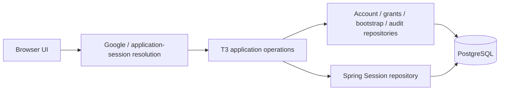

# T3 identity, sessions, permissions and administration

* **Author:** igrgin
* **Status:** Draft — Overview & Goals approved 2026-11-07; Technical Plan in progress. Owner confirmed mode A and per-account grants with independent, additive convenience templates; Technical Plan approval remains pending.
* **Date:** 2026-11-07, Europe/Zagreb
* **Issue:** [#3](https://github.com/igrgin/ai-knowledge-base/issues/3)
* **Workflow:** EGM with small fixes 0.2.1, `egm-draft`.
* **Predecessor:** [Concepts brief](concepts_brief.md), with [accepted decisions](authentication-decisions.md) and [round-2 findings](../../reviews/t3-identity/brainstorm-round-2/review.md).
* **Authority:** The owner authorized bounded T3 drafting and resolution of disabled-sign-in behavior on 2026-11-06. This is a working design, not implementation authority or completed design review.

The owner approved Overview & Goals on 2026-11-07 and instructed proceeding to the Technical Plan, starting with the remaining disabled-sign-in behavior. The approval preserves the existing scope; it does not select an unresolved technical mechanism.

## Overview

T3 establishes how people enter the AI knowledge base, keep an application session and exercise their assigned permissions. Google is the sole normal login provider. A first successful sign-in automatically creates an ordinary application account; returning sign-ins resolve that same account. No invitation, separate registration, approval or profile-completion step is required. The account receives basic capabilities immediately, including permission to create projects as T4 introduces that feature.

The application owns accounts, sessions and authorization. Google proves identity; it does not decide access to projects or administrative actions. Administrators use the same website and account model, with ordinary capabilities plus explicit administrative permissions. Those permissions do not confer access to other people's private projects, PDFs or chats.

Developer startup from IntelliJ must also work without Google sign-in or credentials. An explicit YAML setting controls this behavior. Disabled development uses a persistent database administrator account through the same authorization and ownership paths. Production defaults to requiring sign-in but permits an explicit override. This design must resolve disabled sign-in outside development without inventing a production development-admin fallback or silently reversing that override.

The scope includes the owner's accepted session controls, individual permissions, initial-administrator safeguards and configurable auditing. It supplies narrow contracts to later features rather than implementing their projects, uploads, jobs or sharing workflows.

## The Problem

The running application currently provides a foundation/readiness shell rather than an account or security boundary. It cannot yet identify a project owner, preserve a user's login, enforce individual grants or let administrators manage those grants and sessions. Later resource features need one trusted account identity and one consistent enforcement contract before they can safely store private content.

Development must remain easy to start while using realistic persisted accounts and permissions. That convenience must not overwrite a saved Google session, renew its deadlines, regrant deliberately removed authority or leak private state between identities. Production disablement is an accepted operator choice whose no-session behavior remains unspecified; leaving it implicit would make entry behavior and attribution unpredictable.

The brainstorm also reached future sharing, upload and recovery details. They establish consumer obligations, but requiring those complete implementations now would keep T3 from becoming buildable. This design bounds their interfaces and keeps their implementation with their existing owners.

## Goals

The detailed accepted decisions remain constraints throughout drafting. A technical proposal is not selected merely because it appeared in research or the brief.

| Outcome | Required behavior |
| --- | --- |
| Automatic Google accounts | Create exactly one application account on first successful sign-in; resolve returning identities without merging accounts by email. Keep a stable application UUID distinct from Google profile data. No application passwords or separate admin login. |
| Configurable developer entry | Plan `app.auth.enabled=true` commonly and in `prod`, with `dev` overriding to false. Allow explicit overrides and tests of both values. Enabled mode fails startup with sanitized feedback if required Google settings are missing; disabled mode needs no Google configuration. Never silently change the boolean. |
| Persistent development identity | Disabled development creates/reuses one database admin, preserving its UUID, data and explicit revocations across restarts. Provision initial grants once. Enabled development uses Google. Never provision/select this fixture when `prod` is active, including mixed profiles; keep normal initial-admin setup separate. |
| Explicit disabled-mode behavior | Resolve requests with and without valid sessions outside development in the technical plan. Preserve permitted production disablement and the required red administrator banner driven by backend effective configuration: “Sign-in is disabled in the production profile.” Never treat disabled sign-in as disabled authorization. |
| Session continuity and isolation | Preserve valid Google application sessions across browser reopening, backend restart and mode changes without resetting/freezing their deadlines. Keep dormant Google sessions separate from development identity; development activity never renews them. Resume only still-valid sessions. Keep private view/draft restoration within the same account and never replay a write automatically. |
| Independent session timing | Each application session has its own server-enforced defaults: 30 minutes idle and 8 hours maximum. Meaningful authorized actions renew inactivity; local visible-tab interaction reports are limited to once per minute across tabs sharing a session. Polling, prefetch, workers, passive tabs and other sessions do not renew it. At five minutes or less before the maximum, new uploads/mutations need fresh sign-in; reads remain available while valid. All four timing defaults are configurable in development, production and test profiles. |
| Session management | Users list/revoke selected or all own sessions; ordinary logout ends the current session, while revoke-all includes it. Explicitly authorized admins manage user sessions across instances. Revoked cookies cannot resume sessions; later Google sign-in remains possible with current permissions. Define concurrent-login/revoke-all behavior without adding account suspension. |
| Current individual permissions | Admins assign/revoke individual permissions in the app. New and existing accounts receive basic permissions; a deliberate all-user grant may restore a previously removed permission, as amended by the owner on 2026-11-07. Check current permissions and resource ownership for each new protected request; no forced logout or Google re-login for grant changes. Hide unauthorized admin areas and explain disabled ordinary actions; reject stale/forged submissions. |
| Initial administration | A one-time trusted-host command targets an existing account UUID and atomically establishes initial permission-management, admin session-management and audit-inspection grants. Supply supported own-UUID discovery and useful command outcomes. Do not replay grants on ordinary startup. After setup, atomically prevent removal of the final permission manager, including concurrent changes. Count account authority rather than live sessions. |
| Configurable audit foundation | Independently default admin capture to true with 90-day retention and ordinary-user capture to false with 30-day retention; all four settings are overridable across profiles. Admin capture may be disabled, including for the development admin, without falling through to user capture. Preserve captured category for cleanup and keep functional permissions/bootstrap state separate from history. |
| Safe audit inspection and diagnostics | Provide permission-gated, read-only metadata history, without private content, tokens or session credentials. When admin capture is enabled, its privilege/session changes and audit rows commit together; audit failure rejects the change. Disabled capture omits that write dependency. Define remaining event/failure semantics. Minimal sanitized failure diagnostics remain available independently and must not recreate disabled action history. |
| Narrow consumer contracts | Later slices consume trusted identity/current permissions and retain their own resource ownership, admission and lifecycle rules. Atomically order admission against revocation. Already-authorized requests and specific durably accepted work may finish within original bounds; new submissions/retries and result/status/file reads require current authority. Preserve spending, quota, deletion and sharing fences without implementing their engines here. |

Basic capabilities retain the [accepted action table](authentication-decisions.md#accepted-basic-permission-set): own projects, eligible document/chat/source actions, own sessions/status, and full-project share/import. Administrators receive those basic capabilities plus administrative grants, with explicit revocations still authoritative. Future feature permissions become active with their actual slices; this design does not pre-build their functionality.

The accepted Google recovery policy also remains: safely end a failed attempt and offer user-triggered fresh sign-in, without replaying a callback or one-use code. Do not invalidate unrelated sessions or extend authority during a provider failure. Concrete dependencies, transport bounds and failed same-browser reauthentication require design and verification.

T3 completion must eventually demonstrate its accepted behavior through its own UI/API/persistence and meaningful checks, rather than documentation alone. Developer-bypass evidence, offline protocol/fault tests and real Google acceptance are distinct. No live Google setup, runtime tests or performance measurements are established by this initial section.

## Non-Goals

* Implementing projects, PDFs, saved chats, AI processing, durable jobs or upload staging. T4 and the existing feature owners retain those implementations and their ownership/admission checks.
* Implementing invitations, general sharing links, capture manifests or full-project copying. T16/T19 retain both accepted access modes and mandatory complete independent copies, including all saved chats/citations/source settings. No content selector or files-only product mode is added.
* Restoring standalone chat snapshots, anonymous/public content access or an administrator exception for them. R27/T17 remain withdrawn.
* Giving administrators access to another account's private content; bypassing quotas, recipient checks, lifecycle fences or provider spending rules.
* Adding account suspension/deletion/relinking, external Google-account-loss recovery, an application email service, a local-user product edition or an account switcher.
* Building later operational restore machinery or cross-feature UI integration in T3. T3 states its identity/authority recovery obligations and supplies metadata/interfaces; T11/T15 and T12 retain their integration work. T13 extends integrated fault/multi-instance evidence without replacing T3's own checks.
* Introducing a generic policy language, universal domain-event system, second job engine or new audit service without demonstrated need.
* Authorizing implementation, publishing gates, changing remote issues, deploying or making paid calls through this draft.

## Technical Plan (Architecture)

### 1. Authentication mode and effective account

The owner confirmed alternative A on 2026-11-07 after clarifying the distinction between disabling fresh entry and ending existing sessions. Retain the ability to disable sign-in outside development, with valid sessions usable until their normal limits end. Technical Plan section approval remains pending; this is an application policy, not a framework default.

#### Rules already fixed

| Configuration | Account behavior already accepted |
| --- | --- |
| Auth enabled, any profile | Use normal Google authentication/application sessions. Missing required Google settings stops startup with sanitized feedback. Do not select a development account. |
| Auth disabled, `dev` active and `prod` absent | Create/reuse and automatically select the persistent development database admin. Preserve stored Google sessions separately under running deadlines; do not renew them through development activity. |
| Auth disabled outside that development case, including mixed `dev`/`prod` | Startup does not require Google configuration. Use an existing valid Google session; without one, deny protected access. Block new Google sign-in and callback completion until auth is re-enabled. Never provision/select the development admin or invent a fallback account. |

In every case, current application permissions and resource ownership remain enforced. Mode changes do not invalidate saved Google sessions, reset/freeze their deadlines or revive expired/revoked sessions. When `prod` is active and auth is false, an identifiable administrator must receive the selected red banner. A browser-supplied UUID/email cannot establish an account.

#### Selected policy A: existing sessions only outside development

Disabling sign-in is allowed outside development, including production, even if rarely used. It stops new Google entry and callback completion; it does not erase existing sessions. An already-valid Google session continues to identify its original account, using normal meaningful-activity renewal, current permissions, ownership checks and revocation rules. No session is guaranteed to last until the absolute maximum: idle expiry or explicit revocation can end it earlier.

A request without a valid session cannot enter protected application areas. Show a neutral sign-in-unavailable outcome; do not redirect repeatedly to Google, select a shared account or replay a pending action. A Google flow begun before disablement cannot complete into a new application login while disabled. Exact routes/status codes and preservation of a separate existing session during failed reauthentication remain implementation-design work.

The configured maximum is never extended. At the default 7h55m pre-write threshold, a new upload/mutation still needs fresh authentication. Because fresh sign-in is disabled, reject that new write without starting or queuing it. After the operator re-enables auth and the user successfully authenticates, the user must explicitly retry; nothing automatically resumes or replays. Reads continue only while the existing session remains valid. Accepted requests/durable work keep their original admission boundary; disabling entry does not create a job-cancellation policy.

An existing administrator session can reach the required red production banner. After all administrator sessions expire or are revoked, there may be no in-app audience for it. Restoring access then requires the operator to re-enable auth through deployment configuration with valid Google settings. There is no special recovery account, fresh-password guarantee or automatic extension. The additional sanitized startup warning remains a recommendation, not an accepted replacement for the banner.

The effective-account ordering is:

```text
on protected request
  if auth is disabled and dev is active and prod is absent
    use the persisted development account
    keep stored Google sessions separate and dormant
  else if an existing Google session is valid
    use that session's application account
  else if auth is enabled
    require normal Google sign-in
    stop this protected request
  else
    deny protected entry with sign-in-unavailable feedback
    stop this protected request

  validate current permissions, ownership and applicable fresh-sign-in rules
  admit the operation only if those checks pass
```

Alternative B, optional configured Google entry while auth is false, is not used in the current draft. It would permit fresh entry but make the property/banner less literal. Retain that comparison for the later Alternatives Considered section. The owner confirmed A after the expiry/pre-write clarification; this does not approve the entire Technical Plan.

Required mode checks will cover: disabled production startup without Google settings; valid-session access versus no/expired/revoked-session denial; blocked new entry and callbacks; unchanged 30m/8h limits and 5m pre-write behavior; explicit re-enablement; admin banner metadata; mixed-profile fixture exclusion; and development activity not renewing dormant Google sessions. Exact tests/files follow in the detailed implementation plan.

### 2. Permission storage — selected per-account grants

**Owner amendment, 2026-11-07:** use individual grants as the current authority, with convenient permission templates such as Basic and Admin. No template membership is saved on an account. Removing a grant removes access; there is no separate deny/revoked state used for authorization. The owner expressly accepts that a deliberate decision to grant P to all users includes Ben even if an administrator previously removed P from Ben. This supersedes the earlier requirement that such a global update must preserve every past individual revocation.

#### Logical data and enforcement

```text
Account ── individual grant ── Permission
Template ── listed permission ── Permission

No Account → Template membership or inherited authority
```

* The permission catalog defines stable named actions. Each account's stored grants determine its action authority, alongside current resource ownership, quotas and lifecycle/admission checks.
* Templates list permissions for convenient application through permission management. Selecting Basic/Admin populates actual grants; it does not assign a continuing role/template membership. User/admin concepts are separate from templates; this decision does not introduce a new account-type flag or replace individual permission enforcement.
* An individual grant adds access. Removing it removes access on new protected requests under the accepted transaction ordering. A missing grant means no permission; the server need not know whether it was never assigned or deliberately removed.
* Current grants are checked on the server. Do not treat a browser list or login-time permission snapshot as authority. Grant changes require no session invalidation or Google sign-in.
* Optional audit history still records administrative changes when enabled, subject to its accepted retention. It is not read to reconstruct current grants or preserve an indefinite deny state.

For example, Ana may hold Create, Upload and Import grants; Ben may hold only Create and Upload. A deliberate all-user Import grant later gives both accounts Import. Ben's earlier removal does not block that explicit grant decision. The operation targets accounts directly, regardless of any template previously used.

#### Templates and automatic/default updates

| Event | Selected behavior |
| --- | --- |
| First successful Google sign-in | Create the account and its ordinary basic grants atomically. Do not save Basic membership. |
| Returning sign-in or ordinary restart | Preserve existing grants. Do not reapply Basic/Admin or restore missing grants merely because the user logs in or the app starts. |
| Initial normal/development admin setup | Copy the selected initial grants once, with durable completion evidence. Keep the existing separation of development provisioning and normal bootstrap. |
| Admin removes P from Ben | Remove Ben's P grant. No permanent authorization tombstone is required. |
| Admin deliberately grants P again, directly or through a template | Add the concrete P grant. A prior removal does not veto the explicit new grant. |
| A reviewed new basic-permission rollout targets all users | Populate concrete grants for existing accounts, including admin-capable accounts. Apply the active basic policy at new-account creation. This does not require login/session refresh. |
| A deliberate decision grants an existing P to all users | Add P to all targeted accounts, including Ben. This may intentionally override earlier individual removals. |
| Template definition changes without a grant rollout | Existing account grants stay unchanged; there is no saved membership to synchronize. Future explicit applications use the changed definition. |

Changing a template and deciding to change every account are different operations. No generic bulk-edit UI, runtime template editor or policy language is added by this decision; exact application/rollout interfaces remain bounded design work. A feature migration or other approved rollout must state its target accounts and privilege effect. Administrative-only actions must not accidentally enter ordinary-user grants.

A rollout must not silently run again on every startup or restore a later removal through an unnoticed retry. Its grant effects and durable completion/progress need a defined transaction/recovery boundary, independent of retained audit history. Coordinate grant population with concurrent account creation and permission edits. Exact atomic/batched implementation, schema/indexes and deployment overlap remain technical-plan work; no performance guarantee follows from this selection.

Stable permission identifiers remain important. Display renames preserve the identifier. Splits/replacements must explicitly define grant mapping and whether they are deliberately granting new authority globally; do not disguise a regrant as a label change. No permanent revocation record is needed to block a global grant that the owner explicitly intends to apply to everyone.

The accepted last-permission-manager invariant, conditional atomic admin auditing, session revocation semantics and admitted-work boundary remain unchanged. Permission-template application is itself an authorized administrative action and must preserve those safeguards.

The shared-default/inherited-exception alternative is not selected. The earlier per-account proposal's additional permanent revocation evidence is also superseded by this owner's clarified global-update policy. These dispositions belong in the later Alternatives Considered section; this subsection does not select an ORM or physical database schema.

#### Selected template application: add only

The owner selected additive application on 2026-11-07. Applying a template inserts its listed permission grants and keeps every other current grant. An already-present grant stays present without duplication. A listed permission previously removed is deliberately granted again by this explicit application. Do not save template membership or synchronize accounts after later template-definition changes.

Administrators remove individual permissions through separate explicit actions. Selecting Basic after applying Admin therefore does not remove existing administrative grants. Resetting an account to exactly a template is not part of this workflow. The last-permission-manager invariant, current authorization and conditional atomic admin auditing still apply to all grant/removal operations.

The replaced-list alternative is not selected because the owner wants unrelated grants retained. Carry that disposition into the later Alternatives Considered section.

### 3. Domain persistence — next author decision

The [independent primary-source comparison](../../research/t3-domain-persistence-comparison.md) addresses the application design's first-domain-persistence checkpoint. It examined the committed foundation at `f68be1c`: the backend has Spring JDBC/Flyway/PostgreSQL and no domain repositories, entities or tables beyond V1's extension. The locally managed Boot version is 4.1.2. The note records exact managed versions, verified official capability sources and remaining integration limits. It is research evidence, not a selected stack, benchmark or completed formal design review.

This decision concerns application accounts, Google identity links, permissions/grants/templates, bootstrap/rollout state and audit data. Spring Session JDBC's framework-owned HTTP-session persistence is a separate choice. Selecting a domain repository style does not change the accepted permission model or let future resource slices bypass ownership.

#### Three unselected approaches

| Option | Mechanism | Trade-off and failure condition |
| --- | --- | --- |
| **1 — Spring JDBC / explicit SQL repositories** | Use the existing JDBC foundation, `JdbcClient`/templates and short application-service transactions. Write parameterized SQL and map results to application data. | Keeps SQL and lock/update boundaries explicit; routine create/read/update/list operations need handwritten queries and mapping. Incorrect SQL, constraints or transaction scope can still break invariants. Existing dependencies establish no performance advantage. |
| **2 — Spring Data JDBC repositories plus targeted SQL** | Use repository/aggregate mapping for ordinary persistence, with explicit SQL for grant sets, shared guards, bulk updates and projections where needed. | Reduces some routine repository work. Aggregate membership must be deliberate: treating all grants as children saved through one account can conflict with independent grant edits. The documented default child replacement behavior needs consideration or custom methods. It does not remove the need for transaction/SQL design. |
| **3 — Spring Data JPA/Hibernate plus targeted SQL** | Map entities/relationships and use repository queries, adding native SQL/JDBC for appropriate operations. If mixed, configure a compatible shared transaction boundary. | Provides entity/relationship persistence facilities. Managed entity state, flush timing and refresh/clear behavior must stay consistent with direct SQL changes. Separate local transaction managers are not automatically atomic, even on one database. |

All three can implement T3. No option is selected, ranked or established as faster. The [research note](../../research/t3-domain-persistence-comparison.md#transactions-and-mixed-access) supplies the official capability sources and labels its project-fit judgments as inferences. The domain convention in K0 remains provisional until the owner chooses; amend it with actual manager/mixed-access rules if the chosen stack differs.

#### Responsibilities shared by every option



This is a logical data path, not the unresolved package/module graph. Administrative mutation and enabled audit capture must share the required committing transaction; two arrows to PostgreSQL alone do not establish that guarantee.

* **Account creation:** a database uniqueness constraint protects the Google issuer/subject mapping. First-login resolution and initial grants must commit atomically, with a defined conflict/retry path; email never merges accounts.
* **Grant operations:** unique account/permission grants prevent duplication. Additive template application inserts missing grants; individual removal deletes a grant. Global rollout completion/progress must coordinate with account creation, concurrent edits and retries without reapplying completed grants on ordinary restart.
* **Administration:** normal bootstrap consumes durable setup completion once, separately from development provisioning. Last-manager protection needs a shared database serialization/locking protocol covering every relevant grant removal. A repository `save()` or count alone cannot establish it.
* **Current authority/admission:** the chosen repository boundary must support current grant checks and atomic ordering against revocation. It must not turn managed/cached permission data into lasting authority or make identity import future project/job internals.
* **Audit:** enabled administrative changes and their audit rows commit or roll back together; disabled capture omits that dependency. Inspection and cleanup remain bounded, category-aware operations, independent of functional bootstrap/grant state.
* **Resource use:** release connections/locks before Google/network/filesystem waits. Session persistence, grants and audit share the existing four-connection datasource with a 2000 ms acquisition timeout. Measure combined queries, pool/lock waits, transaction durations and enabled audit work before introducing optimizations or claiming capacity.

#### Session-revocation integration obligation

The official [Spring Session JDBC transaction documentation](https://docs.spring.io/spring-session/reference/configuration/jdbc.html) says session operations default to `REQUIRES_NEW`, and provides transaction customization. Therefore an outer administrative service transaction does not, by itself, make framework session deletion atomic with its audit insert.

The design must explicitly settle the participating transaction operations/manager for audited revocation and account for servlet save ordering and concurrent revoke/save/login. Verify that enabled audit failure rolls back both effects, disabled capture has no audit-write dependency, and concurrent requests cannot revive a revoked session. Do not silently drop atomicity or add a duplicate session registry as a shortcut. Exact configuration and race handling remain subsequent technical-plan work after the domain-stack choice.

No production dependency, configuration, schema, code or test was changed to establish these findings. The later exact-file implementation plan must name the selected dependency/configuration changes, additive Flyway migrations, owned repositories, shared-contract edits and meaningful PostgreSQL/security checks. This subsection does not authorize those edits.

## Open Questions

These are bounded inputs for the technical plan, not requests to reopen accepted product choices.

1. **Permission administration and evolution:** settle stable IDs, grant rollout/retry ordering, the permission-management UI and exact schema. Template application is additive; admins remove grants separately. Per-account grants without template membership or permanent deny state are selected. Preserve create-once setup evidence independently of retained audit history.
2. **Security/session and persistence boundaries:** choose the domain stack from the completed comparison; settle module direction, session/context isolation, filter/CSRF/error behavior, transaction ordering, audited Spring Session transaction participation and cross-instance consistency. Preserve the accepted deadlines and revocation semantics.
3. **Audit and operational bounds:** settle action/failure behavior, safe metadata, retention cleanup and finite diagnostic acceptance. Bound and measure combined session/permission/audit work against the existing datasource rather than assuming its cost.
4. **Executable handoff:** later approved sections must identify exact file actions, migrations, permitted shared changes, buildable phases and meaningful checks, carrying every accepted requirement and review obligation forward.

## Additional Resources

* [Application requirements and target design](../application.md)
* [Roadmap authority, ownership and prerequisites](../../roadmap.md)
* [Available contracts](../../contracts/README.md) and [K0 foundation](../../contracts/k0-foundation.md)
* [Google sign-in investigation](../../research/google-sign-in-investigation.md) and [failure-handling investigation](../../research/google-sign-in-failure-handling.md)

The Technical Plan is in progress. Critical User Journeys, Alternatives Considered, Non-Functional Requirements and Detailed Implementation Plan will follow through the EGM section gates. This working draft does not yet supply an implementation file allowlist or resolve the open architecture choices.
