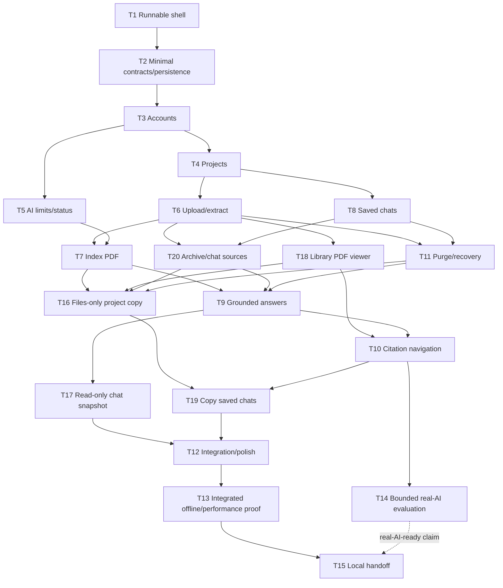

# Delivery roadmap

## Current authority

[Issue #24](https://github.com/igrgin/ai-knowledge-base/issues/24) authorizes the documentation governance cutover only. T1 is merged in [PR #21](https://github.com/igrgin/ai-knowledge-base/pull/21); T2 is merged in [PR #23](https://github.com/igrgin/ai-knowledge-base/pull/23), merge `d5b2efceda70db39bcf6e19fcdef69c9f236f297`. T3–T20 remain pending and require separate implementation authority. No paid calls, deployment or merge follows from this record. Concurrency remains one.

[Application design](designs/application.md) owns product requirements and proposed mechanisms. [Contract availability](contracts/README.md) owns published interface gates. [Workflow](egm-workflow.md) owns EGM routing and review handoff; [remote work](remote-work.md) owns native task/branch/PR operations. Current progress belongs here; detailed execution evidence belongs on the task/PR.

## Dependency semantics

Start gates permit bounded development against a published and agreed provider/consumer contract. A task ID means its completion; a K gate means the narrower checkpoint in the contract index. A draft alone is insufficient. Completion prerequisites must be integrated real implementations; controlled adapters support development but cannot substitute for production wiring. Numeric order and preferred demonstration order create no dependency or implementation permission.

Every feature owns its UI, API, persistence, schema and meaningful tests. Shared changes remain with their owner/integrator. A spanning requirement is complete only after all mapped slices and integration checks pass.

## Shared foundation

T1 provides the runnable shell and toolchain. T2 provides migration/test infrastructure and a few contract conventions. Neither creates future users/projects/documents/chat/vector/sharing tables, a general job engine, speculative adapters, or every feature's UI. Domain tables are introduced by their owning feature. The first real durable queue/storage implementation belongs to T6, the financial ledger to T5, and lifecycle recovery to T11.

## Tasks

A task in the start column denotes its completion; a K gate denotes the narrower checkpoint in the contract index. Completion columns list the real dependencies directly, including some transitive ones for clarity. A feature can begin before all its completion dependencies exist, but cannot claim its integrated demonstration early. Writer roles are bounded assignments for a future build, not people or agents appointed by this record.

| Task | Demonstrable result | Requirement IDs | Can start after | Must exist before completion | Assigned writer | State | Intent label | Issue / branch |
| --- | --- | --- | --- | --- | --- | --- | --- | --- |
| T1 | Run the Java 26/React shell and local database reproducibly | R18, R19 | Planning/build authority | None | Integrator | completed | feature | [#1](https://github.com/igrgin/ai-knowledge-base/issues/1); `1-run-java-26-react-shell-and-local-database` (created) |
| T2 | Provide Flyway/pgvector wiring and safe API error/K0 conventions | R18, R23 | T1 | T1 | Foundation owner | completed | feature | [#2](https://github.com/igrgin/ai-knowledge-base/issues/2); `2-add-minimal-persistence-and-contract-conventions`; [PR #23](https://github.com/igrgin/ai-knowledge-base/pull/23) (merged) |
| T3 | Register, log in/out and retain an authenticated session after restart | R1, R2, R16, R18, R23 | T2 | T2 | Identity slice owner | pending | feature | [#3](https://github.com/igrgin/ai-knowledge-base/issues/3); `3-register-log-in-and-retain-authenticated-sessions` (planned; not created) |
| T4 | Create/list/open/rename private projects through the UI | R2, R3, R6, R17 | T3 | T3 | Project slice owner | pending | feature | [#4](https://github.com/igrgin/ai-knowledge-base/issues/4); `4-create-and-manage-private-projects` (planned; not created) |
| T5 | See AI availability/budget status and enforce bounded, idempotent provider spending | R12, R16, R17, R23 | T2 and K0 | T3 | Usage/model slice owner | pending | feature | [#5](https://github.com/igrgin/ai-knowledge-base/issues/5); `5-show-ai-availability-and-enforce-provider-spending-limits` (planned; not created) |
| T6 | Upload a private PDF, observe durable extraction/failure status and recover after restart | R2, R4, R5, R6, R16, R17, R22, R23 | KP | T4 | Document slice owner | pending | feature | [#6](https://github.com/igrgin/ai-knowledge-base/issues/6); `6-upload-and-extract-private-pdfs-with-durable-status` (planned; not created) |
| T8 | Create/reopen/delete separate saved chats in a project | R2, R8, R14 | KP | T4 | Saved-chat slice owner | pending | feature | [#8](https://github.com/igrgin/ai-knowledge-base/issues/8); `8-create-reopen-and-delete-saved-project-chats` (planned; not created) |
| T18 | Open an uploaded original PDF from the project library | R2, R3, R13, R29 | KD | T6 | Viewer slice owner | pending | feature | [#18](https://github.com/igrgin/ai-knowledge-base/issues/18); `18-read-original-pdfs-from-the-project-library` (planned; not created) |
| T7 | Finish indexing a text PDF and show it ready for knowledge queries | R4, R5, R6, R16, R17, R22, R23, R25 | KD and KU | T6, T5 | Indexing slice owner | pending | feature | [#7](https://github.com/igrgin/ai-knowledge-base/issues/7); `7-index-pdfs-and-recover-interrupted-embedding-work` (planned; not created) |
| T20 | Archive/unarchive files and control each chat's fresh-retrieval sources | R2, R7, R13, R28 | KD and KH | T6, T8 | Source-control slice owner | pending | feature | [#20](https://github.com/igrgin/ai-knowledge-base/issues/20); `20-archive-pdfs-and-control-chat-retrieval-sources` (planned; not created) |
| T11 | Delete a project and recover safely from purge/restart/restore failures | R2, R5, R14, R15, R20, R23, R24 | KP, KD and KH | T6, T8 | Lifecycle slice owner | pending | feature | [#11](https://github.com/igrgin/ai-knowledge-base/issues/11); `11-purge-projects-and-recover-safely-after-restore` (planned; not created) |
| T9 | Ask a grounded question and persist an idempotent, validated answer | R2, R7, R9, R10, R11, R12, R16, R17, R22, R23, R28 | KU, KD, KH, KS and KL | T5, T7, T8, T20, T11 | Answer slice owner | pending | feature | [#9](https://github.com/igrgin/ai-knowledge-base/issues/9); `9-answer-grounded-questions-with-saved-provenance` (planned; not created) |
| T10 | Open a validated answer citation at its original physical PDF page | R2, R10, R13, R29 | KV and KC | T18, T9 | Citation slice owner | pending | feature | [#10](https://github.com/igrgin/ai-knowledge-base/issues/10); `10-open-answer-citations-at-the-correct-pdf-page` (planned; not created) |
| T16 | Share/import a fixed project copy containing files and ready knowledge | R2, R3, R7, R13, R15, R17, R20, R25, R26, R29 | KP, KD, KS, KV and KL | T7, T18, T20, T11 | Distribution slice owner | pending | feature | [#16](https://github.com/igrgin/ai-knowledge-base/issues/16); `16-share-and-import-independent-fixed-project-copies` (planned; not created) |
| T17 | Publish/update/revoke a restricted or public read-only chat snapshot | R2, R14, R15, R16, R20, R27 | KH, KC and KL | T8, T9, T11 | Publication slice owner | pending | feature | [#17](https://github.com/igrgin/ai-knowledge-base/issues/17); `17-publish-and-revoke-read-only-chat-snapshots` (planned; not created) |
| T19 | Include all saved chats with working destination citations in a project copy | R2, R7, R8, R10, R14, R20, R26, R28 | KI, KH and KC | T16, T10 | Distribution extension owner | pending | feature | [#19](https://github.com/igrgin/ai-knowledge-base/issues/19); `19-include-saved-chats-and-citations-in-project-copies` (planned; not created) |
| T12 | Complete cross-feature navigation, accessibility and packaged UI consistency | R1, R3, R6, R8, R10, R11, R12, R13, R14, R15, R18, R26, R27, R28, R29 | T4 | T17, T19 and all feature demos integrated with passing evidence | Integrator/UI integration owner | pending | feature | [#12](https://github.com/igrgin/ai-knowledge-base/issues/12); `12-integrate-navigation-accessibility-and-packaged-ui` (planned; not created) |
| T13 | Prove integrated privacy/lifecycle/scalability behavior and measure no-cache performance | R1, R2, R4, R5, R7, R10, R12, R13, R14, R15, R17, R20, R21, R22, R23, R24, R25, R26, R27, R28, R29 | T6 | T12 and its feature prerequisites | Verification owner | pending | feature | [#13](https://github.com/igrgin/ai-knowledge-base/issues/13); `13-verify-privacy-lifecycle-scalability-and-embedding-performance` (planned; not created) |
| T14 | Evaluate actual model grounding, citation quality, latency and cost within a bounded allowance | R4, R9, R10, R11, R16, R17, R21, R24, R25 | T5, T7 and passing focused offline dispatch/accounting checks; separate credential/paid-call authority | T9, T10 and passing focused offline answer/citation checks; paid-call authority | AI evaluation owner | pending | spike | [#14](https://github.com/igrgin/ai-knowledge-base/issues/14); `14-evaluate-real-ai-grounding-quality-latency-and-cost` (legacy planned name; no branch required for spike) |
| T15 | Hand over the reproducible local package and truthful readiness evidence | R18, R19, R20, R21, R22, R24, R25, R26, R27, R28, R29 | T1 for living documentation | T12, T13; T14 additionally required for a real-AI-ready claim | Integrator/handoff owner | pending | feature | [#15](https://github.com/igrgin/ai-knowledge-base/issues/15); `15-document-and-hand-over-the-reproducible-local-package` (planned; not created) |

T5 can begin beside T3 and does not depend on T4's project UI. T8 has no T7 dependency. T18 has no embedding/answer dependency. T16 and T17 have no dependency on each other. T19 completes R26's optional chat-copy branch without putting that work inside basic project import. T12 does not gate any feature slice.

## Completion dependency graph

Solid arrows mean integrated completion prerequisites, not permission to start. Transitive edges are reduced for readability; the table above supplies the exact full prerequisites. T14 also has the explicit credential/paid-call gate. T15's T14 edge is conditional on claiming real-AI readiness.

For example, T5 starts after K0 while T3 is unfinished, although its signed-in UI/ownership demonstration finishes after T3. T9 can demonstrate its first grounded answer once T5/T7/T8/T20 are wired; T11 is additionally required before declaring T9 complete because its deletion-race checks need the real delete command. T10 starts after KV/KC agreement while real answer integration is still underway. T17 can develop transcript publication using test-only transcript fixtures after KH/KC/KL agreement, but completion requires actual T9 messages. No app-mode fake provider or public endpoint backed only by a stub is allowed.

## Demonstration order

| Demonstration | Relevant slices | Scheduling intent |
| --- | --- | --- |
| Local accounts/projects | T1–T4; T5 can overlap | First useful authenticated shell; no broad all-domain foundation |
| Upload/read and saved chats | T6, T18 and T8 | Show these independently before embeddings/answers |
| Ready knowledge and source controls | T5, T7, T20; T11 alongside | Finish AI inputs and lifecycle foundations without serializing viewer work |
| Grounded chat/page citation | T9, T10 | Extend history/reader; T14 may begin bounded evidence after focused safety checks |
| Distribute knowledge or a conversation | T16/T19 and T17 | Independent copying and publication branches; no collaboration feature |
| Complete local evidence/handoff | T12, T13, T14, T15 | Integration, actual AI evidence and package claims remain separate |

A valid single-writer sequence remains possible, for example T1, T2, T3, T4, T6, T8, T18, T5, T7, T20, T11, T9, T10, T16, T17, T19, T12, T13, T14, T15. This is a preference only. In particular T5 can be started earlier, T18 can follow T6 immediately, and T17 need not wait for copying.

## Ownership and coordination

The following paths assign future slice ownership, not current authorization or deployed schema. Assign an actual writer and committed baseline before dispatch. The integrator is the sole editor of this roadmap and shared contracts. Feature owners deliver UI/backend/schema/tests together; there is no separate frontend/backend ownership split for one slice.

### File and schema ownership

Paths are proposed because implementation files do not exist yet. Backend paths below are under `backend/src/main/java/com/aiknowledgebase/`; frontend paths are under `frontend/src/`. Matching feature tests/e2e fixtures belong to the same slice. A writer cannot modify another owner's base files merely because their task can start; request a small contract/implementation change from that owner/integrator instead.

| Slice owner | Exclusive application files/directories | Feature schema/migration responsibility | Shared touchpoints to coordinate |
| --- | --- | --- | --- |
| Integrator, T1/T2/T12/T15 | Root build/config/scripts, application shell/routes, `components/ui/`, `lib/api/`, contract records, plan and shared test bootstrap | Only minimal migration wiring in T2; reviews/numbers feature migrations at integration | Sole editor of poms, npm manifest/lock, common config, Compose, shell/routes, shared API types and plan; feature authors submit narrow changes |
| Identity, T3 | `identity/**`, `features/auth/**` | Users/JDBC sessions | K0 UUID/trusted-identity conventions; concrete principal and route/auth integration |
| Projects, T4 | `project/**`, `features/projects/**` | Projects/ownership/count limits and lifecycle revision | KP ownership/lock API; library mounts feature components without taking their files |
| Usage/model, T5 | `usage/**`, `model/**`, `features/ai-status/**` | Reservations/usage/periods/shared provider admission | KU, actor FK to T3, model dependencies/config through integrator |
| Documents, T6 | `document/upload/**`, `document/storage/**`, `document/api/**`, `ingestion/extraction/**`, `jobs/**`, `pdf-extractor/src/**`, `features/documents/upload/**`, `features/documents/status/**` | Documents/versions/pages/extraction, storage admission and first durable operations/jobs | KD document state, file service and job API; other slices extend through these boundaries |
| Indexing, T7 | `ingestion/indexing/**`, `features/documents/indexing/**` | Chunks/vectors/generations and ready-publication data | KU/KD; document state fields and status mounting through T6/integrator |
| Saved chats, T8 | `chat/history/**`, `features/chats/history/**` | Chats/ordered messages | KH; project lock, later answer metadata and deletion integration through agreed boundaries |
| Viewer, T18 | `source/viewer/**`, `features/pdf-viewer/**`, `features/documents/open/**` | Normally none; reuse T6 document identities | KV and document file route; library action mounted by integrator |
| Source controls, T20 | `document/archive/**`, `chat/sources/**`, `features/documents/archive/**`, `features/chats/sources/**` | Archive grants/cycles, chat exclusions and source revisions | KP/KD/KH; adds its own migration to existing domain tables with table-owner agreement |
| Lifecycle, T11 | `lifecycle/**`, `features/lifecycle/**`; backup/restore script contents integrated by sole script owner | Revocation journal/purge/tombstone data | KL; T4/T8 commands and T6 job/file API changes are serialized with those owners |
| Answers, T9 | `chat/answering/**`, `retrieval/**`, `features/chats/answering/**` | Answer operations and provenance/citation extensions | KU/KD/KH/KS/KL; message-schema extension approved with T8; no second history/provider/job implementation |
| Citations, T10 | `source/citations/**`, `features/chats/citations/**` | Normally none; extend T9 provenance only when warranted | KC/KV; use existing viewer props and coordinate API changes with T18 |
| Distribution, T16 | `distribution/projectcopy/**`, `features/distribution/projectcopy/**` | Fixed manifests, token/invitation access and import acceptance/state | KD/KS/KV/KL and existing quota/job APIs; KI for chat-copy extension |
| Publication, T17 | `publication/**`, `features/publication/**` | Transcript snapshots/access/revocation | KH/KC/KL; separate token namespace/routes from T16; no edits to its copy pipeline |
| Chat-copy extension, T19 | `distribution/chatcopy/**`, `features/distribution/chatcopy/**` | Pinned chat-manifest/mapping extensions | KI/KH/KC; T16 owner/integrator controls base copy engine and include-chats mounting |
| Verification/evaluation, T13/T14 | `evaluation/**`, dedicated `frontend/e2e/integration/**` and `backend/src/test/**/integration/**` scenarios | No production feature schema | Root launcher/Compose changes through integrator; failures go to the feature owner |

This matrix restricts ownership rather than granting blanket access to shared parent directories. When two slices need the same test helper, DTO, table definition or route entry, its existing owner/integrator is the sole writer and consumer changes are integrated together.

### Feature migrations and integration coordination

1. Each slice lists the tables/columns/indexes it owns when its contract gate is agreed. T2 owns only migration infrastructure. Examples: users/sessions in T3, projects in T4, money/provider slots in T5, originals/jobs in T6, saved history in T8, vectors in T7, grants/exclusions in T20, answer provenance in T9, lifecycle journal in T11, import/publication in T16/T17, copied-chat extensions in T19.
2. Slice writers use isolated disposable test databases and task-specific SQL filenames. The integrator assigns final unique Flyway version numbers in actual integration order after prerequisite migrations are available. Tentative branch migration numbers must never be applied to user/shared persistent data.
3. Before merging, rebase on the integration baseline, assign the final unused version/name, and rerun clean-schema plus upgrade-from-baseline checks. An unapplied/disposable-branch migration may be renumbered; an applied integrated/non-disposable migration is immutable. Never enable out-of-order execution or rewrite applied history to repair a collision. One integration writer serializes this step, so merging a higher migration cannot silently strand a lower version.
4. A foreign key to another slice's table is a real migration prerequisite. For example T5 can develop after K0, but its user ownership migration cannot complete before T3's identity migration; project UI completion is irrelevant. T20 needs T6 document and T8 chat schemas. T9 needs vector/history/source schema. This is separate from preferred UI order.
5. Cross-owner table/interface changes require the provider owner and integrator to agree on the extension and impacted consumers. Keep the API contract and consumer checks in the same integration batch; no concurrent edits to common DTO/build/config files.
6. Update slice state/evidence and the contract checkpoint only after its actual UI/API/database/test completion criteria pass. A branch with tests against adapters alone stays incomplete until real completion prerequisites are wired. The integrator alone updates `docs/roadmap.md` and shared contract records; other writers report evidence and proposed edits.

### Parallel opportunities and actual limits

| Candidate pair | Earliest useful overlap | Independent ownership and completion caveat |
| --- | --- | --- |
| T3 accounts + T5 usage/model | T2/K0 agreed | Identity/auth files vs usage/model files; T5 signed-in UI/FK tests finish after T3, not T4 |
| T6 upload/extraction + T8 saved chats | KP agreed | Documents/jobs/parser UI vs saved-history UI; both finish against real T4 projects; no embeddings required |
| T7 indexing + T18 library reader | KD/KU and KD respectively | Indexing schema/worker vs PDF viewer; common document/status API changes go through T6/integrator |
| T18 reader + T20 source controls | KD and KH available | Viewer files vs archive/source-picker files; both use document state without editing its owner's base files |
| T7 indexing + T11 recovery | KD/KU and KP/KD/KH available | Indexing vs lifecycle/journal; shared lifecycle/job contract agreed first; T13 verifies combined races |
| T16 files-only import + T17 transcript publication | Their KD/KS/KV/KL and KH/KC/KL gates available | Distribution and publication own different modules/tables/UI; neither waits for the other. Each must still satisfy its own completion prerequisites |
| T19 copy-chat extension + T17 publication | KI/KH/KC and KL available | Chat-copy mapper vs published transcript; copy engine and journal integration remain single-owner edits |

These are alternatives, not permission to start every ready pair at once. The integrator selects work whose start gates and exclusive paths are available. T12 integration and T13 harness work can begin early, but shared routing/configuration edits stay serialized and do not add a third writer. T14 functional provider checks can overlap later UI work only with explicit paid-call authority and independently passing focused safety checks; they share the existing global provider allowance, not a new budget. T13/T14 timed resource benchmarks run in a quiet reference environment, not alongside load tests or heavy builds that would contaminate their measurements.

## Requirement and constraint coverage

Each requirement maps to its owning vertical implementation and later integration/evidence. T2 supplies conventions, not every domain implementation. T12 verifies composition, not duplicate feature UI. Partial slice demonstrations do not claim the entire mapped requirement complete.

| Requirement | Owning slice and evidence |
| --- | --- |
| R1 | T3 registration/login/session UI/API/schema; T12 composition; T13 cross-account/session checks |
| R2 | T3 identity, T4 projects; each T6–T11/T16–T20 owns its resource authorization; T13 integrated private/public attack paths |
| R3 | T4 projects/counts; T6 document library/status; T18 retained PDF reader; T20 active/archive controls |
| R4 | T6 real parser/negative fixtures; T7 page-local indexing; T14 source-quality evidence |
| R5 | T6 first durable upload/extraction jobs; T7 indexing/retry; T11 purge fences; T13 restart/race integration |
| R6 | T4 empty project/library; T6 upload/status UI; T7 ready outcome; T8 saved chats; T12 consistency |
| R7 | T8 project-serialized chat creation; T20 grants/exclusions/automatic uploads; T7 readiness; T9 KS retrieval/revision checks; T19 copied grants; T13 races |
| R8 | T8 saved-history UI/API/schema; T9 answer persistence; T19 optional copied histories; T13 independent conversations |
| R9 | T9 evidence-only retrieval/answering through real history/data and KU; T14 semantic grounding/follow-ups |
| R10 | T9 validated citation provenance; T10 navigation extending T18 reader; T19 copied mapping; T14 semantic/page gate |
| R11 | T9 refusal/structural validation/UI states; T14 unsupported-question gate |
| R12 | T5 charged idempotency/admission; T6 reusable operation mechanics; T9 answer operation/UI; T13 duplicate/unknown-outcome tests |
| R13 | T20 archive/unarchive/grants and quota retention; T18 retained viewer; T11 no orphan purge; T13 lifecycle cases |
| R14 | T8 saved-chat deletion without PDF removal; T11 journal-aware parent deletion; T16/T19 distribution revocation integration and T17 snapshot revocation when introduced; T13 replay |
| R15 | T4 parent revision/ownership; T11 real delete/purge/recovery UI; T6/T7/T9 consumer fences; T16/T17/T19 original-link revocation and copy independence; T13 combined races |
| R16 | T3 session boundary; T5 server-only adapters; T6 parser isolation; T7/T9 minimal model inputs; T17 bounded transcript publication; T14/T15 retention evidence/docs |
| R17 | T4 account project limits; T6 storage/pages/files admission; T5 financial/global provider authority; T7/T9 bounded calls; T16 import admission reuse; T13 races/T14 actual usage |
| R18 | T1 local shell/toolchain; T2 persistence wiring; each slice runnable locally; T12 single-origin integration; T15 repeatable distribution |
| R19 | T1/T15 no hosting prerequisite; hosted provider/controls/costs remain separately requested later work |
| R20 | T11 independent journal and restore replay; T16/T17/T19 extend actual revocation integration; T13 old-backup tests; T15 documentation |
| R21 | Every slice owns meaningful tests; T13 integrated offline/performance evidence; T14 real-model gate; T15 truthful handoff |
| R22 | T6 first combined/web/worker durable execution; T7/T9/T11/T16 extend it; T13 two-web/two-worker proof; T15 role instructions |
| R23 | T3 JDBC sessions; T4 SQL ownership/lock boundary; T5 shared admission/accounting; T6 claims/fences; T20 grants/revisions; T11 recovery; consumers reuse those boundaries; T13 competing processes |
| R24 | T6/T11 shared local file/journal contracts; T13 load/corpus/failure report; T14 bounded provider-stage evidence; T15 clearly deferred multi-host storage/operations |
| R25 | T7 bounded embedding batches and completed-vector persistence; T20 ready unarchive reuse; T16 compatible ready-vector copying; T13 no-cache performance/embedding report; T14 actual endpoint data; no mandatory cache prototype |
| R26 | T16 fixed invitation/link files-only imports; T19 include-all-chats extension completes optional chat behavior using the same pipeline; T11 lifecycle contract; T13 quota/independence/version/race tests |
| R27 | T17 explicit restricted/public transcript publication/update/revoke and lifecycle replay; T8/T9 actual history; T11 parent/journal contract; T13 no-PDF/no-AI and revocation cases |
| R28 | T20 fresh-retrieval exclusions; T9 keeps bounded prior answers/context and fences stale retrieval; T19 maps exclusions into copied chats; T13 no hidden history reset |
| R29 | T18 library/original PDF reader; T10 citation navigation; T16 destination files; T19 destination citations; T17 never grants PDF access |

| Invariant or concern | Work/disposition |
| --- | --- |
| Per-user confidentiality and explicit sharing | Resource-owning slices enforce ownership; T16 imports only via explicit grants; T17 returns transcript-only views; T13 tests together |
| Old-chat archives, new-chat exclusion, retained originals | T20 is the only eligibility owner; T9 consumes KS and T18 viewer remains separate; T19 remaps archive grants |
| Physical-page provenance and grounded/refused answers | T6 extraction, T7 immutable indexing, T9 validation/refusal, T10 viewer navigation, T14 actual grounding |
| No resurrection after delete/revoke | T11 parent/journal base; later T16/T17/T19 install their own actual consumer integration before completion; T13 restore/worker races |
| Independent copies and transcript-only snapshots | T16/T19 fresh destination ownership/IDs, T17 isolated view; no shared mutable project or original PDF grant |
| C1 hosted cost fit | Deferred hosting; T5 financial bounds, T13 resources and T14 actual usage inform a future cost decision |
| C2 archive/source UX | T20 owns controls; T18 owns library reading; T9 consumes retrieval-only choices; T12 checks navigation/copy consistency |
| C3 limits/languages/evaluation | Existing quotas/English-first criteria unchanged; feature tests and T13/T14 evidence before expansion |
| C4 unfinished/failed archives | T6 owns processing state; T20 visibility/cancellation; T7 uses the same fences and T13 verifies combined cases |
| C5 backup/provider retention | T11 local journal/restore; T16/T17 replay integration; T15 transparent retention; hosted backup terms remain later |
| C6 review/operations/platform policy | Use the EGM workflow, fresh implementation review and selected project agent assignments. The remote-work guide governs native GitHub operations; hosted controls remain deferred and require actual authority |
| C7 account email | T3 password sessions and in-app T16 invitations; no email service added; hosted verification/recovery later |
| C8 dependency/model compatibility/access | Core checks T1, feature-library checks in its slice; T5 test adapters remain test-only; paid/account-quality limitations affect T14 only |
| C9 unknown total workload/capacity | T13 reproducible experiments, T14 bounded provider evidence; no invented throughput promise or budget increase |
| C10 no-cache performance | T7/T16 reuse ready embeddings; T13 report mandatory, cache prototype optional only with evidence |
| C11 retrieval-only exclusion | D12 settled behavior; T20 filter/T9 bounded prior context, T13 checks; no transitive history-filter graph |
| C12 import/publication operating limits | T16 reuses existing quota/admission/jobs; T17 bounds views; T19 extends one copy pipeline; T13 measures before hosting |
| Preserve instructions/settings/tools | Preserve current records and native definitions; T1 is merged, T2 is authorized, later tasks remain pending, and the concurrency proposal is unapplied |

## Open delivery inputs

T1 and T2 are merged; current implementation authority is limited to issue #24. T3–T20 remain pending and unauthorized; the full task definitions, gates and ownership above govern any later request. The specification owns current behavior and unresolved application-design concerns.

| Input | Current disposition | Affected work |
| --- | --- | --- |
| Representative PDFs/questions | Use redistributable/generated fixtures; preferred owner material remains optional | T6/T13/T14 |
| Languages and limits | Accepted baseline starting limits and English-first quality criteria remain unchanged; verify them in their owning features and expand only after evidence. Later explicit resource proposals and experimental targets retain their separate status | T6/T7/T13/T14; specification limits/quality gate |
| Capacity/concurrency | No traffic/corpus target was supplied; measure defined local experiments without claiming hosted throughput. Current concurrency is one; any increase requires a separate owner decision | T13/T14 and later sizing/dispatch decisions |
| Real provider access and paid-call scope | Credentials/account access and bounded call authority remain unresolved; ordinary offline work is independent | T14 and real-AI readiness only |
| Model quality | Execute recorded fixtures and numeric grounding/citation criteria; structural citation validation alone is insufficient | T14; T15 real-AI-ready claim |
| Hosted operations/email/provider controls | Optional later phase; establish actual permissions, security/operating controls and recovery before dependent release actions | Hosted operations, not local-v1 readiness |

## Completed foundation

T1 provides the Java 26 Maven reactor, shared BOM, React readiness shell, loopback persistent PostgreSQL/pgvector, profiles and same-origin package. T2 provides Flyway V1, typed safe MVC errors, correlation and K0, plus Maven-owned npm install/build/test. Both are merged; historical review rounds remain in their PR evidence, not a new EGM policy.

Final T2 deliberately removed synthetic persistence/adoption/restart/broken-migration and general HTTP smoke demonstrations. Its retained verification was 7 MVC cases, 1 real restrictive-Accept HTTP regression, 1 packaged extractor check and 3 browser checks. Dedicated existing-volume adoption coverage was retired; later fresh feature tests do not implicitly cover that special upgrade case. Concrete identity belongs to T3; real persisted data, migrations, ownership, spending and recovery checks belong to their actual feature owners and T13. See [K0](contracts/k0-foundation.md) and [test-scope research](research/java-spring-test-scope-review.md). Earlier larger suite counts are historical.

The first proposed EGM feature design is T3 identity/session/security, using the existing requirements and K0. It has not started. Resolve the principal, session/CSRF/error interfaces and module boundary in its own separately authorized design before implementation. There is no retrospective T2 feature draft.
